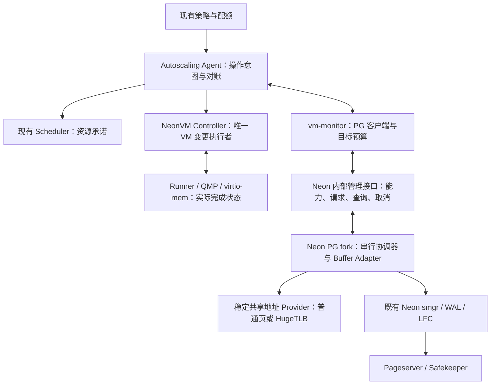

# Neon 在线内存扩缩容：架构复核与实施规范 V3

日期：2026-10-19（Asia/Shanghai）。状态：后续实施标准；项目所有者已确认以 V3 恢复实施。具体环境参数和发布认证仍待补齐。全文涉及现有实现的判断保留方案复核时快照；恢复实施后的提交、已关闭子片和剩余项统一见[当前实施状态](DSGA-当前实施状态.md)及模块记录，不将候选写成已交付。

本文落实项目所有者的最新要求：**本阶段先在 PG17 完整实现并测试，其他 Neon PG 大版本暂缓；Mac 能验证的先验证，依赖 Linux、KVM、HugeTLB 的项目明确留作后续验收。** “必须”表示交付门槛；“建议”表示尚需按指定配置/工作负载选择的参数。这里的架构结论不是并发算法的形式化证明，也不是生产验收结果。

2026-10-26所有者进一步明确：本任务先完整实现和验证Neon/PG17/autoscaling
内存伸缩核心；独立开发中的控制面待完成后移植，再统一端到端闭合。不持续
合入该项目main、不在这里修改其业务或分支；相关官方核心维护仍按规范同步。
控制面暂缓不豁免预算、准入、Scheduler/Controller/Runner等核心业务缺口。

同日所有者要求收尾封版：已于17:29:30（Asia/Shanghai）完成本轮最后一次PG17
官方核对，完整纳入该时点公开维护后冻结；不再逐批追入新上游打断闭环。固定
完整SHA、原分支与核心封版门槛见[冻结清单](DSGA-冻结基线与封版清单-20261026.md)。
冻结后只补核心缺口、修自身缺陷和验证受影响范围；旧维护流程的追新要求不再
适用于本轮，其他PG版本/独立控制面移植仍暂缓。

2026-10-28所有者更新长期范围：**PG17核心完整实现、Mac可执行验证及阶段归档后，
依次实现PG18、PG16**。此项覆盖此前“其他PG版本全部暂缓”和第11节旧顺序；
PG14/15、独立控制面仍暂缓，PG17固定维护基线和本轮不构建镜像/不部署边界不变。
阶段提交不表示全功能完成；后续版本不能引用PG17测试代替自身内核正确性证明。

## 1. 复核结论及文档优先级

**技术方向成立，但现有方案和已完成代码还不足以支持生产上线。** 在 Neon Compute 中动态调整 Shared Buffers，需要修改其 PostgreSQL fork 的 Buffer Manager；只改 Rust Pageserver、LFC 或 VM 内存无法完成这件事。应继续沿用 Neon 存算分离、PG 原生 pin/锁/WAL/smgr 和现有 Autoscaling 控制链。

需要修正的重点是：同一 Postmaster 内崩溃恢复的启动预算、checkpoint 长时间保护、私有内存预算的约束能力、最终 VM 写入的 fencing、普通页/HugeTLB 能力证明，以及多版本和扩展兼容范围。现有 Grow/Provider 等代码可以保留为候选基础；不能因已经写完或已有回归通过，就免除这些复核。

后续解释顺序为：项目所有者最新要求 → 本规范 → 具体模块设计与验证记录。2026-10-18 原方案和独立评审保留作历史资料；旧文中的 PG18 首发假设、未推送状态及笼统的“全部 ACK 即安全”不得继续作为实施依据。英文 RFC 与中文范围索引中的冲突以本规范为准。

原始两篇文章提供 DSGA、粒度管理和分阶段伸缩的思路，但没有给出可直接迁移到 Neon 的完整实现。第二篇是社区学习文章，不能与厂商代码或正式接口规范视为同等级证据。本文的新增协议和取舍是本项目设计判断。[阿里原文](https://developer.aliyun.com/article/1504779)、[腾讯社区文章](https://cloud.tencent.com/developer/article/2638157)

Neon 官方 2026-09 的缓存文章说明了固定规格实例的大 Shared Buffers，并把动态伸缩描述为后续工作。本次检索未取得足以替代本项目完整实现/验收的公开交付证据，不能据博客宣称上游已经提供可直接启用的完整链路。[Neon 缓存演进说明](https://neon.com/blog/improving-lakebase-compute-cache-part-1)

## 2. 本次审查基线与进度事实

本次实际读取了原方案、已有评审/RFC/模块记录，核查 PG 布局、Grow、Provider、pin/IO、checkpoint、Postmaster 恢复，以及 Monitor、Agent、NeonVM/QMP 相关路径；还按固定 Neon PG14–18 分支比较了关键结构。它不是所有源码逐行审计。恢复实现前仍须完成第 14 节的逐路径证据清单。

| 项目 | 此次核验事实 |
|---|---|
| Neon 功能分支 | `codex/dsga-neon-20261019`，`8103321197c8ba9a64f27d52fa624c8b68a1ba7f` |
| 实际 PG17 子模块 | `vendor/postgres-v17`，`2d60467e0218be4ad48761d9878e163dc74b2976`；属于 `william-lbn/postgres` fork |
| PG17 已合入维护基线 | Neon `56692dfb680281a963c7470fc7f0fec7f65ecfd4` + 社区 `94035972af3f10cdaf9ff2b5d232ad5f45463469` |
| Autoscaling 功能分支 | `ef6cd154aa3e60d72cab1e6b64abeb217ff9b245`；尚未实现本功能的 Agent/VM 业务链路 |
| 此次只读查询的 Neon 官方 main | `fa504217c61bbcaf5c512d75830564541f917f8f` |
| 此次只读查询的 Autoscaling 官方 main | `a4bce09e4d6bd7932ea634a1ed79afe26a9cfd1f` |
| 此次查询的社区 PG17 新头 | **`723075b0315d7a71c8d99252938f3582c6c1cee9`，尚未合入** |
| 中断前 M2f 工作树 | 有 pin/空闲链表和测试草稿；未完成验证、未提交。不得计为已交付 |

新社区提交修复 `jsonb_set_lax` 对常量 NULL 参数的使用后释放问题，并补回归，声明回补至 PG14。相对已经合入的 `94035972…` 为 1 个提交、3 个文件。本轮只记录；恢复实现后先走独立维护合并和回归，再继续功能开发。[官方提交](https://github.com/postgres/postgres/commit/723075b0315d7a71c8d99252938f3582c6c1cee9)

已复查原有日志：M2e 的 Mac `check-world` 开、关配置各报告 81 组/664 项通过，未启用 TAP；主仓构建的 PG17 加载 `neon_rmgr`，5 项集群生命周期测试通过。**这些覆盖 Grow/布局/部分访问边界，不覆盖完整 Shrink，也不等于真实 Pageserver/Safekeeper 存储端到端。** 本轮未重跑这些测试，未将新草稿算入旧结果。

本轮实际执行了文档/源码绑定检查：`git diff --check` 通过；`python3 ci/compute.py validate --source-ref HEAD` 和 `--source-ref index` 均通过（18 个二进制、4 个 PG 锁、39 个扩展构建阶段）。额外加 `--require-pg-checkout v17` 的严格检查因现存 M2f 未提交源码而**拒绝通过**，不是完整工作树已获认证。V3 的本地链接、代码围栏、风险/测试/门槛编号以及 14 个固定提交源码链接路径已检查。业务草稿在文档修改前后的 diff/未跟踪测试文件 SHA-256 一致。

Autoscaling 上表是本地功能分支头；当前 Neon 发行清单仍锁定其原 main `c0052f5f2d38fce6c70e448f3f1ee2ee239a0a93`。功能分支目前只有文档/约定变化，不能将它的存在解释为新 Agent 已进入发行。后续业务接入必须同时更新实际依赖清单。

## 3. 完整交付范围

| 需求 | 完整交付定义 | 当前判断 |
|---|---|---|
| FR-01 在线扩缩 | 同一连接可继续 SQL；真实新增 Buffer 被使用；真实尾部排水并减少逻辑容量；支持重复扩→缩→扩 | Grow 已有候选实现，Shrink 未完成 |
| FR-02 容量事实 | 分别报告目标、L/H/M、各数组保守占用、待回收和未知状态；VM/Guest/Host 各有实际值 | 部分字段已有，跨层未完成 |
| FR-03 操作恢复 | 身份验证、重放、取消、拒绝、部分完成、响应丢失与跨进程重连对账 | Grow 局部已有，完整链路未完成 |
| FR-04 并发生命周期 | 普通/并行 Backend、Worker、checkpointer、恢复进程的启动、退出、错误清理和过期引用均安全 | 未完整证明 |
| FR-05 Provider | 普通页与显式 HugeTLB 独立能力；指定 Linux 配置真实分配/回收可验；不支持时准确拒绝 | Mac 普通页逻辑已部分验证；Linux/HugeTLB 待验 |
| FR-06 Neon 联动 | Compute 启动预算、Monitor/LFC、Agent、Scheduler、NeonVM、RW/RO 和存储一致性 | 大部分尚未实现 |
| FR-07 平台 | Mac 用于开发验证；首个生产认证 Linux amd64；Linux arm64 单独认证 | 生产平台未认证 |
| 多版本长期目标（2026-10-28更新） | PG17完整核心及Mac验收归档后，PG18→PG16；各版本单独内核/扩展/集成验收，PG14/15暂缓 | 当前只有PG17有动态内核实现；整体核心仍未闭合 |
| NFR-01/02 | 无错误回收/数据破坏；正常变配不主动断连；忙时可以拒绝 | 必须由并发及端到端证据证明 |
| NFR-03/04/05 | 热路径开销、服务时延/成本有基准；功能默认关闭；可冻结、回退、诊断 | 待性能及发布验收 |

首个共享内存 Adapter 是 Buffer Pool，沿用原稿明确的首期边界。其他内核共享组件预留接口；RO 自动横向增删、连接保持迁移及完整 HA 不是 Buffer Resize 自动带来的能力。它们保留在完整产品工作清单中，分别落实控制面接口、路由/一致性和故障域验收；不得因 Buffer Pool 完成而将这些依赖标作“已实现”。

| 产品工作项 | 后续必须落实的约定 | 验收边界 |
|---|---|---|
| 自动策略与 RW/RO 独立规格 | 同一组的总配额、单实例上下限、WSS 输入校准、滞回及紧急增容 | T18/T19/T22；不能仅按缓存命中率决定缩容 |
| RO 横向扩缩 | 对接实际部署的创建/删除/路由 API；追平 LSN、预热、健康后才接流；下线先停止新路由再排空 | 独立多副本/路由验收；失败创建可对账，永不误删 RW |
| 连接保持迁移 | 复用 NeonVM 迁移能力，保持网络/传输状态；与 resize 共用互斥和 fencing | T21；任意 SQL 事务不能靠换 PG Backend 无感搬迁 |
| 暂停/唤醒 | 接入准入、会话处置、WAL 持久化和旧实例 fencing；唤醒按安全 bootstrap | 独立生命周期/首查询验收；不恢复旧缓存指针 |
| HA | 写实例唯一性、Safekeeper quorum、Pageserver 恢复、独立故障域与明确 RPO/RTO | 独立故障演练；同一物理宿主机上三个 VM 不证明物理 HA |

对应的协议草案在[英文 RFC](rfcs/dynamic-shared-buffers.md)。生产控制面/API、路由系统和故障域尚未核验；`neon_local` 不能替代这些交付依赖。以上工作未验收时，只能声称完成已签收的内存子项目，不能声称完整复刻文章中的 Serverless 产品。

## 4. 目标架构和改动边界



| 组件 | 必须承担的责任 | 最小化约定 |
|---|---|---|
| PG fork / C | 对象寿命、L/H/M、排水、发布、Provider 和本 boot 操作事实 | 保留原 pin/hash/内容锁/IO 语义；不建立第二个 Buffer Pool |
| `pgxn/neon` 及配套扩展 | 受限控制/状态接口、smgr/LFC/遍历兼容、能力发现 | 内核机制留在 PG；不要只按大版本号猜能力 |
| `compute_tools` / Rust | 生成安全启动规格、扩展/二进制一致性、恢复前能力与预算 | 不用旧大规格配置重启小 VM |
| `libs/vm_monitor` / Rust | 请求关联、预算、取消/重连、跨层状态和内部认证 | 复用连接与协议框架；增加能力版本和明确状态 |
| Autoscaling Agent / Go | 目标决策、顺序、重试、持久意图与实际状态对账 | 扩展 `core`→`executor`→`execbridge`，不另建竞争控制器 |
| NeonVM / Scheduler | 资源预留、最终 fencing、QMP 串行执行、实际资源与迁移互斥 | 复用已有实际内存查询；补安全条件而非重写热插拔 |
| Pageserver / Safekeeper | 保持既有持久化权威，验证兼容 | 内存功能不创造新 WAL 格式；官方维护导致的 WAL 兼容另列模块 |

固定地址采用 fork 前建立的共享映射；正常伸缩保留地址及 backing 对象身份。首版不在各 Backend 运行时新增映射/分发 FD，不需要独立 MMAN 进程、通用共享分配器、新的缓存一致性协议或默认新增 CRD。未来若采用不同 Provider，必须重新证明其 attach/退出协议。

## 5. 必须修订的架构问题

### R01 / P0：仅修改外部启动配置，不能覆盖同一 Postmaster 内的恢复

源码中 `postmaster.c` 的异常恢复会在原 Postmaster 内执行 `shmem_exit()` 后重建共享内存；不会必然再次运行 `compute_ctl`。现有动态布局又以进程内启动 `NBuffers` 初始化。所以“启动 8 GiB → 在线缩到 2 GiB → VM 缩到 4 GiB → 子进程崩溃”仍可能再次尝试建立 8 GiB 池。现有测试验证了 boot 更新，没有验证这个资源交错。

**推荐最小方案：固定安全 bootstrap。** 每个 Compute 本次生命周期的启动 `shared_buffers = B_boot`，按该 Compute 允许的最小规格计算，运行时通过 Grow 达到较大 H。规定 `B_boot <= L <= H <= M`；所有合法目标 VM 的预算都必须能容纳 bootstrap、固定元数据和非 Buffer 保留。内部 crash recovery 自然回到安全小池，恢复完成后重新协商 Grow。新 Postmaster 的配置生成也遵守同一规则。

这会增加冷启动/恢复后的预热时间，应作为指标验收。若产品坚持在线缩到 `B_boot` 以下，就必须另行实现 Postmaster 可读取且不会随共享内存重建丢失的安全启动上限；在证明之前拒绝该目标。只改 `postgresql.auto.conf` 或只依靠 Monitor 看见重启都不够。

bootstrap 只限制 Buffer Pool，不自动限制恢复后新查询的私有内存。严格 VM 缩容模式下，新 boot 在重新确认持久目标预算/在途 VM 动作前，必须维持最小规格的准入约束，或将普通工作准入保持关闭，只允许必要的恢复、健康检查和管理操作。这个默认状态必须覆盖内部 crash recovery；不能存在“先接收任意 SQL，稍后等 Monitor 发现新 boot 再限制”的窗口。

### R02 / P0：私有内存观测不是未来资源使用的硬保证

当前 Monitor 使用近期 anon 用量决定缩容，并更新内部 threshold；现有代码不是完整查询内存约束。`work_mem` 不是单查询总上限，多个算子、并行 Worker、扩展、DSM、维护任务都可能额外消耗内存。降低新会话默认值也不会回收已执行查询的内存。

**约定：** 目标预算从准备缩容起保持到 VM 实际完成/确定撤销。需要具备明确的查询/维护并发准入与资源额度，或者等待不满足目标预算的工作结束并暂停新工作准入；可以保留连接并排队，不能靠 OOM 杀进程“完成缩容”。没有可执行约束、采样过期或正在运行的工作无法界定时，允许 PG 逻辑收缩，但拒绝发放严格模式的 VM 缩容许可。

首版建议采用受控排空与准入暂停，避免为了本功能同时重写 PG 通用内存分配器。门禁必须覆盖所有应用入口、已连接会话的新命令、扩展协议及维护/后台工作；只关代理的新连接不够。活动事务、游标、临时状态或扩展仍保留不可界定内存时拒绝本轮 VM 缩容，不强制断连。恢复准入后仍按目标规格的并发/扩展支持清单运行。若部署无法提供这种门禁，自动 VM 缩容功能保持未完成；不能默认永久返回拒绝，再把它算作完整功能。

`memory.high` 是节流/回收边界而非不可越过的上限；`memory.max` 可能触发 OOM，也不能充当无中断保证。原方案的“历史分位数 + margin”应定位为策略估计，不能称为安全证明。对于无限制 SQL/扩展内存分配，不存在只靠采样即可保证永不 OOM 的方案。[Linux cgroup v2 文档](https://docs.kernel.org/admin-guide/cgroup-v2.html)

### R03 / P0：Revision 记录进度，不自动构成最终执行权

复核基线中的 Agent VM JSON Patch 使用 replace，没有附带 VM UID/resourceVersion/操作身份的条件检查；当前 Revision 实现主要用于配置进度。旧 Agent、重试请求或已进入 QMP 的操作，可能晚于新目标生效。仅 PG 拒绝旧请求不能封住这条路径。

**约定：** 沿用 Revision，但补持久的操作身份与唯一执行者约束。最终 VM 执行必须核验 UID、领导权代次、目标、Revision 和预算承诺；Kubernetes 更新使用条件更新，Controller/Runner 还要串行处理实际 QMP 动作。API CAS 不能代替已发出的 QMP 对账。超时或租约到期均不是取消成功；旧动作未查明之前禁止与其冲突的新动作。权限超时后不得自动撤掉仍可能被 VM 缩容消费的目标预算。

**2026-10-21实施约定补充：** 协调者选择采用绑定完整VM UID/incarnation的Lease，
进程holder随机且不复用；实际issuer epoch来自原journal的CAS单调接管，不能从
LeaseTransitions、Pod名或请求方数字推导。已派发原请求保留旧epoch，换owner后
只允许观察/取消/真实效果对账，不改写成新epoch继续派发。Lease和journal均须
核验真实对象UID/RV/绑定；固定Lease对象被重建时当前会话失败关闭，不重置日志。

选主不等于最终fencing。失租要取消当前调用并等待已登记工作真正退出，不能靠
提前释放Lease宣称旧动作消失。远端凭据签发还须验证当前已授权主体与完整VM/
Compute/epoch绑定；本机私有Session构造或协议夹具不能代替远端认证/RBAC。
授权API/凭据回调必须有独立等待期限；HTTP Client自身超时不覆盖Do前的取凭据。
SDK未知原意图的解除须显式、持久且完整核验，不以一次查询/Fenced或重造空Client
清除；跨owner/boot关闭协议未完成前仍禁止相关冲突动作。

远程签发主体采用专用audience的Kubernetes TokenReview，并核对允许的SA及其
实际UID、投影令牌绑定的真实Pod UID、Pod生命周期和所在Node。进程随机holder
绑定该Pod UID；Pod名字、单纯SA名或调用方自报数字均不能当主体。签发器使用
自己的RBAC客户端读取Lease→完整原journal→Lease，核验固定UID/incarnation/
当前owner，不另设可漂移的未压缩owner镜像。续约新鲜度只用于保守拒绝，时钟
不能证明最终执行权；所有检查有独立总期限、不缓存正向授权、不泄露Bearer。
生产主体核验、独立中心HTTP/JWT、六路由代理和Agent实际消费者已分批接线；
持久启动身份也已在中心复核。各准确提交/边界见[当前实施状态](DSGA-当前实施状态.md)，
中心到真实Rust/PG全链及最终Runner仍须完成，不据这些子模块通过关闭R03。

Agent的SA令牌只可发给控制面独占TLS身份的签发器。现有每Compute TLS私钥也
挂载到Guest，不得作为签发服务身份或Agent信任启动链。中心凭据服务采用独立
监听/管理域证书，Agent只从可信平台配置取得管理CA和固定目标，拒绝Guest
单Compute身份；普通请求不得自报URL/CA。证书/SA配置不完整时启动失败，不能
借缺省关闭、旧key或general/admin Token降级继续。证书轮转及实际平台Secret/
RBAC隔离仍需目标环境证明，TokenReview协议夹具不替代该证明。

受管VM创建还必须有持久初始化屏障：apiserver分配真实VM UID后，Driver先
持久化同一incarnation/Compute实例身份、安全启动spec与完整journal，再按准确
UID/RV条件解除屏障。屏障期间Controller不得分配Runner/进入资源执行；失败或
写成丢回复只重读同UID原事实，不新建身份或初始化空日志兜底。已有Runner、
Node绑定、重启历史或丢失journal的实例不得在线改造成新的受管VM。Agent看到
受管标记（包括损坏标记）后不得退回legacy监控/资源写入。截至2026-10-21，自有Autoscaling8e1e0ea已实现API/发布CRD CEL、完整journal
初始化/释放、直接reader的Webhook/Controller及Agent拒绝保护。详见同仓
《DSGA-持久创建屏障与启动身份》。**Driver实际创建顺序仍未接通**，不能将核心
库/准入通过写成完整创建链已交付，也不能将这个代码缺口归成Linux待验。

创建协议进一步固定如下约定，后续实现不得只修改VM中的PG_VERSION：

1. 可信平台给出的模式、PG大版本、镜像不可变引用、显式bootstrap/M/最小Guest/
   non-buffer reserve及随机创建身份，必须先随原始创建Operation持久化。
   重试不能重读可变env决定是否改走legacy；最低Guest按未来所有合法目标取值，
   降低bounds低于已固定下限必须拒绝或采用独立受控重建。
2. DSGA创建采用旧worker无法执行的版本化操作入口；仅在旧JSON中增加可忽略
   字段不安全。发布/恢复时禁止DSGA意图落入旧PG16 createCompute/wake/route路径。
   旧入口发现bootstrap、任一journal标记或动态配置（包括空/null/坏值）必须拒绝，
   不得用labels相同来收养。预读不是跨对象原子fence，最终UID/RV仍不可省略。
3. PG大版本必须从项目事实贯穿创建Operation、祖先/目标Timeline及实际Guest。
   恢复/冲突GET要核对原版本与祖先身份，不能只改环境变量而继续创建PG16存储。
4. CREATE先写held、随机incarnation和固定Compute ID；取得真实VM UID后再生成
   原生v2 spec、owned且绑定同VM UID的配置Secret、完整初始journal。释放必须
   测试原UID/RV/原held记录并同时固定VM UID与实际Secret UID。**同Secret UID不
   等于内容不可变**：DSGA初始配置须冻结安全启动字段（优先使用immutable Secret，
   catalog变更经独立受限configure投影），恢复启动仍核对原持久计划。不能在同UID
   下替换预算/关闭dynamic后凭身份检查通过。丢回复只能重读同一事实，禁止重置
   日志、重复生成身份或收养已有运行历史的实例。
5. **租户SQL角色与内部超级用户必须隔离。** 旧Driver把租户密码用作cloud_admin
   verifier；生产Compute明确以SUPERUSER创建该管理角色，而当前PG准入为内部
   管理超级用户保留通道。DSGA不能沿用这份租户角色/路由/密码语义。内部管理
   凭据不得下发租户或进入普通可登录路由；应用角色不得继承管理/超级用户权限，
   并应验证SET ROLE、既有连接新SQL、RO、扩展协议及恢复后仍受准入约束。
   单独设置NOSUPERUSER仍不证明完整R02：授权关系、后台维护和全部预算继续核验。
   **官方管理身份约定（2026-10-23补充）：** `cluster.roles`只声明业务角色，禁止
   声明cloud_admin/postgres/zenith_admin等内部身份。内部cloud_admin沿用Compute的
   本地管理通道，PG口令保持NULL；外部管理JWT/TLS不是数据库超级用户口令。
   不得新造“私有PG管理SCRAM”放入全局认证目录。主库原子应用角色时清除遗留
   cloud_admin口令，但这不能撤销旧超级用户会话，旧混用实例仍须受控重建/排空。
   其他超级用户有口令则拒绝应用，不能静默覆盖未知运维身份。RO核验真实恢复
   状态、内部无口令事实和源timeline已冻结的业务verifier，不在副本生成新盐值。
   角色模块证据及当时尚未接齐的HBA/Renderer/来源回执见
   [原生角色模块交接](DSGA-原生角色模块与Mac验收-20261023.md)；不能据其单独
   通过开放公开路由或关闭R02/R03。
   **私有认证与启动契约补充（2026-10-23）：** 受管PG单一0700 Unix socket/peer、
   初始hold与角色核验后发布业务HBA、Postmaster认证参数和完整7字段/端口冻结
   已实现，Mac真实主/物理RO及HTTP定向证据见
   [私有认证验收](DSGA-PG17私有认证与启动契约-Mac验收-20261023.md)。HBA随机
   nonce仅确认本机实际加载，不等于原Operation/VM/Config/boot与混合镜像能力
   初始化回执；已有连接不因reload自动排空。完整Renderer/公开worker、预算/
   quiesce与最终执行端协议仍须完成。当前仅PG17，其他大版本按所有者要求暂缓。
6. Mac要验证实际Driver的丢回复、冲突、崩溃断点、UID/Secret重建、坏日志、旧
   worker/新协议混部拒绝与角色隔离；native链最终应经过同一中心到真实Rust/PG。
   CRD/TokenReview/RBAC/etcd及物理效果仍由目标环境独立认证。

当前代码进度、实际链路及剩余创建/预算/Runner见
[当前实施状态](DSGA-当前实施状态.md)；具体owner核心证据见
[所有权与持久循环验证](DSGA-所有权与持久循环验证.md)，不据单模块通过关闭R03。

### R04 / P1 发布阻断：checkpoint 全程 Guard 不满足在线伸缩时效目标

现有 `CheckPointBuffers()` 把整个 `BufferSync()` 包在数组 Guard 中，其内部有实际写入和 `CheckpointWriteDelay()`。因此一次正常长 checkpoint 就可能超过 Grow 的等待期限。它目前偏保守地保护了内存寿命，但不能据小数据回归证明高负载下可及时伸缩。

**约定：** 分离“访问 Descriptor 的短保护”“持 pin 的 IO”和“checkpoint 排序工作区的寿命”。扫描按有界批次取得 Guard；IO 依赖正常 pin；工作区单独持有使用登记/容量，checkpoint 完成前不得回收或在 regrow 时清零其仍占用部分。工作区可以暂时保留较大占用并计入预算，不能让长 IO/节流持续占用容量发布锁。过期候选 ID 再用时验证 H 与页面身份，确保该 checkpoint 必须持久化的旧脏页已经按原协议处理。

这项变更必须先写逐函数交错证明和 checkpoint 正确性测试；不能简单把现有 Guard 删掉，也不能每次缩容强制一次全库同步 checkpoint 来掩盖问题。

### R05 / P0：最后一次 unpin、IO 完成和非 pin 遍历必须分别证明

原 Neon 测试驱逐及原生 pin waiter 的路径存在放下自己的共享 pin 后再次访问描述符的代码；当前 M2f 草稿正尝试前移这些访问，但尚未完成测试。`StrategyFreeBuffer` 的访问保护还涉及 mapping→access 反向取锁风险。本轮没有把风险等同于已经复现的死锁。

**约定：** 所有 Descriptor/页/IOCV 访问都有可指明的保护者。最后共享 pin 释放后不再解引用对象；必要的 waiter 目标先保存，通知不能被插入的 ERROR 点丢失。IO 的完成通知、CV 退出队列和错误清理全部在相应寿命保证内结束。PG18 的 AIO handle/完成回调需要独立证明，不能只看 `BM_IO_IN_PROGRESS=0`。

### R06 / P0：Provider 的“成功”必须说明到底证明了什么

固定 VA 不等于不计系统提交额度。当前可写共享匿名 mmap 没有提供关于所有 overcommit 配置的承诺；预留 M 可能受到 commit、地址空间、页表、容器及 HugeTLB 额度约束。必须实测和前置检查，不能配置 1 TiB 上限后假设只有当前 H 有成本。[Linux overcommit 规则](https://docs.kernel.org/mm/overcommit-accounting.html)

`MADV_POPULATE_WRITE` 从 Linux 5.14 提供，可能部分成功，且 OOM 时进程仍可能被杀；返回成功也不等于永久驻留或给所有 Backend 预热页表。单次系统调用不提供业务期限内返回的硬保证。[madvise 手册](https://man7.org/linux/man-pages/man2/madvise.2.html)

**约定：** 编译宏只表示能编译；启动时用与生产相同 backing 的小范围真实探测建立能力。Linux 不支持所选语义时拒绝开启对应能力，不静默用 Mac `memset` 路径替代其保证。请求期限约束协调等待/批次，不承诺可强行中断内核调用；超时已发出的动作进入待对账，不能当作“未发生”。

### R07 / P0：PG 已释放 backing 与 Guest/Host 已缩小是不同事实

Provider 成功只能证明该 Provider 所定义的区间处理。Guest 空闲 HugeTLB 页还可能留在池中；QEMU 资源、Guest 可管理 RAM 和调度承诺也不相同。Guest HugeTLB 与 Host HugeTLB 是独立配置维度，不要求两层一定同时使用巨页。普通页、THP、显式 HugeTLB 不可互相冒充。[HugeTLB 文档](https://www.kernel.org/doc/html/latest/admin-guide/mm/hugetlbpage.html)

现有 NeonVM 已通过 QMP `query-memory-size-summary` 查询实际 base+plugged memory，并与目标比较；应复用它。仍需补 Guest 可用状态、Provider/池账本、操作关联和最终承诺释放。PG Granule 的 VA 偏移不是 virtio-mem 可拔 PFN 的地址证明，不能自行指定“一段 PG 内存对应一个 8 MiB VM 块”。[virtio-mem Linux 指南](https://virtio-mem.gitlab.io/user-guide/user-guide-linux.html)

### R08 / P1 发布阻断：上限 M、固定元数据与最小规格必须一起设计

按 M 保留 BufferTag hash 可以显著降低改动量，但存在最小内存成本。Descriptor、IOCV、checkpoint workspace 也不是零成本。以常见 64 位 PG17 的 64 字节 Descriptor 为例，64 GiB 最大 Buffer 页容量对应 8,388,608 个 Buffer，单 Descriptor 数组全驻留就需 512 MiB，尚未计入其他结构。此例不代表所有版本/平台的 `sizeof`。

**约定：** 构建/启动必须报告实际结构尺寸、hash 估算、数组对齐及固定成本，证明最高 M 与最低 VM 规格相容。保留四数组的独立生命周期；不要为省审查而悄悄把所有元数据按 M 永久实分配，也不要为了节省少量元数据增加不必要的在线 hash 重建。固定 hash 成本若已超过最低预算，先调规格范围/M；动态 hash 属于额外设计。

### R09 / P1 发布阻断：接口必须区分请求结果与观察到的当前状态

当前 Grow 只保留最近一次操作；竞争锁超时时可能返回正在执行的另一操作的 snapshot。内部原型可以这样返回，但生产协议不能把它解释为“本请求已 DENIED/COMMITTED”。旧操作被新操作覆盖后，也不能承诺任意旧 ID 都能从 PG 查到历史结果。

**约定：** 返回独立的 request receipt 和 observed state；每个结果带自身身份。PG 保留有界当前事实/终态，外层持久保存历史；过期请求返回 `STALE` 或 `RESULT_EXPIRED` 并附当前事实，绝不重新执行。业务取消、连接断开和 SQL ROLLBACK 均有明确且不同的语义。

### R10 / P0：跨版本与扩展 ABI 是完整功能的一部分

PG14 的 pin waiter 使用 PID，PG15–18 对应字段使用 PGPROC 编号；PG14/15 与 PG16+ 的关系定位类型不同；PG17 有批量读流程，所核验的 PG18 分支增加 `PgAioWaitRef`。**该 PG18 固定分支仍有 freelist**，不能根据其他开发分支的印象机械删除/增加链表逻辑。

每个大版本均要先核对官方维护基线，再做语义移植。原生 `NBuffers` 的旧假设还可能存在于扩展；例如 `neon_test_utils` 当前直接按 NBuffers 扫描，必须适配。`neon_walredo` 的 NBuffers=4 是另一运行模式，须验证而非机械替换。对任意未审计 C 扩展不能承诺自动兼容；发行扩展须按实际 PG headers 重编并列入矩阵。

### 修订事项的责任与验收映射

| 问题 | 负责模块及必须产物 | 关联测试 | 未满足时的处理 |
|---|---|---|---|
| R01 | PG 初始化、Compute、Monitor：bootstrap 预算和新 boot 准入/对账协议 | T11/T18/T19 | 不启用 VM 缩容 |
| R02 | PG/部署准入、Monitor、Agent：可执行预算、排空及恢复规则 | T13/T14/T18/T22 | 拒绝 VM 缩容，不能报完整交付 |
| R03 | Agent、Controller、Runner：持久意图、条件更新、实际动作串行与对账 | T14/T17/T21 | 冻结冲突变配，保留预算承诺 |
| R04 | PG checkpoint：短访问保护和工作区独立寿命设计 | T05/T09/T22 | 不通过在线伸缩时效验收 |
| R05 | 各版 PG pin/IO/遍历、扩展：逐函数引用及锁序清单 | T06–T10 | 禁止回收相关数组 |
| R06 | PG Provider、平台探测：真实能力与部分失败账本 | T03/T12/T15/T16 | 拒绝相应能力、保留未知占用 |
| R07 | Provider、Monitor、NeonVM/Scheduler：跨层资源回执和账实核对 | T15–T17/T21 | pending；不提前释放资源承诺 |
| R08 | PG 布局、Compute 规格：实际尺寸及最小预算计算 | T02/T03/T11/T18 | 拒绝不兼容的 M/最低规格组合 |
| R09 | PG API、Rust/Go 客户端：请求回执、当前状态和有界历史规则 | T04/T12–T14/T21 | 拒绝旧请求；未知结果先对账 |
| R10 | 每版 PG、扩展、构建发行：语义差异表和独立验收报告 | T01–T22 中该版本适用项 | 不标记该版本支持 |

## 6. 内核状态和对象寿命的强制约定

下述索引统一为 0-based；PG 对外 Buffer ID 仍按原有约定转换，禁止混用。

| 量 | 定义 | 不能代表的事实 |
|---|---|---|
| B_boot | 本 boot 重建共享内存的安全启动 Buffer 数 | 在线目标 H |
| L | 新 victim 分配上界 `[0,L)` | 旧 pin 合法性的上界 |
| H | 当前已初始化、允许受保护访问的逻辑上界 `[0,H)` | 物理 RAM 已减少到 H |
| M | 当前共享内存生命周期固定的逻辑上限 | 已预留可用的物理 RAM |
| capacity_generation | 已提交逻辑容量的版本 | VM 执行权、boot 身份 |
| committed_upper_bytes[i] | 数组 i 已占用/可能占用的保守预算上界 | RSS、全体 Backend PSS 或 Host 资源 |
| allocation_unknown / release_pending | 未能证明的分配/释放事实 | 可以忽略的成本 |

必须始终满足：

1. 稳态 `B_boot <= L = H <= M`；排水态 `B_boot <= L < H <= M`。扩容初始化完成后才发布 H，再允许 L 增长。
2. 持 pin 可继续访问 `[L,H)`；普通 hash 命中可以继续获得真实 pin，因此缩容允许因热页忙而失败。L 不是对现有页面的拒读标记。
3. 对未持 pin 的 Descriptor/IOCV/数组遍历，保护从读取边界之前开始，持续到最后一次解引用；先读地址再检查 H 不合法。
4. Hash 映射删除与新 pin 的取得按原 mapping/header 协议串行；包括 `BM_TAG_VALID=1, BM_VALID=0` 的读失败对象。
5. 无 pin、无 IO、无 dirty、无有效 tag、无相关 waiter/回调和旧遍历者，是回收前必须共同证明的条件。单独的 ACK、refcount 快照或 H 数字均不充分。
6. 控制目录、身份、协调锁不在可回收区。每个数组的对齐/保留边界独立计算，不能按 Buffer 页数直接推断元数据释放量。
7. 发布较小 H 后不以“事务回滚”恢复旧 ACTIVE。恢复容量只能作为新 Grow，先重新准备 backing 和对象。
8. SQL ERROR、取消、FATAL 的资源清理和 Postmaster crash recovery 都要有测试；不能只测试正常函数返回。

**锁纪律：** resize 锁只串行容量操作；access 锁保护无 pin 访问及短发布；strategy 锁保护 freelist/clock；status spinlock 只复制固定大小事实。不得在 spinlock 下做 IO、分配、报错或长遍历；不得持 access 独占等待 pin、IO 或 barrier。已有 mapping/header/content 锁的路径不得临时引入未经证明的 access 反向取锁。对 `StrategyFreeBuffer` 等特殊入口，若采用 strategy 锁内 L 校验替代 Guard，必须证明所有 L 下降同锁发布，且 Grow 初始化与 L 读取之间有发布/获取屏障。

`ProcSignalBarrier` 只用于完成已定义的进程本地动作；必须逐项列出需要清理的本地缓存/引用。稳定地址本身不要求每次 Grow 重新 attach。若保留 shrink barrier，其完成依据是原生 slot generation 和完成回调，不是信号已发送或 check mask 已清零；新加入/退出进程复用原生生命周期。barrier 不能替代 Guard/pin 排水，也不能持有 ACK 所需的锁等待。是否能删减某个 barrier 必须有引用清单证明，不能凭“地址没变”判断。

## 7. Grow / Shrink 的线性化与失败语义

### 7.1 Grow

顺序必须为：验证身份/范围/目标总预算 → Scheduler 预留 → VM 实际增加与 Guest 可用 → PG 取得串行操作权 → 分批准备各数组 → 初始化所有新对象 → 短保护下发布 H/L/generation/COMMITTED → 外层对账完成。

每次 Provider 调用前先登记最坏占用，失败/取消保留可能已经分配的成本。较小重试不能清掉先前较大失败请求的未知尾部。正常页预触、Descriptor/IOCV 初始化和 checkpoint workspace 准备分别处理。任何仍被旧 checkpoint 使用的工作区不能因 Grow 被清零。

**PG Grow 的线性化点**是受保护的 H/L 与操作终态发布。此前失败维持旧容量；此后响应丢失仍然已提交。SQL ROLLBACK 不撤销共享内存容量。VM 已大、PG 未长大的状态可以保留并对账，不能未经新的安全检查立即补偿缩 VM。

### 7.2 Shrink

1. 验证当前实例身份、支持能力、目标规格、B_boot/M 和完整内存预算；获取目标预算承诺并阻止冲突操作。
2. PG 串行记录操作；在短发布保护下令 L=目标、H 不变；过滤尾部 freelist，限制 clock/ring 新 victim。
3. 分批尝试排水：尾部被 pin/IO/dirty/竞争锁占用就跳过或稍后重试，不强清引用，不删除仍在用的标签。
4. dirty 使用现有 PG/Neon 写回链路。首个正确性版本可节流请求异步 checkpoint，但不得等待全库同步 checkpoint 作为唯一进展机制；服务验收还要测其 WAL/GetPage/IO 放大。
5. 对无 pin 的干净 tagged 对象，遵守 mapping/header 协议重新检查并原子撤销 tag；包括读失败残留标签。不持 header spinlock 阻塞等待 mapping 锁。
6. 完成本地引用/遍历排水及必要 barrier；取得短独占保护作最终检查，确认没有新的尾部对象可再进入。发布新 H/generation 和逻辑提交事实。
7. 在生命周期规则允许时逐数组回收完整安全页，保留活跃边界页和仍在使用的 checkpoint workspace；记录各区间成功、未知、未支持或待回收。物理调用不在短发布锁/策略锁内执行。
8. 只有 PG/其他预算及 Guest 条件均满足，才生成与当前操作绑定的 VM 缩容许可；Controller 再次核验并执行，观察 QMP/Guest 实际结果。
9. 实际收缩完成后释放相应 Scheduler/Host 承诺；保持仍留在池/映射/未知范围中的预算。

**两处提交点必须分开：** PG 逻辑 H 发布；VM 物理资源实际改变。二者之间可长期存在安全的额外资源占用。禁止将任一阶段写成跨系统 ACID 原子事务。

| 故障发生点 | PG 允许动作 | 外层约定 |
|---|---|---|
| 尚未取得串行权 | 返回 BUSY/期限结果及当前快照，不冒用别人的 operation ID | 重试或取消意图 |
| H 未缩且 backing 未动 | 可恢复 L=H；已正常驱逐的页无需还原 | 不缩 VM |
| H 已缩、尚未释放 | 保持较小 H，记录物理待回收 | 不凭逻辑数字扣占用 |
| 某数组部分释放或结果未知 | 保持较小 H，保守记账；禁止回滚旧 ACTIVE | 无充分预算证据不许可 VM 缩容 |
| PG 回执丢失 | 同一身份查状态/重放，不重复执行 | 响应超时不等于取消 |
| VM 命令丢响应/Controller 换代 | 保持目标预算约束；PG 不擅自 regrow | 查询实际值及旧操作进度，阻止冲突动作 |
| PG 内部 crash recovery | 新 boot、小 bootstrap，所有旧 PG 许可失效 | 未完成的 VM 目标预算仍须约束新 boot |
| Monitor/Agent 重启 | 从 PG/VM 实际值及持久意图重建状态 | 不以本地内存为空推断没有在途缩容 |

Mac 普通页 Provider 的物理释放不支持时，允许验证逻辑 H 降低、数据正确和保守预算保留；结果必须是物理未完成，不能生成 VM 完成证据。故障后清理/regrow 同样受 resize 操作身份保护，禁止旧异步 Release 回收新 Grow 刚使用的范围。

## 8. 内存预算与最小规格

预算以 Guest 目标实际可管理容量为基础，并同时满足 Host/Scheduler 限额。建议按以下项建立不重计的账本：

```text
目标 Guest 可管理内存 >=
  OS/内核与不可迁移区保留 + 页表与进程基础成本
  + 固定 PG/Neon 共享结构及按 M 保留的 hash/目录
  + 各 DSG 数组保守占用（包括失败 Grow、边界页、延迟回收）
  + 正在执行和已准入查询/并行/DSM/维护的预算
  + LFC 元数据及其需保留的驻留预算
  + 未被上述 DSG 项计入的 Guest HugeTLB 池/保留成本
  + 变配瞬时开销 + 安全余量
```

逐项标记它是“硬额度/已承诺上界/观测/估计”。实际 cgroup 总量与分类项校验时要去重：共享内存不按 Backend RSS 相加；shmem、file、anon 与 HugeTLB 依目标内核的记账规则解释；HugeTLB 是否计入 memory controller 还取决于内核和挂载能力。reservation、已分配页和池中页存在包含关系，不能直接三者相加；已归池的页从 DSG 占用转到池占用，池尚未减少时 Guest 总预算不下降。不能把所有 file 都当作可立即丢弃的缓存。

LFC 文件大小、驻留页缓存和内存消耗不是同一数字。增大 Shared Buffers 后，LFC 事件减少可能意味着一级缓存更有效，不能当成工作集消失后继续反复缩容。保留 LFC 回退能力；SB/LFC 比例经负载基准确定，不复制 75% 或文章中的 CPU 阈值。

缩容步长按实际 Provider 页边界和 VM 规格粒度分别取整；向安全方向取整，返回真实目标及原因。最小 Buffer 数由 bootstrap、并发/pin、恢复和工作负载验证决定，不能把内部 API 允许的 16 个 Buffer 当作生产规格承诺。超过 M 需要另一次受控重启/升级配置，不承诺当前 boot 无限在线增长。

实施时必须填写以下规格表；目前没有现场证据的值保持“待配置/待测”，不能在代码中悄悄固化：

| 参数组 | 需要固定的内容 | 缺少时影响 |
|---|---|---|
| 容量 | VM 最低/最高/启动值，B_boot、M、Provider 页粒度、VM 步长；统一 bytes 与 Buffer 数转换 | 阻止生产启用；Mac 可使用明确标注的测试配置 |
| 工作负载 | 最大连接/活跃查询/并行/维护并发，支持扩展清单，准入执行点及排队期限 | 阻止 VM 缩容许可；不能仅给出 work_mem 默认值 |
| 平台 | Linux/架构、backing、Guest/Host kernel、QEMU、NUMA、swap/overcommit/cgroup/hugetlb 配置 | 阻止该组合物理能力认证 |
| 服务目标 | 增长/排水期限、失败退避、最长 pending、P99/TPS/恢复预热阈值 | 只能报告实测分布，不能宣称达到未定义 SLO |
| 产品接口 | 资源承诺存放位置/寿命、控制面与路由 API、VM 唯一执行者、迁移/HA 约束 | 阻止相关完整产品工作项签收 |

请求必须显式处理“目标不可表示/取整后不同/低于安全下限/超过 M”。取整值返回给调用者确认其实际意图；常规合法规格由双方事先协商，无需每次变配人工确认。

### 8.1 聚合预算与实际动作顺序（2026-10-24接线约定）

原生startup_shared_upper_bytes已经包含bootstrap四数组；运行期使用新成本API提供的固定主段上界+当前数组保守占用。不能将启动总量与当前数组再相加，也不能按逻辑H或RSS直接扣除未知/待回收成本。该范围不含DSM/私有/LFC/OS/Guest池。

预算结算合同允许分类模式与聚合模式互斥选择。聚合模式覆盖整个PG主段/DSG/私有/DSM/LFC和整个Guest HugeTLB池（包括空闲池），再加不在覆盖范围中的系统、变配与安全上界；不得再叠加Shared/私有/LFC/池分类。聚合约束由生产者核验，不要求将操作系统不提供的独立私有硬限额生硬拆账。是否由memory controller计入HugeTLB、池与使用的包含关系必须按实际内核/挂载验证，不能盲加memory.max与池大小。

PrepareBudget首先持久化目标承诺并保持现行约束，不能在Guest尚小时提前提高grow额度，也不能在PG仍占大池时提前强压完整shrink聚合上限。Grow在VM/Guest实际可用后提高相应约束，再扩PG；Shrink先关准入并真实排空，再缩/释放PG，满足实际占用与保留预算后由GuestReady域应用并回读目标约束，再允许VM变更。物理未释放/不支持或命令未知时保持原承诺和待对账，不提前退Host额度。

约束生产者须认证并持久fence（独立于PG boot），核对真实进程/cgroup/Guest/Host身份、约束写回和持有寿命。kind/SourceID格式、memory.high、采样/估计或PG成本成功均不是完成证据。新PG boot仍受未完成VM目标的旧预算约束，不能清journal/HWM重造“初始空闲”。此处是后续生产者的实现标准，相关生产者尚未全部接齐；仅最终恢复准入消费者及成本API已有Mac基本验收，见[模块记录](DSGA-PG17共享成本与预算接线-Mac基本验收-20261024.md)。

### 8.2 Guest硬约束执行器的生产边界（2026-10-24）

AS的`pkg/dsga/resourceguard`执行固定cgroup memory.max/禁swap及全部hstate池
约束。资源floor不能随PG boot重置；原日志缺失不能由Fence自动补建。写前保留
完整原意图与上一份Held约束，跨进程锁覆盖同步内核调用与前后fsync；超时、取消、
部分写或丢回复保留未知，普通重试只读对账，当前owner才能显式原样重放。

内核适配器必须确认root控制目录和限额文件及实际Postmaster进程归组；不得在
官方旧postgres可写限额配置下声称约束成立。全部hstate都必须有目标，禁surplus
overcommit并读回目标池/surplus0；整个池含空闲，只在当前支持的未计入memory
controller模式下与memory.max组成保守聚合上界。该上界不包含外部系统/过渡/
安全承诺的认证，也不证明Host释放、VM完成、物理回收或永不OOM。

这个执行器及Mac基本验证已经存在，但受管权限/启动、Compute授权通道及完整
预算/独立启动准入接线仍是业务工作，不能改成Linux待验。Linux6.12不能假定新
内核memory.max的O_NONBLOCK语义；同步等待期间不得提前释放锁。真实内核写、
HugeTLB/surplus/HVO、SIGKILL恢复和物理行为留目标环境验收。见
[本模块事实及接线边界](DSGA-Guest资源硬约束与控制链接线边界-20261024.md)。

### 8.3 先约束后出生与PID不变量（2026-10-24）

PG尚不存在时，以独立BootstrapCommand建立真实Guest/cgroup限额，不伪造PG PID。
写前保留原身份/epoch/承诺与全部额度，准确读回前不能出生；组内必须空闲。未知
写保留原意图，普通重试只观察，当前floor才能显式原样重放。裸floor并非启动预算。

受管Linux固定帮助程序须root拥有且不可被postgres修改。普通postgres真实UID只
可使用launch-postgres：同一资源锁内读回当前Held/真实约束，入固定cgroup，清
能力保留/ambient，全线程降组/降真实/有效/保存UID，NO_NEW_PRIVS后原位exec固定
PG。不能增加sudo/代理父进程却继续将Child PID当作PG；不得留下root线程或泄漏
root控制FD。资源写操作另要求真实root及独立认证通道，不能接旧无认证neonvmd。

配置/程序路径不由租户、环境或请求选择。缺少原启动事实、未知命令、约束漂移、
在用组或Guest身份变化都不能回退旧cgexec。重启采用当前Held而非原较大额度；
Guest已有受管标记但尚无冻结DSGA spec也必须拒绝启动，不能走非受管fallback。
受管模式不使用无创建预算的临时512MiB预热池。此出生只启动关闭普通SQL准入的
Postmaster，不代表预算全结算、普通SQL可用或VM许可。实际sysinit/安装/原预算
与认证接线仍继续编码；Linux UID/SUID/迁移/PID信号/内核行为须后验，见
[模块事实](DSGA-启动硬约束与原位PG出生-Mac基本验收-20261024.md)。

### 8.4 原资源来源与产品sysinit（2026-10-24）

平台VM profile v2显式保留normal硬限、OS/过渡/安全上界及全部hstate池；禁止
worker以RSS/比例/当前env给旧计划补额度。资源来源与Compute配置由原Renderer
一次成功生成，同存原owned immutable Secret并绑定UID。资源数据只含管理公钥，
不含签名seed/TLS私钥或业务verifier；原计划深拷贝所有可变额度/池数组。

Controller直接重读原VM/完整Spec和原Secret，核验原UID/owner、immutable、原
pristine日志、native预算/公钥与资源来源一致，再给Runner只读ISO输入。Runner
有界解压并复核完整启动身份；来源字节/SHA不因重序列化丢失。手工flag不是Kube
授权，该投影不能替代最终Runner/QMP的持久fence。已有history的重启走受控恢复。

Guest封存准确原来源，固定root目录/cgroup与实际限额；任何已有不同来源不覆盖。
vmstart和每次PG出生重读ISO/封存/固定配置及原Bootstrap，核验当前Held，不能让
provision失败后旧Applied代另一来源放行。Kernel/残留模式只收紧旧入口，不是
预算授权。根迁移权限关闭后不得由旧cgconfigparser再次委派；受管Compute不启动
旧WS Monitor并发修改memory.high/LFC。旧Guest daemon只保留CPU只读和固定管理
TLS三键有界供给，资源写另由认证/fence通道执行，不开放任意文件写。

此段产品源码已接入，未构建镜像/安装SUID/执行Guest。Mac只证明相关输入/恢复/
路由逻辑和编译，实际只读ISO、root权限/迁移、TLS正向供给及内核/物理行为必须
Linux验收。完整运行期控制链与受控跨boot恢复仍是业务工作，见
[本批证据](DSGA-原资源来源与Guest启动接线-Mac基本验收-20261024.md)。

### 8.5 认证root资源通道与独立生命周期（2026-10-24）

原公钥来源延续8.4，不让普通Compute通过SUID调用资源写；SUID仅允许原位PG
出生。root服务由Guest init以真实root启动，固定UDS、root不可委派目录、服务
独占锁先于socket清理。每请求重新校验原Ed25519短JWT、准确aud/control scope、
VM/CI、epoch、时间和唯一JSON字段；Compute已验签不替代root验签。可连接socket
不是授权，凭据也不是租约/完整预算/VM许可，网关current owner和最终资源floor
各自保留职责，不向旧无认证TCP入口回退。

五个固定identity/fence/apply/observe/replay-original接口独立于SQL连接和PG boot。
资源Fence必须在同一锁中比较完整Guest boot/cgroup身份再落盘floor，不能在
Inspect后另行无身份接管。新owner只读旧epoch原意图，旧代次不得重放；接管保留
Original/Held/未知结果。网络不提供initialize/bootstrap或清空Pending动作。

调用方先写外层完整原意图，再发送；消费者保留未知栅栏、独立观察连接和显式
原重放，不因超时/丢回复或新PG boot抹除资源承诺。回复必须完整严格解码，核对
所有实际限额、整池、占用和准确身份，vm_shrink_permit必须false。原资源身份
首次发现后须持久固定，跨Guest/PG重启不能自动重绑。PG死亡仍须受控关闭旧资源
效果，不能以旧PID查询失败推导NoEffect。

产品服务、正式Compute代理和中心固定网关源码已接线；Agent资源领域执行器/
持久恢复及完整预算/排空/Host/最终VM仍继续实施。Mac签名/TLS/真实UDS及分段
协议检查不是Linux root/cgroup/HugeTLB或K8s/物理端到端认证，详见
[本批事实与边界](DSGA-认证Guest资源转发-Mac基本验收-20261024.md)。

### 8.6 原Postmaster出生事实与不可收养（2026-10-24）

资源命令不能仅以请求PID/starttime及同组进程当作Postmaster。原位root出生路径
先在同一资源锁内持久Birth，再入组/全线程降权/exec；PID和starttime来自实际
启动程序自身，不由普通请求填补。临时存储同步不能冒充普通Postmaster出生。
Birth记录本身只是启动意图，真实程序/UID/固定cgroup和启动时间仍须独立读回。
PG程序及可替换它的父目录须root保护，产品构建源必须与检查约定一致。

运行期写必须匹配原Birth，固定GET process只读来源不接受自选PID。缺旧记录、
exe不匹配或进程死亡都不能收养另一进程或清除旧资源承诺/未知动作；新PG不改
旧命令、Held及floor。计划者读取后先持久冻结完整进程事实及原命令，再发送。
PG17原位exec与UID/exe/cgroup/文件系统语义仍须Linux真实验收，Mac协议及源码
核对不可替代。详见[出生来源接线](DSGA-原Postmaster身份转发-Mac基本验收-20261024.md)。

### 8.7 实际Agent原Guest绑定与资源floor（2026-10-24）

实际Agent先确认长期owner Session，以原VM/Compute绑定做一次只读Guest发现。
没有HWM/任何历史/原操作才允许首次冻结；root已有孤立运行期命令时拒绝收养。
完整资源身份先经原VM UID/RV CAS写前持久化，再root fence。丢回复不能派发，
恢复只能读取原身份；接管、PG boot和历史淘汰都不得清除或重发现替换。

新字段为原账本optional ResourceIdentity，旧未启用数据可读，已写新字段须用
对齐版本reader，不能无条件降级。原pristine bootstrap不允许夹带运行期绑定。
同一资源客户端随Session持有，未知完整GuestReady命令从原步骤恢复Pending。
新PG POST及显式重放前仍须检查当前资源floor和已确认持续约束，不能仅凭旧
GuestReady或配置数字；原未知PG查询保持可达，约束暂态保持unknown而不换owner。

固定资源状态接口是原日志和当前约束的观察，不是NoEffect/预算/VM许可。独立
资源revision不能借Native PG revision或淘汰历史后猜测。完整资源步骤生产/执行、
预算、准入、排空、Host和最终VM仍须接齐，见
[实际接线范围](DSGA-Agent原Guest接管与状态转发-Mac基本验收-20261024.md)。

### 8.8 GuestReady独立资源执行（2026-10-24）

同一VM账本的原Completed PrepareBudget必须提供完整Prepared目标承诺，绑定
原请求/Guest/Runner/原VM与目标可用Guest容量；outside系统/过渡/安全类别去重。
Grow未来数组上界按ABI6固定前缀保守放大，固定主段只计一次；不得把当前PG成本
当目标成本。该计算可能保守拒绝，精确quote另行完善，不削减未知或保留尾部。
Prepared格式和kind不是生产者认证；真实预算生产者未齐时不能启用完整功能。

实际Agent的GuestReady执行器先核对原前驱、当前PG/floor及实际Runner/VM/Guest。
Grow必须VM已增且Guest可用，再提高限额，后扩PG；Shrink必须原提交和四数组物理
释放均已确认，再设目标约束，后变VM。完整命令先原UID/RV CAS再Apply，独立资源
revision来自root原WAL。回复未知普通轮询只Observe原命令；显式恢复入口独立，
不换epoch/PID/预算、不从not-found生成NoEffect、不自动重发。写后重读PG/root/
VM/Birth再落审计，任何漂移保留Unconfirmed。GuestReady完成仅属资源约束领域，
不开放准入、不释放Host、不发最终VM许可。预算/全排空/Host/最终VM/受控恢复仍须
实现，目标内核物理证明仍由Linux验收。见
[当前实现范围](DSGA-GuestReady资源执行版本对齐-Mac基本验收-20261024.md)。

### 8.9 已落账原生终态的只读恢复（2026-10-25）

重建worker仍从完整已派发WAL恢复Pending，不能仅看Settled省略栅栏。已有完整
原生COMMITTED/DENIED并已由原审计核验时，实际PG循环可先确认当前floor，再只读
查询同原终态：完整请求context、历史回执与当前观察、逻辑不变量及本地同一
Pending均须一致。网络前后拒绝执行在途，不能借旧回执清另一个请求；普通Status
不改变此规则。成功只返回SDK reconciled，不重写WAL、不重发Resize、不授权预算/
VM/准入；之后仍逐域推进。缺历史、过期、非原生拒绝、跨boot或矛盾结果保持未知。

严格Mac跨仓门禁已验证实际Router/JWT/SQL/PG及更高owner下历史原终态，仍不是
Guest/Host/最终VM证明。完整预算、初始准入/排空与受控关闭继续实施，见
[当前模块记录](DSGA-原生终态恢复版本对齐-Mac基本验收-20261025.md)。

### 8.10 协议读入也是准入预算的一部分（2026-10-25）

门禁不能等完整消息体分配/读入后才检查。关闭时的Query/Parse/Bind/FastPath、
主循环CopyData及ignore-till-Sync大帧须在StringInfo扩张之前决定，固定缓冲流式
消费被拒/忽略正文；沿用原类型、长度上限和断连规则。CopyData残留必须静默，
不得额外报准入错误/Ready；其他完整拒绝帧返回55000并
保留连接，Sync/Close/Terminate按原协议清理；半帧/非法长度不能伪造Ready。
丢弃时门禁重开仍拒绝该原帧，不对已消费正文再次检查后当空命令执行。

此修复仅限制新拒绝/忽略消息。关闭前已经开始的读入、认证/新连接、当前COPY、
后台/并行/DSM工作仍须真实在途注册/排空及持续预算；不得据本项完成Quiesce、
发VM许可或推断无OOM。真实PG半帧memory-context日志和旧版本负向证明仅覆盖
消息缓冲上界，不替代Linux cgroup/HugeTLB/Host/物理证明。见
[本批实现与边界](DSGA-准入大帧读取上界-Mac基本验收-20261025.md)。

### 8.11 真实前台在途与进程生命周期观察（2026-10-25）

按固定PGPROC槽真实注册/注销，目录全部计入主段预算，不改变Buffer ABI6。
在类型校验后、正文分配前与admission同锁决定拒绝并登记；COPY/WAL流到真实命令
返回前一直是执行。错误恢复/退出须先完成资源清理再报告idle/注销。保留事务
独立于消息阶段，拒绝慢帧不能隐藏事务；Describe同Parse/Bind须在门禁内。
只读观察同锁复制Native boot/floor/generation/门禁与计数，五互斥阶段覆盖client，
事务为子集，固定有界丢弃仍需连接预算；后台/辅助生存期不能解释为已quiesce。

正式管理Work1为独立增量能力，扩展1.12正式升级及函数成员必须存在；旧版本
明确拒绝。固定无参数观察用完整Simple Query：普通扩展协议Parse/Bind未Sync
本来就可能保留事务，不能为使管理观察通过而削弱Native登记。其他会话、显式
事务、原未Sync事务必须仍阻止idle；观察不解除任何Pending，不产生预算或VM权。

本项是实际前台登记与管理消费者，尚非完整Quiesce。PGPROC前的startup packet/
SSL/GSS、后台/并行/DSM/预备事务及全部持续约束须有真实覆盖并接入完整生产者，
不得以foreground_idle替代后续证明。锁内不得扫描/分配/报错；ProcStructLock外
注册/注销，退出后槽所有权未知须失败关闭。详见
[源码及Mac证据](DSGA-真实前台在途登记-Mac基本验收-20261025.md)。

### 8.12 Postmaster启动包前登记的无锁边界（2026-10-25）

Work2必须覆盖fork前到PGPROC建立，不能只看pg_stat_activity或InitProcess后的
STARTUP。Postmaster先登记固定子槽；PGPROC在同status_lock内交接；确认退出或
fork失败由父进程回收，重复回收幂等。早期child沿用官方直接_exit，不安装依赖
共享内存清理；Postmaster不得等待任何backend锁，不从共享长度决定寻址范围。
原生32位原子及内存屏障不支持则拒绝启用，不能退化到共享锁模拟拖死恢复。
元数据全计入主段预算。受管容量/恢复拒绝必须在fork前结束，不能产生未登记的
无界dead-end子进程；临时连接可直接EOF，既有连接和非DSGA路径保留。

真实验收含慢/半startup、SSL/GSS、超时/取消/畸形早退、PGPROC交接、容量满及
持status_lock所有者SIGKILL后Postmaster仍重建；发送信号不等于退出，必须观察
实际reap结果。旧Work1不提供此覆盖，正式消费者须明确要求Work2，不能仅因字段
形状相同而接受。此版本仍不提供禁止后续新fork的持续门禁确认；完整Quiesce须
继续覆盖允许的有界管理/检查点回收工作、后台/并行/DSM/预备事务及持续预算，
不能全停检查点造成回收死锁，也不能将一张idle快照升级为VM许可。见
[本批源码与Mac验收](DSGA-Postmaster启动前登记-Mac基本验收-20261025.md)。

### 8.13 持续连接门禁和Postmaster同点确认（2026-10-25）

Work2的瞬时空闲不禁止下一次fork。受管Neon必须显式设置postmaster-only
require_connection_gate，要求Connection API1和正式扩展1.13；旧能力enabled=false
不可发完整Quiesce。固定PGDATA/dsg_socket由当前PG UID拥有、目录/Unix端点0700、
非符号链接、无共享group；运行期以getsockname实际端点判定，不能信任未认证
startup用户名。关闭在BackendStartup分配/fork前持续拒绝公共Unix/TCP，既有连接
留存；权限漂移拒绝新私有连接并撤销ready，不能用旧文件检查作永久许可。

status_lock内与准入一起发布原生32位wanted，锁外通知；Postmaster主循环才能
写applied，信号处理器或此前launch中途不得ack，绝不取backend锁。更早launch
必须已经登记或回收。wanted冻结期间先读applied、读屏障后采prestart/PGPROC；
Postmaster ack发布前有写屏障。不得先采旧空闲后取新ack。31位串号连同开闭位
比较，饱和仍可最后关闭但禁止再开放，启动/崩溃新boot全部关闭、ack不继承。
全部固定元数据计入主段预算，不改变Buffer ABI6/Work2布局。

固定GET /dsg/v1/connections/state只读同一Native快照的ack和Work2，私有文件
检查在锁外；Rust/Go必须核验实例、版本、串号范围、开闭位及ack/block公式。
缺失/null/重复/未知字段拒绝，观察保留原Pending，不生成预算或VM权。

后续Quiesce必须区分允许的有界管理/检查点回收与阻止的新工作，覆盖后台/并行/
DSM/预备事务及保留会话内存。已有事务被全Query门禁阻断则无法配合排空，须
实现有界、严格分类的受控结束；COMMIT可能执行延迟触发器/扩展回调，不可当作
无内存清理，执行和原预算须持续登记至实际完成。禁止以断连/停检查点伪造排空。
当前源实现及Mac证据见[本批记录](DSGA-持续连接门禁-Mac基本验收-20261025.md)。

### 8.14 关门后已有事务必须能受控结束（2026-10-25）

全部Query门禁会使显式/失败事务无法协作结束，不能用临时重开准入掩盖活性
缺口。只为已有事务接受完整wire正文至多512字节的ASCII结束命令，以官方
raw_parser核验单条COMMIT/ROLLBACK且chain=false，支持官方END/ABORT及NO CHAIN
等语法；拒绝多语句、PREPARE/PREPARED、ROLLBACK TO、CHAIN和嵌入NUL。超界固定
流式丢弃，不能在门禁重开后执行已丢掉的原命令；半帧/非法长度保持EOF语义。

扩展协议同样必须可协作：只新增唯一unnamed语句/portal，零参数、0或1个合法
格式；旧named语句/portal须检查真实已有结束AST及有界源文本，不能由body声明
语义。Describe只对应结束对象；Execute必须完整结束且禁止借普通已有计划执行。
错误后直到Sync仍忽略后续消息，不能因其中Q写着ROLLBACK而逃逸。实际简单执行
使用的AST须再核验，禁止跨ERROR保留进程全局allow标志。SU管理及walsender边界
沿原权限/协议；分类不持共享锁、不提前执行目录分析或计划。

允许结束只解决可协作性，不证明内存已释放。COMMIT可运行延迟触发器、FDW/
扩展回调或同步复制等待，ROLLBACK也可运行回调；原READ/EXEC/retained及旧预算
须持续至实际清理和输出完成。已有命名缓存、临时/会话分配、后台/DSM/预备事务
另有上界与排空要求，foreground_idle仍不可单独授权VM缩容。超长/非ASCII控制
文本在关闭期间明确拒绝，客户端可用标准小型结束命令恢复；正常开放路径不受
该分类上限影响。详见[真实Mac证据](DSGA-关门事务结束-Mac基本验收-20261025.md)。

### 8.15 两阶段保留槽不能由前台空闲补零（2026-10-25）

PREPARE TRANSACTION不同于SQL PREPARE语句缓存：前者在backend退出后仍持有
原生dummy PGPROC/锁等资源。Prepared1须覆盖尚未valid的保留槽、正常完成/失败
回收及WAL/磁盘恢复，不能只数pg_prepared_xacts的可见行或活进程。独立API保留
既有Work2/Connection1布局；固定计数及对齐开销全部纳入实际主段预算，不重复
叠加已由共享成本覆盖的PGPROC/两阶段固定元数据。

固定锁序TwoPhaseStateLock→status_lock，新运行期取槽前与关门串行登记；包括
SU/后台也禁止关门之后新保留。统一RemoveGXact回收，未知/失配不得清零假空闲。
恢复必须重建已持久意图，即使新boot关闭；因此runtime_prepares_blocked只描述
运行期门禁，不能宣称WAL replay停止或承诺以后无旧槽。检查点/回收不能全停。

正式SQL及GET /dsg/v1/work/prepared同点复制原生最大槽、当前保留槽与连接/Work，
缺成员/能力明确拒绝，Rust/Go须严格核验版本、实例、容量及门禁公式，不从idle
补计数。0槽仍不是完整Quiesce/预算/VM许可。首版无法界定已有保留资源时拒绝
本轮缩VM并保持原预算，不擅自提交或回滚客户事务；仅在确定VM动作未派发或
已通过真实闭合协议取消后才可按原预算恢复准入。原协调者随后完成事务可重试。
预备语句缓存、后台/DSM及会话私有保留内存仍独立覆盖，不能因本项完成而漏算。
详见[实现及Mac原生证据](DSGA-两阶段保留槽-Mac基本验收-20261025.md)。

### 8.16 外部 DSM 分配前承诺与原生生命周期（2026-10-25）

独立Native DSM1保持Buffer6/Work2/Connection1/Prepared1 ABI及原生DSM控制段
格式/magic。固定登记表纳入PG主段成本；同一boot每次外部OS CREATE前必须按
实读页粒度预留，发布前CREATING也算，原生控制表成功发布后才转RESIDENT。
主段内preallocated DSM只使用既有主段成本，不重复叠加外部payload；外部
DSM控制段另计固定页对齐上界。附加/固定多个mapping只算一份共享backing。

锁序DynamicSharedMemoryControlLock→status_lock；同点观察复制汇总而不反取
DSM控制锁。Postmaster/早期控制段原有无backend锁路径保持。候选随机handle
在O_EXCL成功前不具所有权，不得提前写入可清理列表后于撞名重启误删他人段。
CREATE异常可能有部分效果时保留UNKNOWN；已证明本次创建的未发布映射仍须
由实际ResourceOwner清理。引用归1、unpin或backend退出不等于销毁成功，只有
真实DESTROY成功且无先前映射未知才扣账；失败、metadata失配不得归零伪空闲。

`dynamic_shared_buffers_dsm_budget`为postmaster-only外部普通页payload承诺，
默认0明确未约束；正数包括SU/后台都在分配前执行，不在关门时一概停统计/
检查点/回收。这个持续payload上界可参与后续预算，但不包含PTE/内核/THP/
HugeTLB/Host，不是物理释放回执。直接绕过dsm.c的扩展须在生产支持清单及
外部聚合约束内覆盖。更改固定cap须新boot与全层重新确认，不能普通SET降低。

新boot表为0不能证明旧OS段已消失：原root Held/Original及未知栅栏继续保持，
跨boot关闭必须由真实资源来源证明，本模块不代做结案。完整预算生产者仍须
核对控制段、主段去重和外部持续约束；正式SQL/HTTP消费者须继续实现，不把
Native能力当已有生产证书。见[本批原生证据与未完代码](DSGA-DSM分配前预算-Mac基本验收-20261025.md)。

### 8.17 DSM正式消费者不能由payload观察冒充完整预算（2026-10-25）

Native DSM1经Neon1.15正式零参数成员与固定认证GET /dsg/v1/work/dsm读取，
原生一次采样内嵌Prepared1/Connection1/Work2。旧成员或能力缺失必须拒绝，
降级后不能缓存成功；C双SU覆盖原session，误授或definer不越权。新增API保留
旧ABI与原getter同点语义，不由序列化补读拼接。

Rust/Go强制全字段/规范u64字符串，校验实际页幂/对齐、control独立成本、
创建中/未知子集、占用和KB GUC范围、cap与本实例/boot。默认0可如实观察但
不构成持续约束；ledger失效必须拒绝。未知继续占原额度；idle不能补零，
main-region不叠加外部payload。任何读取不清Pending或原root Held/Original。

本bootpayload不包含PTE/THP/Host，也不证明旧boot段清理；完整生产者必须另
核验相同原意图的持续资源与system outside、首次准入、后台/私有和最终VM。
Native/SDK成功不给VM许可。具体代码及Mac真实TLS/Router/SQL证据见
[本批正式管理链](DSGA-DSM正式管理链-Mac基本验收-20261025.md)。

### 8.18 聚合预算来源必须绑定原计费域并持续复核（2026-10-25）

实际Agent的GuestReady现从认证root View生产聚合来源，记录到新审计v2。
仅接受原Bootstrap/Held完成、内核限额吻合、原Postmaster出生和populated域；
源绑定Guest boot/cgroup设备inode/出生/完整原命令。换owner不重造来源，Unknown
不能借旧Held结案；后续动作须Match新的认证View，不能把一次审计当永久许可。
摘要验证只查结构，不认证自报来源，旧审计v1不补写成新证书。

聚合金额只加PG计费域memory.max及整个Guest HugeTLB池，不叠加Shared/DSM/
私有/LFC或池的已用/空闲/预留。Outside声明不是已认证SystemOutsidePG，本源
排除它；互补来源必须覆盖其他计费域与系统成本。进程迁入不会迁移既有页收费，
memory.max也不保证无瞬时超额或免OOM，不能把它单独升级成严格物理释放许可。
依据[Linux官方计费域说明](https://docs.kernel.org/admin-guide/cgroup-v2.html#memory-ownership)。

PG/root/Kube不是一个锁内的原子快照。最终Prepare/Finalize与首次准入仍须接上
真实外部承诺、后台/私有持续上界或Quiesce、降限前可容纳和必要后台活性证明、
Host和最终VM等生产者；上述缺代码不能包装成Linux待测。Mac来源及GuestReady
验证通过仅证明本模块，Linux内核/物理/目标集群另验。所有VM许可仍为false。

### 8.19 实际Quiesce采用持续聚合策略，不冒认可降低normal（2026-10-26）

实际Agent/PGWorker现接入Quiesce：原Completed Prepared校验后，核root原聚合
来源/出生和PG fence；完整QuiesceCommand同时保留原请求、关闭及当时原聚合
来源，经原VM UID/RV CAS取得派发票据才执行。恢复/重放不能重新选当前来源，
即使新Held数值相同也拒绝。旧仅关闭格式只读查询、不补源或结案/重放，需要
受控恢复；ResizePG还必须核验回执来源与完整原命令一致。
普通重试只查询原命令，写前/写后丢回复均保留Unconfirmed；NotFound不重发。
关闭方向也从原日志恢复SDK Pending，显式重放与资源/Resize/最终开放分域。

完成依据是正式DSM成员内嵌同点的Prepared1/Connection1/Work2：原关闭revision、
当前floor/容量、私有管理入口及Postmaster持续公共门禁ack，加前台在途排空。
2PC/后台/DSM/会话私有不是0，也不暂停必要后台；它们保留在原持续聚合约束内。
其他计费域与系统成本仍须完整可信预算生产者覆盖，不能从此事实补出外部额度。

该策略当前要求保留或提高normal memory.max；它只推进PG数组排水，不授权降低
normal或缩VM。新的Quiesce及GuestReady派发/显式重放均拒绝无证明降normal，
旧未知只读查询仍可达。降低normal必须继续实现可执行后台/私有上界及安全降限，
不能用RSS低、前台idle或内核OOM代替，也不能用这个有限策略替代V3最终要求。

新Shrink/可能形成新效果的显式重放在ResizePG前重核原Quiesced、当前原root
来源/出生及新的同点门禁/工作状态；历史Completed不能跨来源替换或重开放行。
逻辑PG提交后仍保留物理ReleasePG及所有Guest/VM/Host/预算步骤，无VM许可。
Mac真实关闭/同点消费门禁不等于完整Linux预算或集群E2E；root/外部模型与实际
TLS/Router/JWT/SQL/PG、WAL/CAS的验证范围必须分开记录。

### 8.20 非共享子进程必须独立脱离DSG映射（2026-10-26）

独立四数组不属于官方主段或DSM。非共享内存子进程不得因调用原detach就继续
持有它们；PG17当前只有B_LOGGER进入该路径。父进程重建前等待共享子进程
退出，仍不能排除跨boot存活的logger引用。真实旧版4/4共享映射已复现，RSS0
不能证明引用消失。新child在主段detach前读不可变几何，销毁每个DsgRegion的
局部副本并清本地别名；不能Destroy共享目录字段，以免MemSet所有进程状态。
父进程回调复用同一函数，无backend锁/PGPROC前提，错误不能被吞掉后继续Main。
此不变量也必须约束后续新增非共享子进程/独立映射和预算生命周期证明。

Mac新增首次、Grow后logger重建、同Postmaster内部恢复且logger同PID存活三
场景，均先证父/backend全覆盖再接受logger负证据，数据保持；准确SHA关键
替换不重复计数。此模块不授权物理释放或VM缩容，也不补全后台/私有上界。
Linux映射/物理/内核另验；详见[实际验收及收据](DSGA-非共享子进程映射-Mac基本验收-20261026.md)。

### 8.21 最终开放须持续重核原聚合，历史确认不等于永久许可（2026-10-26）

实际ResumeAdmission复用已认证原root客户端，当前生产开放要求账本持久资源
身份及Finalized.Aggregate引用与真实RootAggregate.Bound完全一致。floor/完整
限额/Guest/出生读回须真实，SDK及root部分未知均阻断；同数值新Held也换源。
Outside三项之和须匹配原root预留，此检查只证明一致性，不认证SystemOutsidePG。
分类旧格式可读，但没有原聚合不能新开放/显式重放或补Completed。

发送前直接GET同VM并核RV，写前完整原命令UID/RV CAS；写后重新核root/VM，
新成功审计v2保存原聚合和资源epoch，旧v1不回写。历史Unconfirmed先查原
准入，再核其他事实；资源/PG/VM问题不能隐藏原查询，原生确认也不等于完整
预算结案。原预算和WAL持续保留，不补发、不换epoch/revision或收养新来源。
跨域不是原子采样，完整生命周期的可信预算生产者/最终VM仍不可省略。

Mac真实执行Owner/Lease/Store/CAS/SDK/TLS，Kube/root/PG为协议夹具，旧源码
负向证明及去重17场景范围见[本批实际证据](DSGA-最终准入原资源复核-Mac基本验收-20261026.md)。
本项不是首次准入或完整Prepare/Finalize实现，不授权VM/物理释放。

### 8.22 首次PG身份先于任何执行器持久固定（2026-10-26）

首次准入不能等首个Resize才把PG写入HWM。实际PGWorker仅在首次只读能力
协商后，以原VM UID/RV CAS固定完整PGInstance；确认前不返回可用worker。
写后丢回复保留可能已提交的原绑定，不重新发现当前boot。Clone/owner接管/
历史淘汰均保留；显式另一个boot在凭据/HTTP之前拒绝。错误资源参数不能先
污染首次身份，绑定本身不写PG准入/floor、不创建Active/HWM或预算/VM许可。

创建保持Model v1，首次绑定与Model v2同CAS，v2必须带PGInstance，外层信封
仍v1。此Model格式和最终Resume审计v2不同；旧严格读者拒绝新字段，并拒绝
正确checksum的v2旧字段投影，原v1仍可读。所有读者先升级再启用，不删字段/
降版本或重造日志回退。旧v1按原HWM恢复、不补首次字段；原历史保持可读，
新请求不能更换HWM所指PG。旧未知Busy与同boot新owner可继续，通用Cleanup
不能替代独立PG/资源/VM跨boot关闭证明；该受控恢复仍须实现。

Mac实际Owner/SDK/typed Store/CAS及旧读者验证范围见[本批证据](DSGA-首次PG身份持久绑定-Mac基本验收-20261026.md)。
本项只完成首次身份基础，首次预算/开放及完整预算/最终VM仍不可省略。

### 8.23 四数组VA必须跨同Postmaster内部恢复持续持有（2026-10-26）

后续地址空间额度不能在内部恢复时把固定DSG额度让给通用分配器。Postmaster
私有所有权表持续持有四数组VA/span；退出共享boot时在原范围单次MAP_FIXED
换成PROT_NONE私有占位，新boot只在该占位建立全新匿名共享backing。不先
munmap再任意选址，不触旧共享目录；几何变化/转换未知FATAL，不能继续复用
可能已失去所有权的地址。必须先停止全部共享使用者，非共享子进程独立脱离
所有Shared/Parked槽，即使DSBCtrl已为空。四数组不等于整个进程地址空间。

这不是跨Postmaster/跨VM attach，也不复用旧boot数据；相同VA不证明相同
backing/boot或旧操作完成，首次PG持久绑定与旧预算/未知继续保留。Region布局
和原生各ABI不变，不发物理释放或VM许可。Linux RLIMIT_AS核对total_vm，
固定VA仅是后续额度的必要前提，不能单独推出私有/系统内存上界，见
[Linux v6.12实现](https://raw.githubusercontent.com/torvalds/linux/v6.12/mm/mmap.c)。

Mac单进程MAP_SHARED实测vmmap标签可为PRV，不允许据此拆私有/共享预算。
测试的单Region采用VA/真实C读写与整个PROT_NONE覆盖、新backing全span零值；
PG父/backend双映射共享仍严格核验。连续三个真实内部boot保持几何/数据，
实际范围与原失败替换见[本批验收](DSGA-跨内部恢复地址占位-Mac基本验收-20261026.md)。
可执行私有/后台额度、exec/PID边界、完整预算/首次开放/最终VM仍须继续实现。

### 8.24 原创建有限任务数必须真实落实且持续冻结（2026-10-26）

私有/后台内存上界不能假设“连接数等于进程数”。可信原创建可显式固定有限
pids_max_tasks，覆盖整个PG domain cgroup的进程/线程；0/缺省保留旧未约束，
不补默认、不据此发私有额度。原bootstrap写前WAL/fsync后先写pids.max，部分
效果保留Unknown；所有运行命令/Held/Quiesce/资源来源摘要保持同N，owner/boot
不能改变。实际Agent在VM-CAS完整命令中复制N，派发前拒绝Prepare改N或遗漏。

kernel pids约束fork/clone，但迁入/调低上限可产生current>max，瞬态计数也可
超过上限；真实读回必须max==原N且current<=N，超额/漂移不确认、不释放预算。
启动/再次出生还须current确为0，不用populated=false推断无尚未release的任务。
Go helper多线程迁入→降权→exec持原资源锁；后续须真实PG executable/UID/group/
starttime确认，不能用Birth记录或helper迁入冒充已满足N。

N只影响来源标识，不重复加到normal+整个Guest HugeTLB池的字节账本，不证明
每任务私有/内核/exec或SystemOutsidePG上界，更不授权降normal或VM。动态N需
另行证明后台活性/预算，本批冻结N避免把fork余量变化隐藏在内存调整里。平台须
在Linux选择/验证足够后台/辅助/扩展线程、恢复峰值的N，不能靠自动放宽规避预算。

实际旧严格读者拒绝新字段，所有读者先升级再为新Guest启用；不删字段重造日志
降级，旧0来源不变成有限证书。Compute是原字节透明资源代理，无须复制Go字段表。
代码、Mac57项及控制面1项合同、准确模块/版本锁和Linux边界见
[本批验收](DSGA-有限任务数硬约束-Mac基本验收-20261026.md)。真实内核待Linux，
完整私有/外部预算、安全降normal、首次开放、Host最终VM/公开worker/受控跨boot
仍需业务代码，不能以该模块通过宣称整体完成。

### 8.25 固定系统计费域与完整外部预算的边界（2026-10-26）

可信原创建可以显式配置system_memory_max_bytes和固定系统组模式，0/缺省仍为
旧未约束来源，不补RSS/比例默认。该额度属于OutsideUpperBytes的一部分，不再
加到PG聚合或总额度。全链原计划/封存配置/系统组device-inode/资源WAL/运行命令
保持同值，PG boot和owner接管不能更换；缺字段或变更在实际worker写前拒绝。

固定neon-system必须是真实root独占cgroup2/domain；原Bootstrap fsync后，在空组
建立memory.max及swap0并读回。启动归组另记持久确认，顺序为同资源锁下PID1先入组、
根组用户进程有界迁入、PG空组及额度/归组复核、fsync确认；未确认不出生PG。
内核线程排除，PID1 starttime允许0；重复PID去重，变化/不收敛/部分效果保持未知。
数值PID写不是pidfd原子迁移，前后身份检查只能检出竞争，因此必须在sysinit、普通
服务/PG出生前且唯一root迁移者条件下使用。确认后只读核验，漂移不自动修复。

系统组的memory计费域是完整SystemOutsidePG的一个组件。迁入进程不迁移旧charge；
根组用户进程为0不代表根组内存为0；根组旧页、未计费内核项等必须由其他可信来源
独立覆盖。SystemCharged只提供这一组件，不可直接当完整外部预算或VM许可。
该来源不随PG Held/revision/floor变化重造；完整预算生产者仍须组合不重叠且足够的
残余外部/过渡/安全约束。依据[Linux6.12 Memory Ownership](https://docs.kernel.org/6.12/admin-guide/cgroup-v2.html#memory-ownership)。

系统额度不随PG缩容降低；过低额度导致启动/OOM不是安全缩容成功。平台须在Linux
资格验收中确定管理服务/辅助进程及恢复余量和剩余系统上界。旧严格读者实测拒绝新
字段，必须先升级全部读者，不能删字段降级或借已有旧来源补造证书。
本批实现、Mac实际通过和Linux待验见[系统计费域验收](DSGA-系统计费域与启动归组-Mac基本验收-20261026.md)。
完整Prepare/Finalize、安全降normal/私有后台上界、首次预算/开放、Host-QMP最终链、
公开worker完整生命周期及受控跨PG boot恢复仍需代码，不能改记为仅待Linux验证。

### 8.26 最终预算结算必须核验持续持有来源（2026-10-26）

实际Agent通过NewProductionPGWorker启用Finalize执行器及带持有来源的准入；
缺可信Core读者不回落旧路径。新Prepared的OutsideClaim、Finalized的Sources
固定真实原对象UID和最终VM回执摘要，旧严格读者实测拒绝新字段，先升级全体
读者再启用。旧格式保留历史读取，生产入口不能据无Sources旧结算发新开放。

最终结算只消费原账本Completed的Prepare、GuestReady v2、ResizePG及最终VM事实；
原Guest审计须等于原WAL命令，并核同一Root聚合/真实PG出生/当前限额/floor。
Shrink必须核ObserveVM与ResizeVM原body相同及当前四数组物理release；Grow的
VM先于未来GuestReady，不能在VM回执补造未来资源来源，结算时再独立核原Root。
原完整Finalized和前驱摘要先经同VM UID/RV CAS持久，再读原持有对象、Root、PG
出生/成本和VM版本后记Completed。丢回复只读复核同一原命令，不重算、更换来源
或重发PG/资源/QMP；取消/期限也不自动释放预算。原请求epoch不改成接管floor，
跨owner完整生产恢复仍需专门验收，不由本批同owner重建测试替代。

Outside/Host承诺必须来自对应可信生产者持续持有的原immutable对象：namespace、
UID、VM ownerref、BlockOwnerDeletion及保护finalizer均核验；原Pod UID/IP/Node/
存活和真实Node UID另读。Host保留目标Guest内存加显式非零VMM/Host开销且不溢出。
保护finalizer防止VM删除/GC在旧预算或QMP未结清时清掉持有对象；普通Agent只读，
只有领域生产者证明完整关闭才可移除。最终开放前后继续核同一原持有来源，缺失、
重建、删除中或保护丢失不能记完成；已派发准入仍先保留原只读查询及Unknown。

标签、immutable、资格ID或JSON结构不证明真实上界/Host预留/QMP完成。可信Prepare
必须建立剩余系统上界/过渡/安全来源，Host和最终Controller/Runner必须真实fence、
串行执行、读回并生产对应持有对象/VM回执，不能由调用者临时补一份声明。
这些生产者仍缺代码，本批执行器不代为创建，故不能将Finalize接线记成完整预算或
完整在线伸缩。首次预算/开放、安全降normal/私有后台、公开生命周期和受控跨boot
也仍需代码；真实Kube RBAC/GC/finalizer/Host/内核/物理/性能后验。
见[最终预算结算验收](DSGA-最终预算结算与原持有来源-Mac基本验收-20261026.md)。

### 8.27 当前预算须独立于请求历史长期保存（2026-10-26）

Finalize回执不能只存在最多16条且有字节上限的结果历史。新的Model v3在同一次
VM UID/RV CAS中保存Completed和BudgetHeld：原Guest身份、完整原结算命令/
派发owner/完整回执及落账序列。PG与资源身份必须事先持久绑定。取消、通用
清理、owner接管、Active关闭、结果历史淘汰均不得清除或重造当前预算；较新
操作未完成时继续保留旧预算。只有完整新结算才替换当前Guest预算，不代为
释放任何旧Outside/Host对象，真实持有生产者仍须各自证明显式结清。

命令/回执/当前预算必须同一完整原请求和字节来源。严格Model校验拒绝新结算
Completed而仍保存旧预算，原WAL/回执或Guest/PG/floor不一致。BudgetFor返回
独立解码副本，不能以同预算ID或同数值来源借用另一操作。持久结构自洽不认证
真实承诺；最终结算/准入继续重读原持有对象、Root、PG和VM来源。

旧v1/v2读取不补写。旧v2完整生产结算只在原Active可重核时显式升级：先查询
已派发未知准入，再完整重核全部原前驱/来源/Root/PG/VM，单CAS保存Held，
保持原Completed/Shared/issuer字节不变；升级独立返回，CAS未确认前不发新的
开放。丢回复重读原Held，不重发外部动作。来源丢失时外层仍Unknown；原查询
不能被预算复核隐藏。旧带来源结算未升级前不能Finish后再从历史推测恢复。
已只剩历史者须后续受控恢复独立证明，不能靠扫描历史或当前RSS自动收养。

外层压缩封装version1、VM模式标记、PG ABI不变。真实已发布565410ad旧读者
实测拒绝Model v3及删budget_held后的v3字段投影，须先升级全部读者再启用。
控制面本轮保留d84/SDK565，后续移植须对齐准确核心依赖、协议与Driver读者，
再统一E2E；不能为迁就旧控制面忽略新字段或降级当前账本。
见[本批Mac验收与未完成核心项](DSGA-当前预算长期持有-Mac基本验收-20261026.md)。

### 8.28 最终Runner以原Kube意图串行执行私有QMP（2026-10-26）

最终VM域复用已认证Kube通道：Agent先将完整typed ResizeVM命令写入既有VM
UID/RV WAL；Runner用自身固定客户端拉取，不新增控制面业务、公开memory RPC
或请求自报授权。Lease→完整journal→Lease复核与原Birth/Pod/Node/状态CM核验
后，只消费原Prepare/Guest/Host UID及全文绑定；摘要不是预算资格或来源认证。
Grow先有Host，Shrink先有完整PG释放/Guest硬约束，Host必须持续持有
max(before,target)+overhead，不能先按target缩小原Host持有。

原Runner随机boot在任何CREATE前本地fsync，受保护immutable Birth固定原Pod/
Node/几何和State UID；QEMU UUID固定到同一boot。丢出生/WAL、同名新进程或
重建对象不能重新发首次身份。受管模式只用私有Unix QMP，关闭TCP/manual；
实际Pod要求显式SA/sysfs、Downward原身份和状态卷，不用default SA回退。

锁序为本VM文件锁→持久floor/完整prepared→二次可信来源→持久may_have_sent
→一次有期限的私有QMP→独立实际读回→持久原结果；没有后台旧writer释放锁
后继续发送。新floor只fence，不清旧pending/预算。非no-op必须记录B≠A且原
requested/actual都为B；唯一set后只有完整requested/device/summary到A可结清。
丢回复/部分热拔/超时保持未知，只读原目标、不自动重发。no-op零set。prepared
恢复not_sent；显式重放仍须完整同命令/owner/Key/来源、原before及新nonce。

原结果先创建/GET确认受保护immutable回执并持久UID，再允许新目标。可变State
按原UID/RV发布当前floor/pending/实际值；Controller展示不发许可，Agent后续
必须匹配原不可变回执并重新核当前Root/PG/Host。新VM来源仍须进入完整长期
预算协议、升级所有相关读者后启用，不能让旧VMSettlement或旧SDK忽略新字段。
本节Runner消费阶段未改变Model v3/PG ABI；后续§8.29将含原Runner来源的
当前预算升为Model v4。控制面SDK本轮保留，待独立任务完成移植。

实际Runner消费与Controller接线及Mac证据见[本模块](DSGA-Runner持久执行与私有QMP-Mac基本验收-20261026.md)。
Agent派发/结算已在后续§8.29接通，原VM显式重放传输见§8.30；可信Prepare/
Host生产者、公开生命周期/完整恢复仍有代码，不以本节或Mac协议夹具声称完整E2E。Linux内核/KVM/真实Host/性能后验独立，
上游按17:29:30固定基线，不用未来维护提交打断核心收尾。

### 8.29 Agent消费原Runner回执并长期保留VM来源（2026-10-27）

实际Agent通过既有VM UID/RV WAL保存完整typed ResizeVM，Runner自行拉取，
Agent不直发QMP或创建自报预算。写前必须当前PG/Root/原Host和Runner成立；
Shrink重新核原Provider物理释放、Guest限额、关闭门禁及前台排空，Host持续
持有max(before,target)+overhead，不能先按缩容目标释放。新Start失败/丢回复
保留原未知；恢复先查原Runner，再核外部来源，不能因缺Host而自动重发。

新VMSettlement绑定原Birth/State/Receipt UID、完整命令及原Runner/外层摘要，
实际requested/actual都到原目标才结算；ObserveVM再次核同一原Resize来源、
保存逐字节相同事实，不增加内存写。原not_sent不自动重放。Finalize与准入
持续重新GET原Runner来源，来源缺失/重建、floor或完整命令不符保持未完成。
实际Agent Run须将Runner原待对账/not_sent保持为原owner下的等待，不因
异步发布尚未到达退出owner；原初始化空发布和落后floor只等待，不赋派发权。
同epoch换holder、错误Lease/UID或坏来源仍拒绝。修复前后两项实际循环与
6项读者边界证据见同模块补正收据，不用逐步Advance代替真实循环验证。

含Runner来源的最终预算与Finalize Completed同CAS原子升**Model v4**，独立
于有限历史长期持有；不能降级成无Runner来源预算。旧v1/v2/v3仍严格读取，
实际已发布c7旧读者验证v3接受、v4及删字段投影拒绝。PG ABI不变。独立控制面
本轮仍d84/SDK565，后续移植须先升级所有读者到支持v4的准确依赖，再启用并
统一E2E；不得为兼容旧控制面删字段、降版本或跳过来源。

Mac实际Agent/Runner协议组合、预算/日志受影响全包、来源反向与真实旧读者
合计去重53顶层/164含子项通过，0最终失败/跳过；原内核/Host/Prepare为明确
夹具，真实Unix socket/文件锁/WAL/Agent/Runner代码执行。增量lint0问题、
8包vet和Agent/Runner/Controller双Linux架构仅编译通过。步骤、包装器退出
说明和边界见[本模块](DSGA-Agent原VM派发与来源结算-Mac基本验收-20261027.md)。

可信完整Prepare/系统剩余上界、真实Host/Scheduler持有/释放、安全normal
下降及持续私有后台约束、首次预算/准入、公开策略/取消/受控跨boot仍须
核心代码；显式VM传输由下节关闭，公开授权入口接线继续生命周期工作。
不将缺失业务列为仅待Linux，不宣称整体已封版。固定上游
继续使用2026-10-26基线，跨日期不自动解冻。

### 8.30 原VM明确未发送后的持久显式选择（2026-10-27）

重放必须是受信协调入口的明确选择，普通轮询/错误/not_sent不产生授权。
实际Session/PGWorker提供独立VM原重放方法与循环通道，完整命令从原WAL
读取。Agent先查原不可变not_sent、当前无pending/原owner/真实before，再
核当前PG/Root/原Host及Shrink持续门禁/Guest；期限、epoch、Key和命令不变。

选择以同VM UID/RV持久保存原Key/owner、三对象UID、完整双摘要及新128位
nonce；整个注解含外层空白限2048字节，严格拒绝歧义。复用原VM写权限，不
授Agent预算CM写权限或公开QMP。重复原选择只GET确认同RV，不再PATCH；
丢回复先查原选择/原回执，不生成替代nonce。

Runner自行拉取，原文件锁内同时核本地LastPublished原回执UID与新nonce。
再一次prepared失败产生新not_sent后，旧选择不能轮换nonce循环执行；新结果
须先实际发布、再有新的明确选择。写前prepared/may_have_sent、二次可信
来源复核与一次QMP尝试保持；可能已发送始终只读原目标，不走显式重放。

选择不是预算/执行许可，不改变Model v4、Runner record v1或PG ABI。实际
已发布29 Runner实测忽略新提示并保not_sent零写；启用前先升级Runner。
VMReplay通道默认nil，公开策略/操作入口的授权接线仍须生命周期实现，不能
以本传输模块冒充整个公开业务闭环。取消、跨boot与旧来源释放/回收亦未由此实现。

Mac去重8顶层/33含子项最终通过、0失败/跳过；扩缩重放、选择丢回复、Host
在选择前后丢失、可能发送拒绝、原回执UID与旧选择防循环均有定向证据。
初轮边界/夹具失败保留并仅替换受影响项，4包vet、增量lint0问题与双Linux
架构Agent/Runner仅编译通过。详见[本模块](DSGA-原VM显式重放-Mac基本验收-20261027.md)。
Prepare/Host/PG/Root/QEMU为明确协议夹具，真实Linux/内核/Host/性能后验
继续；不重复未变PG或追新上游，余下核心仍须真实完成。

### 8.31 节点容量持久账本原语（2026-10-27）

新增Host节点账本以固定原Node/Lease UID和Node UID/RV CAS记录完整请求、VM
incarnation/Pod UID、前后容量及非零开销。同一原VM/Pod多个承诺取峰值；不同
Pod即使VM UID相同也相加，不把新Pod出现当旧QEMU已退出。新owner先原子抬
floor、保留全部旧持有，丢回复不发票据；缺失/空值/损坏/同名重建不自动reset。
初始化单独显式操作，域外额度固定，容量/条目/字节/序列溢出均拒绝，不TTL释放。

这是Scheduler持久分配的基础原语，**不是完整Host生产者**。域外额度必须由
可信平台覆盖全部其他成本，生产Scheduler须真正纳入所有授予/重启恢复、选主
引导及迁移互斥，并从原VM/Pod/Runner核验后才发布来源。尚未接线的代码不能
写成已完成或仅待Linux；显式释放仍须核完整未知/实际VM/当前预算，不能靠Pod
消失、Lease过期或历史淘汰清账。

Mac真实HTTP/RFC6902客户端与模型新增7顶层/26含子项race通过，0失败/跳过；
最终增量lint0问题、readonly vet及双Linux架构包测试程序仅编译通过。该测试
程序不是已接入Scheduler的业务产物。完整源码/日志/产物摘要和fixture边界见
[本批验收](DSGA-Host节点持久账本-Mac基本验收-20261027.md)。冻结基线、PG
与控制面均未变化，整体核心继续原分支实施，不重复未变功能。

### 8.32 原Node持有的Host来源发布与Agent消费（2026-10-27）

Host容量与来源采用明确顺序：原Node完整Plan先UID/RV CAS持有，原VM保护
immutable CM后创建并真实GET，最后Node CAS固定原CM UID并升级模型v2。
该最后CAS才是来源生效点；CM先出现不能提前消费。发布前CREATE丢回复可从
同一完整CM恢复；发布CAS未知只读原UID，发布后丢/换CM不CREATE替代，不TTL
释放或清空持有。所有读取均由启动固定的可信Kube客户端执行，网络间不持本地锁。

新`hostexec.Publisher`自行读取原VM WAL/Lease、Complete Prepare/Outside、
Runner Birth/State实际观察及原Pod/Node，核原owner、期限、before与目标几何。
不接受外部传入Prepared或借源对象名称证明容量。域外/Host开销必须来自可信
平台上界，此组件本身不认证资格；实际Scheduler须纳入全部授予/恢复和迁移。

Host v2读者核原Node完整计划/SourceID/CM UID/保护与容量；Host v1保留历史
合同解码，生产不消费。实际Agent接只读Consumer，原Host引用和完整摘要先写
VM UID/RV命令、复核后结算ReserveHost，Start/Record未知只读原命令/UID。
正常跨对象未发布窗口等待，不提前Start/完成或误退出owner；坏源/丢源不补证。
Agent不增加Node/CM写权限。VM Model仍v4、Runner record v1和PG ABI不变，
Host新协议须读者先升级；实际旧29读者实测拒绝v2。

Mac去重20顶层/142含子项最终通过，0失败/跳过；实际Host组件到Agent/Runner/
预算/准入扩缩组合已测，仍有明确Kube/QEMU、资格与内核fixture。7包vet、
最终增量lint0问题及双Linux架构Agent/Runner仅编译通过，原失败/中断保留并按
完整用例名替换。见[本模块](DSGA-Host来源发布与Agent消费-Mac基本验收-20261027.md)。

**本节0d9fc2c9基线时实际Scheduler入口尚未接线，后续接线见§8.33**：当时全授予/重启恢复、选主/显式初始化、其他成本
计账、首次VM持有、显式释放/迁移互斥须继续实现，不能把本生产组件交付写成
完整Host或整体封版。可信Prepare/系统剩余上界、安全normal/首次预算/公开
生命周期与跨boot仍按剩余清单完成。PG/控制面/冻结基线保持，不追新上游。

### 8.33 实际Scheduler、首次容量与最终Runner核验（2026-10-27）

AS 44bddd7f/55cec6aa/`76f8dc05e6fb18da489ac285cc034e47b125c486`
已实现原Node v3完整Placements、不同副本单调容量CAS及固定原Lease UID选主，
接入实际plugin启动/Framework.Reserve/事件恢复/旧VM批准/Host Publisher。
普通Pod按完整硬limit/init-sidecar峰值，VM按原VM Use/实际/批准/目标最大值及
固定开销入账，不打折memory；默认nil保留未启用域的官方行为。最终Runner
在birth-intent/来源CREATE/QEMU之前独立核首次Pod/VM/incarnation持有。

v3的Outside只含平台固定系统域，不能把v1/v2自动改义升级；引导固定原Node RV，
丢账/换UID不自动初始化。NodeLease只授权owner发布/fence；容量多写者不借另
副本身份获取执行权。未知、Unreserve或Pod消失不清持有。硬限额、配置ID或
交叉编译均不认证物理上界，全部入域写入者仍需准入隔离及平台资格。

Mac20顶层/98含子项最终通过，实际Scheduler选主到Host发布组合已运行；
6包vet/lint0，准确代码Scheduler/Runner/Agent双Linux架构仅编译。完整边界、
失败及替换证据见[本批实施约束与Mac验收](DSGA-Scheduler首次容量与实际接入-Mac验收-20261027.md)。

**本节基线时显式释放/历史收敛尚缺，成功操作部分现由§8.34补齐；其他写入者准入、独立CPU联动与迁移/跨boot结清仍须代码**；
256条/192KiB上限拒绝不是可长期运行的替代。当前受管VM旧CPU批准也被关闭，
后续须单独贯通，不能称全部CPU能力已保留。可信完整Prepare、首次预算/准入、
安全normal和完整策略/取消/受控恢复仍按封版清单完成，不把本批写成整体交付。

### 8.34 成功操作的Host峰值结清与来源收敛（2026-10-27）

AS 39839c1f/`efc385a77412379987ee14ba9054ffc22152a2de`已接实际Scheduler。
原VM无Active、当前预算为最新成功闭合操作且原Runner真实持久完成/无pending/
实际目标一致时，原节点owner才能在原Node UID/RV CAS结清旧峰值；目标/原
当前来源/更晚在途承诺仍持有。节点首结清v4永久保留原请求、Host/Runner UID、
预算序列/摘要水位，旧Key不可重开。执行Reader拒绝已结清回执，当前预算
专用Reader从永久BudgetHeld派生期望值并真实核源，不作为新动作许可。

确认水位后才清严格更早、同原VM/Pod/Node/PG实例的旧Host CM，UID/RV去保护
并删除；未知/重启可重扫，当前/其他域/Outside/Runner不动。恢复不按旧Use重抬
峰值。Mac19顶层/68含子项通过、5包vet/lint0，准确6个双Linux目标仅编译，
仍有明确Kube/QMP与PG/root/资格fixture边界，见[本批验收](DSGA-Host峰值结清与来源收敛-Mac验收-20261027.md)。

**结清的是成功运行操作的峰值承诺，不证明Host物理返还，也不包含VM销毁或
取消的整份额度。** 后者、迁移/跨boot/其他来源生命周期及封版清单内其余代码
继续完成；标准RAM后端discard/平台开销、实际K8s/RBAC/Lease/GC及KVM/HugeTLB/
物理/性能仍需Linux认证。旧节点v3拒绝v4为静态源码核对，未运行旧程序。

### 8.35 原QEMU退出、整Pod承诺结清与VM关闭来源（2026-10-27）

AS基础e3cc8b66/实际`08f3ebcb7e1b03930a840acb2d2aad45a677e731`完成原Runner
Start/Wait→本地不可覆盖退出屏障→原Birth/容器绑定不可变退出来源；保留原
未知resize WAL，不把QMP断开/Pod404/PID消失变成退出或动作完成。实际Scheduler
核完整原Pod终态与Wait来源，持久Pod关闭意图后经原Node UID/RV CAS结清该Pod
全部峰值；首结清v5要求所有新容量写者真实核Pod终态，旧v4程序拒绝v5。
运行成功结清在v5保持版本，不可降级。先写原VM关闭锚点再移除Pod保护，
Controller保留停止身份，删除时核原锚点与全Node无原VM持有，再按UID/RV
清本协议来源；删除/写丢回复均从原锚点恢复，不自动重启换boot。

VM Model v4、Runner record/Publication v1、Host CM v2与PG ABI不变；受管
停止不走旧Cleanup/自动重启。Mac20顶层/68含子项通过、5包vet/lint0，四个
服务共8个准确双Linux目标仅编译。真实测试子进程不是QEMU，API/终态/资格
仍有明确夹具；Controller清理为分段组合，见[准确验收与边界](DSGA-原QEMU退出与Pod结清-Mac验收-20261027.md)。

本节结清分配承诺，不认证全部Host物理成本已返还。Node/CRI无回执异常恢复、
Start/init失败、sandbox/cgroup/页缓存残留资格不成立时的分阶段结清、失败取消、
迁移/跨boot及其他写入者/CPU、有界公平和历史扫描仍须完成；可信Prepare/首次/
normal准入和策略公开闭环按冻结清单继续。Linux真实内核/VM/权限/GC/物理/
性能后验，不能据本节称整体封版或只剩Linux测试。

### 8.36 Scheduler有界轮询及关闭历史/GC扫描（2026-10-27）

AS `521537186a337cefaeb3ce298ee09ea3e6aca36c`运行期每轮最多两个256项
页面和16项尝试，单项调用前出队，未尝试尾部续到下一轮。只跳过原Node v5
已确认且无保护的原关闭历史；410只重置发现游标，预算/floor/WAL不变。
首次引导仍完整核算。精确结清水位的一分钟GC调度缓存有界、可丢、到期重核，
不是容量TTL或执行许可。协议版本不变，关键中文不变量与锁/恢复说明随代码。

Mac8顶层/16含子项通过、两包vet/lint0，准确Scheduler双Linux目标仅编译；
包括512历史分页、取消后队尾、410恢复及实际协调跨ticker稳定namespace LIST。
真实规模/QPS/变动/分页和延迟后验，不能把512个夹具写成物理退出认证或给出
所有规模SLO。其他核心取消/恢复/预算/准入/策略仍须代码，见
[本批准确收据及边界](DSGA-Scheduler有界轮询与GC收敛-Mac验收-20261027.md)。

### 8.37 未派发取消与永久预算关闭水位（2026-10-27）

AS `3b7d06c647acc2a2991070190221dbf3367309af`接通实际worker的原计划
全Planned取消，只按原VM UID/RV关闭；有派发、Cleanup、删除/跨PG或本地
SDK矛盾均保留原意图。预算/节点持有不动，不产生原生Cancel或NoEffect。

`68fd1addb28cde796fac6642310b03bbdb05b4c3`在成功Finish同CAS保存永久
BudgetBoundary，首次升**VM Model v5**，与原预算完整命令/落账/成功关闭
绑定。仅未派发取消推进，任何Start/Cleanup均在写前撤销证明；换预算重新成功
关闭且版本不降级。Host不再依赖短期历史/HWM恰等于原请求，仍核原Runner/
当前来源/Node并原CAS。接管、数量/字节淘汰不丢证明，绝不跨已派发效果。

旧v4仅在显式Finish中以完整原成功及连续零派发历史升级；过期/夹杂派发
不猜测。Node v5/Host v2/Runner v1/PG ABI不变，旧VM读者拒绝v5；独立
控制面冻结不改，其后移植须同步升级并统一E2E。

Mac去重54顶层/148含子项最终通过、相关vet/lint0，准确四服务双Linux
目标8个ELF只编译。实际codec字节淘汰→worker取消→原Host结清组合通过；
数量18轮由Model/codec覆盖，避免重复外部链路。完整已派发取消、异常/受控
恢复、可信Prepare/预算准入与策略公开生命周期仍须代码，详见
[本批实施与真实证据](DSGA-未派发取消与预算关闭水位-Mac验收-20261027.md)。

### 8.38 原VM未发送取消终态与Agent消费（2026-10-27）

AS `1e0d432d8ac6cd39c07e10c94f9227ebaf707a0a`接通已进入VM WAL、尚未
发送QMP的原命令取消。Runner在原flock内以两次固定Kube认证包围真实before，
只对尚未接收/prepared/not_sent封成cancelled_before_send，保留完整原派发者/
命令/HWM和取消快照，禁止迟到重放。may_have_sent不清未知，真实目标完成
仍为Completed；普通Denied/not_sent/404/超时或当前before不代替新终态。

Agent两次核原Birth/State/不可变Receipt UID与完整命令后，原VM UID/RV
CAS只记这一条VM NoEffect，不回滚此前PG/Guest、不开放准入或释放峰值。
Host对其他域NoEffect/Rejected交后续协调，不能因错误分流退出owner或跳过
前驱派发。完整预算/准入AbortReconcile及容量/来源结清仍须代码。

首次新终态升Runner record v2，新普通动作不降级；VM v5/Node v5/Host v2/
PG ABI保持，外层Publication/Receipt类别v1。旧严格读者拒绝新record/字段；
独立控制面后续移植须支持原格式/引用，不通过丢字段兼容。Mac32顶层/153
含子项最终通过、四包vet/lint0，准确四服务8个Linux ELF只编译。实际组合
覆盖扩缩取消、丢回复/回执、过晚只认Completed，来源/内核仍按明确夹具
边界，见[本批准确验收与剩余代码](DSGA-原VM未发送取消-Mac验收-20261027.md)。

### 8.39 完整容量落账后的取消恢复与Host结清（2026-10-27）

AS `f4986b05adaa50b3240c894255c20ade0003b5ee`完成所有容量步骤均Completed、
同一次完整Finalize预算已持有后的取消恢复。保留实际目标和原BudgetHeld，不
回滚猜测、不记整操作NoEffect。原Resume未知先查询落账；已完成开放只查询；
未派发开放须独立Cleanup写前CAS后恢复准入。写前/写后/Finish前均核PG成本/
floor、Root限额及出生、Host/Outside/Runner来源与实际VM UID/RV和当前门禁。

Cleanup未知从原WAL重建SDK栅栏，普通not-found/超时不重发；独立受信循环
选择仅能重放原owner的完整原命令，接管只查旧命令。Cleanup落账和Finish分轮，
业务结果仍AbortedAfterReconcile；同CAS升级VM v6保存容量关闭水位，才能由
真实Host Publisher再次认证来源并结清峰值。通用Cleanup、部分效果、未知或
其他预算不得取得该资格，下一次派发依旧立即撤销关闭水位。

VM v6/Node v5/Host v2/Runner record v2，PG17 ABI不变；旧VM v5读者拒绝新
版本。独立控制面保持原分支，后续须升级读者并统一E2E。Mac去重62顶层/
181含子项通过、0跳过，4包vet/lint通过；准确四服务双Linux架构8个ELF只
编译，未执行Linux。原生内核/平台资格/Prepare/真实Kube和QEMU仍为明确
组合夹具。部分PG/Guest/VM取消预算、可信Prepare/首次预算、Monitor/公开
策略/完整生命周期等仍须代码，不能称整体核心封版。实际步骤、失败记录与
目标环境边界见[本批验收与剩余清单](DSGA-完整容量后取消恢复-Mac验收-20261027.md)。

### 8.40 Host关闭Through水位与取消防重放（2026-10-27）

AS `4a8b9cd609770add0c3d0083e670f6862039d0ba`将原成功预算与关闭Through
Key/Sequence分开保留。只能从原VM永久BudgetBoundary派生；Node同UID/RV
CAS保留当前预算及更晚在途，结清关闭水位以内其他持有，永久拒绝迟到取消
Key/同Revision别名重占容量。同预算水位只能前进，新完整预算必须晚于整条
关闭链；未知CAS只重读。只读来源允许同原预算的旧Node关闭水位，执行路径
仍拒绝已结清授权。GC涵盖Through本身的迟到Host CM，保留当前及其他Pod。

携带Through的Node升v6，普通旧结清保持原JSON形状；旧v5版本门槛拒绝v6，
退休不降级。VM v6/Host来源v2/Runner record v2/PG17 ABI保持。Mac36顶层/
123含子项通过，0测试用例跳过；budgetclaims无独立测试文件的包级skip 1
明确保留。4包lint/5包vet通过，准确四服务8个Linux ELF仅编译。

实际Agent/Runner→原VM零派发取消→真实历史淘汰→Host结清/迟到Reserve拒绝/
Through本身CM GC组合通过。其他关闭证明的纯Node用例是显式领域夹具，不
为已派发VM NoEffect、部分PG/Guest效果伪造VM边界。原预算与新取消来源认证、
完整取消预算/准入及其他核心代码继续，详见[验收与后续实施边界](DSGA-Host关闭水位与取消防重放-Mac验收-20261027.md)。

### 8.41 原VM容量未变取消的旧预算恢复（2026-10-27）

AS `be7592544678514ec543f5bee51b7b0799935bfc`在首次Start同CAS保存原预算
关闭链并升VM Model v7。新Grow只有原VM不可变cancelled_before_send、
Guest/PG等均未派发时，才可核旧完整预算恢复。独立联合读者认证旧Completed
及新取消、当前原Birth/State/floor/实际容量；普通完成读者不放宽。PG/Root/
Outside/Host与原Node持有逐项重核，Cleanup记录两端审计，最终Finish延伸原
Through，原BudgetHeld保持，新目标不写成成功。原成功和取消历史淘汰后仍可
核永久链，真实Publisher结清峰值、防迟到重占并清失效Host来源。

当前准入已开放只读确认；关闭时普通循环保留owner等待独立可信选择，不覆盖
暂停/运维意图。明确选择后使用旧预算写前开放；未知Start/setter/Record/Finish
按原SDK pending查询和原派发者显式重放恢复，不改Key/epoch，不重发容量动作。
此Go入口与通道不等于完整Monitor/产品策略发起方已经实现。

Mac采用94顶层/347含子场景的去重通过记录，3个无测试文件包单列，七包lint/
vet通过。准确源码四个CLI各两架构8个Linux ELF核VCS SHA/架构，仅编译。
前一完整v6源码快照接受v6、拒绝v7，Node仍v6、Runner record v2、PG17 ABI
不变。未改PG/Rust不重复；混合失败调用仅采用明确通过的受影响子场景，完整
日志/复用理由/初始失败见[本批验收](DSGA-原容量取消恢复-Mac验收-20261027.md)。

部分PG/Guest/VM效果取消的真实预算、可信Prepare/首次/normal服务、异常启动/
跨boot/迁移、持续约束与全部写者CPU、Monitor/策略仍须代码。Linux物理/内核/
集群验证仍未执行，详见[核心进度与Linux清单](DSGA-核心进度与Linux验证清单-20261027.md)；
不能据本批或Mac证据宣称整体完成。

### 8.42 部分容量预算合同和可信来源读者（2026-10-28）

AS `1f850453aa4bcc2cf564c193ab6348a7b30139f8`新增独立ReconciledCapacity，
保留原Request，分别记录实际PG前缀/代次/原操作和VM容量，不放宽Finalized
的完整原目标成功语义。当前PG须稳定、终态、分配已知，成本不能超保留上界。
Outside的原目标必须覆盖当前准确VM，不能借小VM资格覆盖尚未缩小的大VM；
Host继续覆盖before/目标/实际峰值。Root聚合及整HugeTLB池去重，完整来源摘要
与当前认证读取缺一不可。独立Cleanup命令/审计约束当前实际预算下的原准入
代次，nullable只读路径不能虚构开放，未知/较新门禁不能变成原成功。

实际Runner读者分别核Completed target和不可再发送取消before；普通not_sent/
may_have_sent不产结清源。新增Active取消的Host/Outside原CM、Pod、Node读者，
核真实UID/RV/protection/owner及Node已发布原完整Host计划，网络前后重读。
结构校验和来源提取不赋派发/释放权，PG/Root/平台仍须真实生产者认证。

Mac采用49顶层/237含子场景去重通过记录；budgetclaims无独立测试文件包级
skip单列，相关新读取由真实Runner/Node来源组合覆盖。三包lint/vet通过，
准确四个CLI双架构8个Linux ELF只编译。VM仍v7、Node v6、Runner v2，无新
永久预算头字段；PG17/独立控制面未改。完整来源/失败与复用记录见
[阶段验收](DSGA-部分容量预算合同与来源读取-Mac验收-20261028.md)。

本批是领域底座，**尚未接永久实际预算替换、自动Cleanup/准入恢复、Host按
实际容量结清及完整Agent部分效果组合**。后续必须同CAS保存真实原审计，
历史淘汰不能丢当前预算，旧读者须拒绝新增持久语义。不能据合同/读者通过
宣布部分取消或整体核心完成；其他核心缺口和Linux认证边界继续按进度清单。

### 8.43 永久实际预算及原Cleanup SDK恢复（2026-10-28）

AS `d99e4cb6998b3f1d248861ae9de72261b2dbf802`新增VM Model v8 CapacityHeld，
和普通BudgetHeld互斥。原Cleanup完整命令/审计、资源身份、原origin及落账
序列在同Record CAS长期保存；不改原目标或投影成Finalized。原Prepare/Host/
VM摘要、PG WAL结论和完整Root身份必须相符，不跨容量Unknown或已派发最终
预算/准入。Finish保留业务取消及永久容量关闭水位，历史淘汰/接管不清预算。
后继正常Finalize要求当前真实PG代次，同CAS替换实际头，格式不降级。

生产worker可在没有旧Finalized时从原实际预算Cleanup恢复准确Admission
pending，仍用当前PG代次，不能误取原目标成功后的generation+1或新建空SDK。
实际Agent/Runner组合覆盖VM已扩/PG未扩、Cleanup Start丢回复及生产worker
重建；旧完整容量取消丢回复回归通过。当前尚不由自动执行器生成这些新命令。

Mac采用52顶层/151含子场景去重通过记录。全journal调用的单个新正常替换
夹具错误，修正后仅定向重跑通过；其余144具体结果复用，不将原失败调用整体
写成成功。两包lint/vet通过，准确四服务双架构8个Linux ELF只编译。旧v7完整
源码接受v7/拒绝v8。Node仍v6、Runner v2、PG17 ABI不变；独立控制面后续移植。

自动实际预算Cleanup/准入执行、Host/Scheduler当前实际预算读取及按实际VM
结清、完整Agent部分效果故障/再操作仍须代码。Host旧读者拒绝不能被绕过，
本批不等于完整部分取消或核心封版。详见[永久实际预算阶段验收](DSGA-永久实际预算与原准入恢复-Mac验收-20261028.md)。

### 8.44 Host按实际容量结清及Scheduler读取（2026-10-28）

AS代码`f2a96d0216edf6ce9520c70107b417a360ad8d4c`接通VM v8实际预算的
Host消费。Node v7显式保存实际VM bytes，原Request不改；只接受原计划的
before/target。缩容取消后VM仍大时按实际大容量记账。Publisher严格核独立
实际关闭合同、原Outside/Host/Pod/Node、Runner当前事实，再执行Node UID/RV
CAS及重读。当前来源、未来峰值和Through约束保留，未知不清账。

Scheduler当前容量恢复/Reserve及Runner当前读者接入CapacityHeld；后者
不将原域cancelled_before_send改称Completed。普通旧JSON保持空字段省略，
旧Node v6完整源码接受v6/拒绝实际v7；PG17 ABI、Runner v2和VM v8保持。

Mac采用39顶层/128含子场景通过记录；六包lint/vet、四CLI双架构8个Linux
ELF编译通过。初次旧future-version及新Scheduler名称夹具失败已保留并
定向修正；原失败全调用不记成功。实际Agent/Runner→typed Record/Finish→
Publisher→Scheduler组合通过，但Cleanup审计仍人工组装，自动实际取消执行器
尚待接线。平台资格/PG/Root/Kube/QMP对端为显式夹具，不证明真实物理效果。
详见[阶段验收及缺口](DSGA-Host实际容量结清-Mac验收-20261028.md)。

本段更新8.42/8.43时点中Host尚未接线的状态。仍缺自动部分效果恢复、完整
来源生命周期、可信Prepare/首次预算、异常生命周期及持续策略，不能封版；
Linux/K8s/KVM/cgroup/HugeTLB/存储性能长稳后验。不构建镜像或部署，不合main。

### 8.45 已持有来源下的实际预算自动取消恢复（2026-10-28）

AS源码`c8cc47a710c1c7fb00444fb574fada1e74a77602`接入自动Cleanup，原
Prepare/效果必须已知，原Finalize/Resume未派发。由当前PG稳定代次/成本、
Root完整持久约束/出生、原生VM终态及原Outside/Host构造实际预算，源对象
不缺失、不换UID，资格准确覆盖实际VM。新命令与旧命令复核分开，已有
Cleanup不重算；Start/发送/Record/Finish间重读并由原VM UID/RV线性化。

已开放服务采用只读恢复；自身仍有效的原Quiesce可恢复，更高/外部关闭须
受信策略独立选择。Owner新增CapacityAdmissionRecovery通道，不由超时投递。
Start未知不发setter，已发未知先查询，显式原重放限原派发者；接管只读。
永久头与原Record同CAS，Finish保留业务取消，PG/Guest/VM不自动反向操作。

Mac实际Agent/Runner VM已扩/PG未扩的自动Cleanup→永久头→Finish→Host/
Scheduler组合通过；独立服务选择和Start/setter前后/Record丢回复及SDK重建
串联通过。6顶层/27含子场景为去重采用结果，不把原失败父调用记成功。
三包lint/vet、准确四CLI双架构8个Linux ELF只编译通过；VM v8/Node v7/
Runner v2不再升级，PG17 ABI不变。原DSM/压缩账本注入夹具错误已定向修正。

PG/Root/资格/Kube/QMP对端仍为显式夹具，SDK重建不是实际换主。实际PG/
Guest部分效果、原Shrink关闭、换主/历史/后继操作组合还要继续；缺原Host/
实际大VM资格或Root不一致时的生产恢复、可信Prepare/首次服务及其余生命周期/
策略仍需代码闭环。详见[阶段验收和准确来源](DSGA-自动实际预算恢复-开发记录-20261028.md)。
本段更新8.42–8.44中的“自动执行器尚未接线”时点，不能扩大为全部取消或
整体核心封版。Linux真实平台、物理/存储/性能仍后验，控制面后续独立移植。

### 8.46 部分Shrink取消、历史与后继正常操作组合（2026-10-28）

AS测试`eb8a89ac1014663e0947488905bf9d2c359dc2e4`新增一条多请求组合：
真实Grow成功预算→新Shrink的Quiesce/PG/Guest生产执行器→VM未发送取消→
自身准入恢复→历史淘汰/零派发取消→Host结清→后继正常Grow。PG代次经过
1→2→3→3→4，实际VM在取消时保持2GiB、原目标仍1GiB。当前实际预算保留
旧2GiB Outside资格，不借小目标资格，也不按取消目标退还Host容量。

同名新UID资格和Root限额漂移在Cleanup前被拒绝。历史受真实annotation
预算淘汰后，永久实际头/原生来源/旧资格仍可结清，Through前进；后继正常
预算按准确PG代次原子替换实际头。normal memory.max保持512MiB不降低。

Mac -race单组合131.91秒通过，1场景+父记录2条pass；Owner增量lint/vet
通过。首轮新status夹具误读Query，修正后通过；生产检查没有放宽。仅3个
测试文件变化，运行时仍c8cc47a7，复用原8个Linux编译证据，不重复未改测试/
编译，不冒充当前测试提交产物。详见[组合验收](DSGA-部分缩容与后继操作-Mac验收-20261028.md)。

PG/Provider/Root/资格/Kube/QMP对端仍为明确领域/协议夹具，未认证真实
物理内核。该组合更新8.45中自身Shrink、部分PG/Guest/历史/后继操作未验
状态；实际换主/其他异常、缺来源生产恢复、可信Prepare/首次服务、异常
生命周期/持续策略和安全降normal仍须闭合，不能宣布整个核心完成。

### 8.47 可信Prepare/Outside生产与原资格寿命（2026-10-28）

AS源码`da291ce8f8549f5c225a3b6b00ce2efbf6dcd9ec`接入实际`prepareexec`。
可信Agent配置按VM UID固定原平台资格CM的UID及完整原始内容摘要；资格由
独立签发者在目标平台取得，绑定Guest/root bootstrap、Runner出生/Pod/Node
和确切VM规格，不从请求、RSS或更小VM结果外推。实际生产者验证原PG成本/
floor、root持有/出生和Runner实际容量后，先同VM UID/RV持久完整原命令，
后创建受保护immutable Outside v2，再将服务端原UID记入Prepared Completed。
Prepare仅保留目标承诺，不提前调整Guest、PG、QMP、准入或Host。

Start丢回复没有票据不得Create；Create/Record未知普通轮询只GET原对象，
404不当NoEffect或自动重建。显式`ReplayPrepareOriginal`/独立通道仅选择原
Key，原派发者仍持Session才可原样创建。Host、Finalize、永久预算及取消重整
均传递重读原资格寿命/UID/内容和Pod/Node，不能只有Prepare的一次性认证。
历史v1保留原严格读取，新生产者只生成v2，旧严格JSON读者拒绝新增字段。

23顶层/117含子场景pass为本阶段采用结果；其中新增组合1场景及父记录2条，
20.21秒，串联三阶段丢回复、原重放、SDK重建、完整Grow/Host结清、资格漂移
和后继Shrink Prepare。五包lint/vet及8个准确Linux ELF仅编译；PG/root/
资格/Kube/QEMU仍为明确夹具，不是完整Agent外层策略或Linux物理E2E。

本段更新此前“缺可信Prepare实际生产”的时点记录，不等于首次完整预算、
安全降normal、换主/缺源/启动/跨boot生命周期、Monitor/自动策略及全部写者
已完成。资格实际数值/报告及K8s权限须目标环境提供和验证，Mac不能签发认证。
安全降normal继续明确拒绝，默认关闭，不部署、不合main。详见
[阶段验收及边界](DSGA-可信Prepare预算生产-Mac验收-20261028.md)。

### 8.48 首次预算合同与原初始Host读者（2026-10-28）

AS源码`34814dfa08b84b1b9a6daa7c064f15cffd83f0f0`增加独立`budget.Initial`
与`budgetclaims`初始placement读者。首次预算直接绑定PG初始容量/门禁、原
root bootstrap/出生、原平台资格和Runner/Pod/Node，不伪造Resize成功、HWM
或后续HostReservation。PG normal与整HugeTLB池聚合只计一次，再加原系统/
过渡/安全承诺；资格与当前完整Host持有从原客户端重读，不相信自报数字。

新合同及来源读取3顶层/23含子场景通过，三包lint/vet通过；两包Linux双架构
仅编译，没有新增完整CLI ELF，也未执行Linux。来源测试中的Kube/root及未
消费Runner出生引用是明确夹具，不是首次服务E2E。

**尚未接持久首次预算/开放WAL、native首次开放、SDK未知恢复或后继替换，
首次服务仍未完成。** 当前VM仍v8、Node仍v7；后续持久格式须显式升级并使旧
读者拒绝，原未知必须先查询、原重放独立、完整原预算永久保留到实际替换。
详见[已实现底座与后续接线标准](DSGA-首次预算合同与初始来源-开发记录-20261028.md)。

### 8.49 永久首次预算、独立开放WAL及SDK未知恢复（2026-10-28）

AS源码`dfe62868aded79b978f5ee52c01effa73b3cc2d3`增加VM v9 InitialHeld，
独立于Resize/HWM保存完整初始预算及首次开放原命令。与普通/实际预算互斥，
首次保存与格式升级同CAS，父v8读者拒绝。Start没有确认票据不能发setter；
未知首次开放阻止新Resize，接管保留原命令，新owner只读确认。完整正常/
实际预算结算与替换初始头同CAS，不提前释放任何外部来源。Node仍v7。

首次命令仅初始容量/revision1，绑定完整原预算；原审计须PG Applied/Replayed、
当前floor/Shared/root一致，NotFound/Expired或布尔值不能完成。SDK从独立
原WAL恢复pending，即使Active=nil也不清未知；Status确认只清本地SDK相同
请求，不冒充VM完整预算落账，重建仍恢复原WAL。原ResourceWorker不能省略。

采用81顶层测试/种子入口、293含子场景/种子pass，0 skip；三包lint/vet
与8个准确Linux ELF仅编译通过，fuzz仅种子。实际Model/codec/typed Store/
Session/SDK已验证，PG/root/平台/Runner/Host域仍是明确夹具。

**实际首次服务生产循环与原重放通道仍未接入，首次服务尚未完成。** 后续
须当前认证PG/root/出生/原资格/初始Host/Runner复核后按WAL顺序执行native
开放，完成首次到后继操作、取消/长期预算/Host来源闭合。不能将本阶段
Model/SDK通过归为完整产品或Linux物理验收。详见
[本阶段证据与生产接线边界](DSGA-首次预算持久化与SDK恢复-Mac验收-20261028.md)。

### 8.50 实际首次服务生产、原选择通道和后继预算（2026-10-28）

代码`3d363028e98aa36a02e8b36f537edf12165d4680`及查询顺序修复
`b9d274accbb94b1f6fd595014c5f10e420da8184`接通initialexec：实际PG/root/
原Runner/固定资格/初始Node读者认证后保存完整Initial，再写原开放WAL并取得
UID/RV票据才发送。普通未知先查原Status，来源缺失不掩盖原未知；独立原摘要
通道仅原派发owner可原样重放，不自动换epoch/revision覆盖维护门禁。新floor
建立后重查原Status，完整原审计才落账；已开放持续复核，原漂移不自动重造。

新首次到后继Grow组合最终-race 42.90秒通过，覆盖各阶段丢回复、SDK重建、
原选择通道和来源漂移；完整正常Finalize同CAS替换InitialHeld。既有可信Prepare
受影响组合通过并复用，共2场景/2顶层/3含父记录，0skip；三包lint/vet通过。
准确最终源码8个Linux ELF仅编译，未执行。VM仍v9/Node v7，平台/PG/root等
仍协议夹具，真实接管组合未认证。此阶段更新§8.49“未接首次生产”的状态，
初始取消/当前Host消费与生命周期、安全降normal及其他既有缺口继续有代码。
详见[首次服务验收](DSGA-首次服务生产与原准入恢复-Mac验收-20261028.md)及收据。

### 8.51 初始Host持续核验、零派发取消与历史寿命（2026-10-28）

代码`1e7826557b79592f4dac853913e404f7f9054f25`接通Scheduler对无Active
InitialHeld的观察，由Publisher核原资格/Pod/Node/Runner出生及实际容量、当前
owner和两端重读。没有原Resize/Host CM时不伪造Settlement；本分支不降容量、
不清峰值或来源。PG/root持续认证仍归Agent，Host观察不替代完整服务许可。

新首次→Host→零派发取消→实际Scheduler4.06秒，初始预算在历史上限后仍持有的
Model/codec5.65秒；相邻实际容量Host/普通Scheduler-GC及两项既有分配验证通过，
共6顶层/8含父记录、0skip，四包lint/vet与8个准确Linux ELF仅编译通过。
旧fake LIST补节点字段过滤、单个真实ticker/GC组合45秒外层测试期限的原因和
失败记录单列，业务期限及生产校验不变。初始部分效果取消/峰值结清/来源回收
仍须代码，VM仍v9/Node v7；不能据此签收整体或Linux。见
[阶段验收](DSGA-首次Host持续核验与零派发取消-Mac验收-20261028.md)及收据。

### 8.52 原VM从未派发的取消预算与实际结清（2026-10-29）

Prepare/Host已生效而原VM仍Planned，不能为了复用旧恢复流程伪造一次Resize
或NoEffect。`InitialVMSources`单独绑定完整原Initial的PG实例/Birth/State UID/
Runner身份摘要/实际启动容量；生产Reader要求原floor/Lease和全部命令历史
为空、requested==actual==原启动值。实际预算v3永久保存完整Initial，原Root/
资格/Host持续重读，Cleanup同一Record CAS替换初始头，未知先查而不改原目标。

Host结清独立保留可比较的原启动来源，Node v8和capacity v3均拒绝旧读者降级。
VM Model仍v9/Runner record仍v2，普通v1/v2合同形状不变；专用16KiB仅供完整
Initial，原普通命令和全账本边界不放宽。该场景不发QMP，结清只释放Host峰值
承诺，不能据此声称物理页已回收。真实生产接线`91b84273`、合同`33b76210`。

完整首次→VM未派发取消→Cleanup丢回复/SDK重建→原资格恢复/释放拒绝→实际
512MiB Host结清→后继Grow/root setter丢回复只读恢复→下一Shrink Prepare，
最终Mac -race101.20秒通过；Node9项及领域13项定向回归通过，七包vet/增量
lint0。准确19源码SHA、用例映射与失败修正见[阶段验收](DSGA-VM未派发取消闭环-Mac验收-20261029.md)
及收据。Kube/PG/root/平台/QMP是明确夹具；缺源/Root受控恢复/完整GC、安全
降normal、启动/接管/跨boot/迁移、Monitor自动入口与全部写者/CPU仍须代码。
PG17核心完整归档后PG18→PG16，Linux物理/权限/内核/性能仍独立验收。

### 8.53 原Host结清后的旧来源有界回收与资格终结（2026-10-29）

原Host持久结清后，逐份解析永久Budget/Capacity/Initial及有界History/Runner
原payload计算保留集合，不能marshal顶层Model而漏掉base64中的ObjectRef。
保留当前来源/完整Last与同名替代对象；资格/Birth/State/Exit在活动VM不收。
仅同原VM/incarnation/Guest/PG/Runner且完整关闭Key覆盖的Outside/receipt
可成为候选；每次GET核UID/原文SHA/协议并重核原VM/Lease/Node结清水位，
自己的保护用UID/RV JSON Patch移除，DELETE带UID/RV，不动他人finalizer。

每类页64、每调用最多两页/16候选尝试（可各有PATCH+DELETE），队列仅保存
小引用和摘要。Scheduler重建Publisher仍保留有界进度；丢回复不阻断队尾，
扫完尾部再从API重试。裸Pending不写一分钟完成缓存，真实错误仍报告。
旧Host GC沿既有实现，不能宣称本批也改成有界新扫描。VM原关闭证明、
全部Node无持有后Controller补识别平台资格；活动资格不因旧历史淘汰删除。

准确代码c09798ea/66e8eee2，Mac -race 11顶层/53含父子记录、四包、0fail/skip，
完整首次取消→后继Grow→GC→下一Prepare 117.08秒；五包vet/增量lint0。
批量来源和Kube/PG/root/资格/QMP为明确夹具。详见
[阶段验收与准确收据](DSGA-原来源有界回收-Mac验收-20261029.md)。
未改PG17/Rust，协议VM v9/Node v8/Runner v2保持。缺源/Root受控恢复、异常
跨boot生命周期、安全降normal、启动接管与自动入口仍须代码；不能封版。

### 8.54 Agent可信本地管理入口与串行约定（2026-10-29）

当前Agent已接默认关闭的私有Unix socket管理服务，正式Session端点向同一
PGWorker.Run投递完整Begin或原Key/摘要选择；不在HTTP中另开SDK执行者。
完整实例及预期当前owner必须显式固定，旧Key与当前epoch分开，领域原WAL/
fence继续决定是否能重放。状态/发现不授予执行权，Accepted不是整操作完成，
HTTP失败不证明NoEffect，不触发自动重放。Run/Session/调用者同时约束执行，
先取消并join管理网络再退出；错误选择不杀死健康owner。目录/祖先/UID权限、
16KiB正文/16在途/130秒期限及准确Mac/交叉编译证据见
[入口验收](DSGA-Agent本地管理入口-Mac验收-20261029.md)。此入口信任Agent
服务UID/root，不向Guest/租户暴露，不等同独立控制面的租户API移植。Monitor/
自动策略、worker建立前的Root异常恢复及其他核心缺口仍须实现，整体未完成。

### 8.55 原Root约束的显式管理恢复（2026-10-29）

resource_state只读原View并返回可修复的原Held来源摘要；修复及只读观察都须
同一摘要，经同一个Session/PGWorker.Run，复用原SDK及Pending栅栏。丢回复
不能另建客户端/换原来源；Reconciled仅结清Root独立恢复，不写外层预算、PG、
VM或Host终态。原维度单调、身份和最终fence不放宽。详见
[本阶段验收](DSGA-Root管理恢复入口-Mac验收-20261029.md)。worker建立前入口、
安全降低normal及其他核心缺口仍需实现；修复不是新的正常缩容协议。

### 8.56 PG发现前的只Root恢复与阶段绑定（2026-10-29）

Agent先建立同一Session的ResourceRecoveryWorker并运行独立门槛。首次已确认
Bootstrap/无孤立Original且来源完整时，允许漂移状态先固化原Guest身份再fence，
不等于确认资源或开放准入。只Root管理端点采用管理专用CoordinationBinding，
0 boot只准资源状态/原摘要修复/观察；原生PG Instance非零要求不放宽。普通
轮询不修复或清PendingHeldRepair，显式观察完成后先注销原端点再发现真实PG。
两阶段共用原SDK执行槽，旧端点不能复用；Run停止须取消并join活跃管理HTTP。
准确[验收](DSGA-启动期Root恢复交接-Mac验收-20261029.md)与源码/日志边界已固定。
缺/坏来源、未知Bootstrap/孤立命令及其他异常受控关闭仍需实现，不自动收养。

### 8.57 完整Runner出生后、未登记启动的永久关闭（2026-10-29）

原生产入口在init/磁盘/网络/命令准备前固定Runner出生；后续错误退出在独立
10秒期限内关闭。CloseUnlaunched必须在同一目录flock中核完整原WAL、确认
process-launch.json缺失并fsync process-exit.json；关闭与RunQEMU的写前launch
只能一方获许可，迟到Start/Tick拒绝。v3无nonce/argv/PID/Wait，不伪装v1/v2；
旧读者不识别即拒绝。已有launch只返回未关闭，不从超时/PID/QMP猜NoEffect。
原内存未知不动，发布失败只补同一原文；缺完整出生/坏日志仍待受控恢复。

原Pod删除可由同UID/owner/node且未重启的原Running容器保存关闭，不准新Start；
Scheduler仍须全部容器终态和原Node CAS才退Host。SIGTERM固定私有powerdown
socket与内存socket分别固定并严格验证，仅原处理器可发固定关机命令，不开放
任意路径/选项或第二内存写者。实际生成器与最终校验共用常量，避免自拒启动。
准确[Mac验收及源码收据](DSGA-Runner未登记启动关闭-Mac验收-20261029.md)已归档；
双Linux架构仅编译未执行。无Wait/出生不完整/分区跨boot、normal/持续预算和
自动策略等仍须核心工作，Linux真实内核/CRI/QEMU和物理回收仍独立验收。

## 9. 请求、权限、幂等与观测接口

请求至少绑定 `(VM UID, Compute 实例身份, PG boot ID, issuer epoch, Revision, operation ID)`，并携带预期 capacity generation、目标 PG Buffer 数、目标 VM bytes、目标预算承诺标识和期限。预算承诺是外部约束的引用，不能由普通 SQL 调用者自行填个数字就获得资源。

最小接口为 `capabilities`、`request_resize`、`resize_status`、`cancel_resize`、`memory_status`、`fence_issuer`（独立代次接管）。实现位置可以是 `pgxn/neon` 包装内核接口；只能由内部管理身份调用，函数内部仍检查权限和状态。请求期间不能携带调用者任意业务事务已有的 buffer pin/锁；生产管理连接使用独立会话和受限执行环境。普通角色、只读副本普通用户、重复 ID 改参数、负数/溢出/超限必须有拒绝测试。

内部 SQL 控制端点不是普通应用查询接口；需要明确其对只读 Compute 的支持方式，避免借“只读”开关绕过管理认证。JSON/Rust/Go/SQL 的数字范围统一；不得把 uint64 身份在 bigint/浮点之间无损性不明地转换。

状态必须分别包含：

- 请求 receipt：本请求的 ID、accepted/replayed/stale/busy、终态/错误原因。
- 当前 PG：boot、issuer_floor_epoch、L/H/M、capacity generation、当前操作、各数组预算和未知区间。
- 外层资源：目标/实际 Guest、QMP plugged、Host/Scheduler 承诺、HugeTLB 使用/池/待释放。
- 能力：Provider、实际页粒度、是否支持受控 populate/物理 release、协议/内核 ABI 版本。
- 进度与阻塞：pin/IO/dirty/扫描/工作区/预算/迁移/不支持能力的分类及耗时。

`SHOW shared_buffers` 保持启动值和可解析的 PG size 语义；实际 H 用专用状态接口报告。`shared_memory_size` 对独立 DSG 映射的统计边界必须注明。指标标签使用有界维度，operation ID 等高基数身份放日志/审计记录。

向旧 Monitor/Agent 的兼容不能仅靠忽略新字段。动态模式启用前必须全链路协商；旧版只能使用经验证的旧模式，不能把旧 `Ok=true` 当作新内核的缩容许可。已经处于动态模式后降级控制组件必须先冻结新的 VM 缩容并按发布流程处理。

## 10. HugeTLB 与平台能力矩阵

| 模式 | 必须证明 | 不支持或未知时 |
|---|---|---|
| Mac 普通共享 mmap | fork 共享、布局/边界、真实 SQL 与逻辑状态 | 可开发验证；不报告 Linux 物理释放成功 |
| Linux 普通页 | 实际内核/backing 的 populate、remove、部分失败、跨 Backend 可见性、overcommit/cgroup | 能力拒绝；不静默改语义 |
| Guest 显式 HugeTLB | 预留/实际分配/归池/减少池分别记账；安全对齐和重新 Grow | 保留成本或拒绝对应物理缩容 |
| Host 显式 HugeTLB backing | QEMU/Host 池与调度额度、源/目标 Host 兼容 | 禁止未证明的热缩或迁移 |
| Linux virtio-mem | 真实 plugged、Guest onlining/zone、回收压力、无法拔出时部分完成/重试 | 保持 pending，不能先退调度承诺 |
| EXEC_BACKEND/Windows | 另有跨进程映射/地址协议 | 本轮明确不支持 |

HugeTLB Provider 可以只用于 BufferBlocks；Descriptor、IOCV、小工作区继续普通页，避免巨页对齐浪费。Provider 选择属于启动配置，首版不在线把同一存活区域从普通页切换成 HugeTLB。按数组报告实际 backing，不能用一个全局 `huge_pages` 字符串代替事实。

## 11. 全版本实施顺序和维护契约

**所有者2026-10-28确认顺序：PG17完整核心、Mac可执行验证及代码/文档归档 → PG18 → PG16。** PG14/15暂缓。Linux/KVM环境未提供时，PG17可达到“Mac候选完成”，不能称为生产认证；不能借多版本移植跳过PG17未完成的核心模块。每个版本单独通过内核/Neon扩展/集成门槛，Linux平台验收另列。

| 版本 | 当前发行锁（审查快照） | 本次核查的移植重点 | 完整支持状态 |
|---|---|---|---|
| PG17 | 17.11 / `b078736a…`（2026-10-28当前锁） | 当前参考实现、批量读、pin/IO/恢复、全链路 | 内核已有模块证据；核心服务闭环仍未完成 |
| PG16 | 16.9 / `a42351fc…` | RelFileLocator、读写接口、扩展 ABI | 未移植 |
| PG15 | 15.13 / `2aaab3bb…` | RelFileNode、IO/资源清理差异 | 暂缓 |
| PG14 | 14.18 / `2155cb16…` | waiter PID 与进程退出、旧接口、维护生命周期 | 暂缓 |
| PG18 | 主仓没有v18 gitlink或发行锁；本地已有官方/自有远程跟踪引用 | 独立基线、AIO pin转交/共享完成回调、Buffer尾部排水、WAL/扩展ABI、Neon FFI/构建及版本门控 | PG17归档后第一移植目标，尚未实现 |

上表旧版本是**当前主仓锁值，不是社区最新版本**。PG14 的官方最终支持日期为 2026-11-12，PG15–18 也有各自生命周期；需要在发行政策中明确 EOL 后是升级迁移还是额外维护，不能承诺永久从已停止维护的上游获得所有补丁。[PostgreSQL 版本政策](https://www.postgresql.org/support/versioning/)

每次版本工作先固定 Neon 主仓、Autoscaling、对应 Neon PG 稳定头与社区稳定头，审查全部差异并保留 Neon 修改。维护合并、WAL 兼容和内存功能分开提交；更新 gitlink、两份版本锁、二进制、扩展和镜像清单。跨大版本的支持不等于允许跨大版本物理 WAL/数据目录混用；采用各版本正式升级路径。

2026-10-28多版本执行约束：PG17继续既有冻结分支，不为准备PG18移动其checkout。
PG18与PG16各建自有内核功能分支并绑定准确SHA；新版本的维护基线需单独记录，
不回写2026-10-26的冻结事实。当前只读本地已有引用，不因增加后续版本自动追新。
本地PG18参考`neon-upstream/REL_18_STABLE_neon`在本次检查时为
`a616eefea763784218a67f81395ba95bc2cf7c4d`，这是缓存引用，**不是已核验最新或已采用基线**。
该源码`src/include/storage/aio.h`明确区分stage、complete_shared、complete_local，
其中stage可转交pin所有权，共享完成可由另一backend执行。移植必须覆盖这些持有者、
错误/取消/退出以及完成后回收，不能仅替换PG_VERSION_NUM宏后复用PG17证明。

通用Agent/Scheduler/Controller/Runner、预算和恢复协议仅在版本合同保持一致时复用；
无需为每个PG复制一套服务。仍须检查Neon扩展编译门控、PG功能发现、Compute启动/管理
接口、Postgres FFI/WAL/存储版本分派、构建和两份锁及测试矩阵。当前主仓
`libs/postgres_ffi/src/lib.rs`只分派到v17，故PG18有主仓发行接入代码工作，不能称为
“只改数据库”。本轮只准备源码/清单和Mac测试，不构建镜像或部署；发布执行仍后验。

每个版本复用同一份与版本无关的成功/未知/取消/预算契约测试，新增版本只跑其内核、
扩展、适配及受影响集成，不将公共未变Go全套重复执行三次。PG18单列AIO并发/完成/退出/
缩尾测试，PG16单列实际接口/资源清理差异；普通页/HugeTLB与真实VM物理效果仍分别
由Linux验收。阶段归档包含准确分支SHA、代码/测试映射、失败修正与未验清单。

此次社区维护头只读快照：PG14 `42b320abe33907fc8449c63ed6c62ad9fba5bd90`；PG15 `b3477b1cab4365b3aa6f97c33bf18bfecec3b159`；PG16 `4a3177299f678043e36f6fad075ce3d69301b4a5`；PG17 `723075b0315d7a71c8d99252938f3582c6c1cee9`；PG18 `52af12e9d908fd528bc347a0c01bb931d3c89010`。这是时间点记录，恢复实现时须重新查询，不能称为永久“最新”。

## 12. Mac / Linux / 端到端验证标准

每项测试必须在报告中记录**平台、配置、源码 SHA、是否实际执行、触发条件和结果断言**。不能把 skipped、仅编译、零项测试或预期失败记作业务通过。Linux 专用 Rust 模块在 Mac 因 cfg 未进入测试时，必须显式标注；纯协议/预算逻辑应与平台调用分离，便于 Mac 执行。

| 编号 | 场景及必须检查的结果 | Mac | Linux CI / 真实环境 |
|---|---|---|---|
| T01 | 三仓/PG gitlink/版本锁一致；发行检查拒绝错误检出和未登记脏树；开发测试记录 HEAD 与完整 diff | 可执行 | 同样必须执行 |
| T02 | 每版本编译、格式、静态分析、开关关闭的原行为 | 可执行的平台部分先做 | 目标发行构建、Assert/Release 必须做 |
| T03 | fork 共享真实映射；边界、溢出、页对齐、部分末页 | 可执行逻辑/映射部分 | 真实 Provider 再验 |
| T04 | 同一会话 Grow 后新 ID 真正承载普通表数据；ROLLBACK/重放不重复改变容量 | 可执行 | 同样执行 |
| T05 | 真正 Shrink、regrow、跨 Granule、反复冷热数据与 stale ID/tag | 实现后可测逻辑；保留物理 pending | 必须同时证明 backing 释放/复用 |
| T06 | 真实尾部 pin 阻止缩容；释放后成功；hash-hit 重新 pin 与撤销交错 | 实现后可执行 | 调度/压力下复验 |
| T07 | 原生 cleanup waiter 的正常通知、取消、FATAL；最后 pin 后无访问 | 可做真实多进程和访问探针 | 目标内核/优化构建复验 |
| T08 | tagged-invalid 读失败、dirty、IO 完成/错误、CV 清理 | 可做本版本支持路径 | PG18 各启用 AIO 后端分别验 |
| T09 | checkpoint/pg_buffercache/autoprewarm/Drop/Flush 与 resize 交错，候选 ID 不越界 | 可执行；大数据验证锁持有范围 | 慢 IO、完整 checkpoint 周期压力 |
| T10 | fork/并行 worker/退出/barrier/异常清理；无 ACK 死锁 | 可执行 | Linux 进程与故障复验 |
| T11 | 同 Postmaster crash；小规格下 bootstrap 安全；新 boot 拒绝旧请求 | 可测身份、配置和逻辑 | 实际 VM 缩小后的恢复/OOM 边界 |
| T12 | 逐数组 populate/remove 部分成功、错误、响应丢失，预算不漏记 | 可测状态/注入；不是 Linux 成功证明 | 真实系统调用故障与进程被杀 |
| T13 | 内部 API 权限、范围、重复/过期 ID、SQL/网络取消差异 | 可执行 | 真实管理部署认证再验 |
| T14 | Rust/Go 协议、单位、状态机、CAS/旧许可/重连；race 适用包 | 纯逻辑可执行，明确平台跳过 | Linux 组件/集成同样执行 |
| T15 | 普通页跨进程物理释放及再触页、实际记账 | Mac 不支持该证明 | Linux 必须；swap/overcommit/cgroup 按认证矩阵 |
| T16 | HugeTLB 分配/归池/减池；不支持、NUMA 和碎片化拒绝 | 只能解析/状态逻辑 | 真实 Linux Guest/Host，不能用 mock 替代 |
| T17 | QMP/virtio-mem 实际增减、Guest 可用、Host 承诺 | 协议单测可做 | KVM 机器或有真实能力的 runner |
| T18 | PG 释放后、VM 执行前新增查询/维护压力；旧 Agent 延迟请求 | 可测协议模型 | 真实资源压力及准入约束必验 |
| T19 | Neon smgr、Pageserver/Safekeeper、RW/RO、LFC、分支/恢复 | 可用本地环境的部分可做 | 完整部署端到端必验 |
| T20 | WAL 旧/新格式兼容、FSM/VM、UNLOGGED、索引、逻辑解码 | 可执行的回归先做 | 完整存储/版本组合复验 |
| T21 | 迁移/缩容互斥、Runner/Controller 重启、旧 QMP 在途 | 状态机可做 | 真实 VM 故障和迁移必验 |
| T22 | 1000 次混合变配、72h soak、数据校验、P99/TPS/成本 | 小规模业务逻辑可先做 | 指定生产硬件/负载认证；次数不等于证明 |

T05–T10 等尚未实现的项目是后续必做门槛，不能在当前报告打勾。现存 M2f 隔离测试草稿还未闭合预期输出和完整阻塞调度，禁止直接引用作 T07 通过证据。Mac 的 `mprotect(PROT_NONE)` 可以检测特定访问寿命，但只改变测试进程页表，不能证明 Linux 物理释放、另一进程的访问权限或 Host 内存下降。

Linux CI 可以承担普通 Linux 进程/Provider 的一部分测试；普通 GitHub runner 通常不能自动代表目标 KVM、Guest/Host 巨页和迁移环境。报告按实际能力记录，不能把“已有 GitHub CI”写成“已有完整 VM 验收”。用户后续提供端到端环境后补 T16–T22 的对应证据。

### 发布门槛

- **G0 方案定稿：** R01–R10 均有实现责任、验证编号和明确失败语义；不遗留以猜测代替安全条件的项。
- **G1 Mac 本地候选：** 模块真实业务与受影响组件全量可执行检查通过；关闭模式回归；草稿/跳过项如实列出。此时允许模块化候选提交，不称生产可用。
- **G2 Linux 内核候选：** 指定版本/架构/kernel/backing 的真实普通页 Grow/Shrink、失败与恢复；Release/Assert 构建及适用工具验证通过。
- **G3 Neon 链路候选：** 真实 smgr/存储/RW/RO、Compute 恢复、Monitor/Agent 协议与权限通过；测试不只加载 rmgr。
- **G4 VM/Provider 认证：** 对指定普通页或 HugeTLB 组合，真实 Guest/Host/QMP/调度承诺、故障与迁移互斥通过。每种组合独立认证。
- **G5 生产候选：** 目标工作负载的性能/成本基准、压力、长稳、升级/回滚及小流量灰度通过。PG 大版本逐一签收。

G1 不能跳过 G2–G5。Linux 环境暂未提供时，可以完成文档、Mac 验证和候选代码，但发布状态必须保持“待 Linux/端到端验收”。最终合并自有主分支仍按项目所有者约定办理。

## 13. 性能、活性及回退标准

正确性要求绝对禁止错误释放和数据损坏；伸缩完成速度则有前提。持续热 pin、不可完成 IO、没有资源余量时必须可以超时拒绝，并返回阻塞类别。策略采用扩缩不同窗口、滞回、步长/频率限制、失败退避、紧急增长优先和最长 pending 告警，避免拒绝后立即循环重试。

同一实际 Guest/Host 资源下比较：原静态小 SB+LFC、静态较大 SB、动态普通页、已认证动态 HugeTLB。覆盖读/写/混合、工作集超过内存、并行查询、连接规模、checkpoint 和远端延迟。报告 TPS、P50/P95/P99、CPU、GetPage、WAL/IO 放大、PG/Guest/Host 记账及伸缩拒绝率。收益不得归因于动态机制却偷偷增加总资源。

沿用原稿的 1000 次混合变配、72h soak 作为最低实验样例；性能退化阈值需要按服务 SLO 定稿，原文 10%/20% 只是建议而不是已确认合同。零 SIGSEGV、无 checksum/amcheck/结果不一致是必要条件，不能只看测试进程退出码。

运行时可冻结新 Shrink/自动策略；已在途操作先对账，不能通过开关重置为 IDLE。内存布局/二进制回退要受控重启并采用安全 bootstrap。升级顺序先部署可理解新协议的读者/控制端，再启用内核能力，最后启用自动策略；维护 WAL 变更另行确定读者先行顺序。任何 P0 缺口或未知物理结果均禁止自动 VM 缩容。

## 14. 恢复实现前的必交付清单

1. 冻结本规范和实际规格矩阵：最低/最高 Guest、B_boot/M、连接/并行/维护约束、扩展清单、内核/架构/Provider、目标 SLO。未明确的参数不能用文章示例填成生产默认值。
2. 刷新上游 SHA，先处理本次发现的 `jsonb_set_lax` 修复和其他新差异；独立维护验证，保留 Neon 专有行为。
3. 建立逐函数引用清单：所有 NBuffers、Descriptor/Blocks/IOCV/workspace、pin/unpin、IO 回调、checkpoint/扫描、扩展入口；每条记录保护方式、锁序、异常清理、版本差异、测试编号。重点审查当前 Guard 对 interrupt holdoff 的人工配对和 ERROR/FATAL/LWLockReleaseAll 交错，不能仅凭正常取消用例断言全部退出路径正确。
4. 为正常 shrink、hash re-pin、最后 unpin/waiter、checkpoint、同 Postmaster 恢复、旧 Agent/在途 QMP 各写一份确定性交错表。必要的状态机模型可在 Mac 执行，但模型通过不能替代真实测试。
5. 先审查并完成 M2f 候选；再完成 Shrink 全协议；不要将未验证草稿提交或批量复制到其他版本。checkpoint 生命周期重构单独切片，保持每批可复查。
6. 完成 PG17 内核与 Neon/Monitor/Agent/VM 协议实现，运行所有当时可执行测试，逐项记录待环境验收；随后按第 11 节移植各版本。
7. 每个提交使用中文标题和正文，说明修改原因、不变量/兼容影响、真实测试、跳过/待验收；关键代码中文注释解释锁、寿命、失败和恢复，不只翻译语句。
8. 先推依赖 PG fork 的新分支，再更新 Neon gitlink/两份锁；禁止强推、未经验证合并主分支或提前发布生产镜像。

单模块验收记录至少包含：需求/R 编号、源码与依赖完整 SHA、平台/编译参数、实际测试命令、输出日志、通过/失败/跳过数、真实业务断言、已知限制、后续 Linux/端到端责任项。没有证据的项目标“未执行”，不得用“应该可用”填补。

### 实施切片及停止条件

以下是恢复编码后的顺序，不是本轮已执行的操作。每片先在 Mac 完成其可执行测试和受影响组件检查，再形成独立中文提交。

| 切片 | 产物 | 进入下一步的条件 |
|---|---|---|
| S0 维护与证据 | 最新官方基线、冲突审查、发行锁；引用清单/规格矩阵 | 维护回归通过；不把维护失败归入内存功能 |
| S1 对象安全 | 复核 M2f、pin/waiter/IO/异常清理，补确定性交错 | T06–T10 的已实现范围通过，无未解释锁序 |
| S2 checkpoint 与恢复 | 独立工作区寿命、安全 bootstrap 和重启约束 | 长 checkpoint 不长期阻塞发布；内部 crash 场景通过 |
| S3 完整 PG17 Shrink | 排水、逻辑提交、各数组回收、失败/取消/regrow | Mac 真实逻辑闭环；物理 pending 正确；T05–T12 对应断言通过 |
| S4 Neon 控制链 | API、Compute/Monitor、准入、Agent、VM 条件执行和对账 | 真实业务及跨语言状态测试通过；无旧许可窗口 |
| S5 Linux 与 VM 认证 | 普通页、HugeTLB 分开认证；完整存储与故障/性能记录 | 相应 G2–G5 通过；缺环境则停在候选状态 |
| S6 各大版本 | PG16/15/14 语义移植；PG18 发行和 AIO 接入 | 每版重复适用门槛，禁止复制 PG17 的通过结论 |

Linux 环境可在 S1–S4 期间并行用于验证，但不能省略 Mac 本地可执行验证。S6 的准备和移植遵守第 11 节；Linux 延后并不意味着可以省略 PG17 尚未完成的业务模块。其他 Serverless 产品工作项单独跟踪，不塞入上述内核安全提交。

### 测试报告模板

```text
模块 / 需求 / 风险编号：
源码：Neon SHA；PG SHA；Autoscaling SHA；本地 diff 摘要/校验值
产物：构建配置、二进制/扩展身份、镜像 digest（本地未产出则注明）
环境：OS/架构；Linux 时补 kernel、cgroup、swap/overcommit、页大小
VM 项补充：Host/Guest、QEMU/virtio-mem、NUMA/HugeTLB 配置、runner 能力
执行命令及日志路径：
触发和断言：实际参与进程、暂停点、边界/数据/资源期望
结果：通过 / 失败 / 跳过 / 未执行（各自数量及原因）
预算回执：PG 逻辑、Provider、Guest、QMP、Host/Scheduler 分别记录
未完成：Linux / KVM / HugeTLB / 存储端到端 / 性能（责任模块及测试编号）
结论：仅本模块通过 / Mac 候选 / 指定平台认证；禁止扩大结论
```

## 15. 主要源码证据入口

以下链接固定到本次已提交基线；M2f 工作树是额外未验草稿，不包含在这些链接中。

- [PG Postmaster 异常恢复](https://github.com/william-lbn/postgres/blob/2d60467e0218be4ad48761d9878e163dc74b2976/src/backend/postmaster/postmaster.c)：原 Postmaster 内重建共享内存。
- [Buffer 初始化与独立映射](https://github.com/william-lbn/postgres/blob/2d60467e0218be4ad48761d9878e163dc74b2976/src/backend/storage/buffer/buf_init.c)、[Buffer 生命周期/checkpoint](https://github.com/william-lbn/postgres/blob/2d60467e0218be4ad48761d9878e163dc74b2976/src/backend/storage/buffer/bufmgr.c#L3896)：R01、R04、R05。
- [Grow 与操作记录](https://github.com/william-lbn/postgres/blob/2d60467e0218be4ad48761d9878e163dc74b2976/src/backend/storage/buffer/dsg_buffer_grow.c)、[普通页 Provider](https://github.com/william-lbn/postgres/blob/2d60467e0218be4ad48761d9878e163dc74b2976/src/backend/storage/ipc/dsg_region.c)：已实现边界与 R06/R09。
- [Monitor 缩容逻辑](https://github.com/william-lbn/neon/blob/8103321197c8ba9a64f27d52fa624c8b68a1ba7f/libs/vm_monitor/src/runner.rs)、[cgroup 采样](https://github.com/william-lbn/neon/blob/8103321197c8ba9a64f27d52fa624c8b68a1ba7f/libs/vm_monitor/src/cgroup.rs)、[旧协议](https://github.com/william-lbn/neon/blob/8103321197c8ba9a64f27d52fa624c8b68a1ba7f/libs/vm_monitor/src/protocol.rs)：R02/R09。
- [Agent VM 请求](https://github.com/william-lbn/autoscaling/blob/ef6cd154aa3e60d72cab1e6b64abeb217ff9b245/pkg/agent/runner.go#L724)、[Revision 来源](https://github.com/william-lbn/autoscaling/blob/ef6cd154aa3e60d72cab1e6b64abeb217ff9b245/pkg/agent/core/revsource/revsource.go)：R03。
- [NeonVM 实际资源协调](https://github.com/william-lbn/autoscaling/blob/ef6cd154aa3e60d72cab1e6b64abeb217ff9b245/pkg/neonvm/controllers/vm_controller.go)、[QMP 查询](https://github.com/william-lbn/autoscaling/blob/ef6cd154aa3e60d72cab1e6b64abeb217ff9b245/pkg/neonvm/controllers/vm_qmp_queries.go)：R07。
- [Neon smgr](https://github.com/william-lbn/neon/blob/8103321197c8ba9a64f27d52fa624c8b68a1ba7f/pgxn/neon/pagestore_smgr.c)、[主仓版本接入](https://github.com/william-lbn/neon/blob/8103321197c8ba9a64f27d52fa624c8b68a1ba7f/.gitmodules)：存储和版本边界。

本次结论是有条件的工程可行性判断：完整实现所需的组件和安全门槛已在本文明确；未知平台能力和未执行验证保留为显式门槛。不得将方案定稿、Mac 候选完成、Linux 认证和生产可用合并成同一个状态。


### 8.58 启动恢复可Observe外层完整原GuestReady（2026-10-29）

Agent必须先完成Root恢复再创建正式PGWorker，但Root已设置、自身完成未知时，
原Observe不能仅放在后者。启动循环在同一执行槽内从外层UID/RV写前日志恢复
完整原GuestReady，只读Observe，前后核当前owner、Guest身份和活动请求。
Root可按完整内核读回补自身Applied/Held并清同SDK原Pending；启动阶段不Apply/
Replay、不换epoch/PID/目标、不Record外层或结清预算。正式PG执行器仍独立核
PG/VM/预算并再次只读原命令后才Record，启动确认不替代完整业务证据。

缺原来源/部分效果继续未知，孤立SDK Pending在任何RPC前拒绝；资源revision
不能从PG Key推导。独立HeldRepair未知仍只能显式Observe，普通启动查询不能
清它。SDK构造与启动查询共用原派发校验，防止不同入口采用不同恢复来源。
本条没有新增wire权限、自动写重试或静默改绑；旧默认关闭和生产门槛保持。

准确AS4f85588c及归档b90afa0d；Mac去重10顶层/33记录0fail/skip，真实失租组合
改走同Agent gate，setter/QMP各1、PG Resize0。Agent双Linux架构仅编译未执行；
证据见[验收及剩余边界](DSGA-启动原GuestReady观察-Mac验收-20261029.md)。
安全降normal、异常关闭及其他核心仍继续，不能以本条宣称PG17整体完成。


### 8.59 CPU未确认不得吞掉独立内存状态（2026-10-29）

Controller受管Running/Scaling共用同一原Runner内存来源及直接读取的Pod；原
身份/Node/floor/来源不符仍整体拒绝。内存来源有效而CPU HTTP失败时，保留
已确认内存的Status写回，CPU专属Condition为False并保持Scaling/1秒对账。
辅助函数返回nil只表示允许外层提交部分已核状态，不能解释为CPU/预算/Host或
整个伸缩成功。CPU POST接受目标后仍未确认，下一轮GET匹配才Ready；内存
pending存在时仍不能Running。此处理不修改操作WAL，也不发公开QMP/内存写。

普通非受管顺序保留；CPU错误回包同样关闭body并限4KiB。可信CPU写通道仍须
实现，受管Guest旧daemon无认证PUT继续拒绝，不能以本状态隔离宣称CPU自动
伸缩完成。准确AS4d8033b2、远程归档c7855907，Mac采用4顶层/27记录0最终
fail/skip，Controller双Linux架构仅编译未执行。审批额度恢复后已先推AS并核完整
远程SHA，本仓发行锁采用c7855907；PG17三处b078保持。
证据与仍缺业务见[验收](DSGA-CPU故障隔离内存状态-Mac验收-20261029.md)。


### 8.60 原GuestReady未送达的同SDK交接和取消屏障（2026-10-29）

外层原GuestReady已写前而Root未收到，不能永远等待Observe阻断正式PGWorker。
仅核完整原PG/Guest/WAL/当前Session后交接同一Pending SDK；普通未知不自动写，
初始或无完整绑定仍走原Root gate。新owner只查/取消旧epoch，不改原命令/出生。
管理取消先持久Abort；Root同Apply文件锁核“从未接收”、完整确认旧约束/出生/
floor/连续revision后fsync取消屏障，零setter，才返回NoEffect领域证据。Apply
先入锁则取消拒绝，取消先落盘则迟到Apply拒绝；未知部分效果继续保留。丢回复
只读完整屏障，外层重核同原命令/owner/Abort后CAS Record；完整预算/PG/VM/Host
仍分别确认，不能由取消回执授予VM缩容或退Host权限。

首次取消屏障与日志格式v1→v2同次持久，旧Guard回滚失败关闭，禁止降格式或删
日志。取消水位与Original共同生成后继revision，只留最近完整取消正文保持有界。
Neon固定认证cancel-original路径透明转发原正文/签名，不由网关猜无效果。
准确AS37194982、远程归档95946509；Mac59顶层/146含父子记录0fail/skip，真实
失租组合及实际预算/Host结清通过，Rust认证/UDS各1项；4个准确Linux ELF仅编译
未执行。详见[验收和限制](DSGA-原GuestReady未收到取消-Mac验收-20261029.md)。
本条只关闭该窗口，安全降normal/异常恢复/持续策略及其他核心仍须实现。


### 8.61 CPU完成条件与取消历史的出生独立性（2026-10-29）

CPUScaler不能吞离线列表读取错误，sysfs扩缩写成功后还须读回实际在线数量，
错误/不匹配不返回成功；部分效果不回滚，后继由实际差值协调。0/负目标在IO前
拒绝，CPU0保护和调用者串行职责保持。这不授予认证/调度权限，受管Guest旧
无认证PUT继续拒绝，可信CPU写链仍缺，不能以原语通过替代全链。

Root的历史Cancelled保存完整旧出生及资源水位，当前Birth可按原空组/确认约束
门槛推进。结构校验不能强制两者永久同PID，否则合法新出生会写出不可再读日志；
启动保存前须校验完整待写record。安装取消及当前回执仍严格核原出生，不能以
新进程签发旧命令NoEffect。日志v2格式/防迟到水位保持，旧Apply/Replay拒绝；
本条不授予外层PG跨boot/迁移完成证据。

准确CPU5181b364、Root a009521f，远程归档8c4e482c；受影响Mac两包20顶层/48
含父子记录0fail/skip，vet/增量lint0。daemon双架构及Agent/Guard四ELF均仅
交叉编译未执行；新回归先复现旧代码失败，原失败/最终采用见[本阶段验收](DSGA-CPU结果与取消后出生-Mac验收-20261029.md)。
PG17三处b078、上游冻结和独立控制面边界不变，其他核心按进度清单继续。

### 8.62 正常全步骤确认后必须由生产循环实际结案（2026-10-29）

原正常路径在ResumeAdmission落账后永久ExternalStep，测试辅助Finish不能代表
生产生命周期。正式Runner及原来源读者齐全的执行器现在独立下一轮：严格验证
原完整准入审计，再查询原开放，复核当前PG容量/成本/floor、Root原出生/持有/
约束、Outside资格、Host/Runner和同VM RV，才以UID/RV CAS执行Finish并建立
永久预算关闭边界。不是从历史Completed直接关闭或提前释放任何原承诺。

Finish提交后丢回复仍保留未知，从原WAL读回；不生成替代Key、改写原命令或
回执、不重发setter，重建也只保留一次历史。原准入被更高关闭覆盖、原资格
释放或任一来源漂移均保留Active。旧领域构造器和取消恢复保留既有边界，缺
完整历史审计不得自动补造。此生命周期补齐不等于Monitor/自动策略已实现。

准确AS源码7cca3f1c、远程归档a1c6c05f，Mac最终7顶层/56含父子记录0fail/skip；
正式Run丢Finish回复、五类来源变化、Host结清和下一Prepare通过。两包vet/lint0，
Agent双Linux ELF只编译未执行；peer不外推真实Linux/K8s/物理认证。详见
[本阶段验收](DSGA-正常自动结案-Mac验收-20261029.md)。其他核心、PG18/PG16及
平台验收仍按核心清单继续，PG17冻结、独立控制面和默认关闭边界保持。

### 8.63 可信自动建议与原Begin投递屏障（2026-10-29）

按VM UID可信配置明确规格、时间和千分比阈值，必须复用正式Prepare的原资格。
只读认证原Root出生/约束、原Runner实际容量、PG Work2及同VM RV；只有原owner
空闲轮次才自动Begin，所有资源执行仍由原领域WAL与认证负责。持续高压Grow、
持续更长无公共客户端低压Shrink、冷却/滞回和紧急优先不构成安全证明；闭门/
未知/坏来源不得越过。实例、容量、normal上限、可选资格、采样间断变化重新
累计窗口；保留时间水位拒绝重复/倒退样本，包括拒绝后再次重送的紧急样本。

Begin投递未知先核同Session/Lease，保存完整Key/目标/期限/原发送RV，只读原
WAL；原Key未接收且RV已前进才关本地投递栅栏。过期但同RV须用独立日志序列
CAS屏障排除迟到旧Begin，不补效果/预算/历史/HWM/NoEffect，不清领域SDK未知。
与Begin双方提交顺序及屏障丢回复均独立验证；不换Key、不延长原期限。

准确AS ef3b3313、归档f631f2c3，Mac最终19顶层/62含父子记录0fail/skip，四包
vet/增量lint0；正式自动Grow完成预算/Host/VM/Guest/PG/准入与自动Finish/Host
结清，重建后自动Shrink至正式Prepare。**后续Shrink步骤仍Planned**；同VM减
Buffer且保持normal仅证明当前支持接线，不证明更小VM或安全降normal。准确
Agent双Linux ELF仅交叉编译未执行。peer不代替Linux/K8s/物理验收，详见
[本阶段验收](DSGA-可信自动策略-Mac验收-20261029.md)。

安全降normal/私有后台持续约束、异常受控关闭、完整生命周期、Monitor缓存/
WSS/组配额/RW-RO策略和全部写者/可信CPU仍须核心工作，随后PG18→PG16。
默认关闭、PG17冻结与独立控制面边界保持；阶段归档不代表整体完成。

### 8.64 自动缩VM在受支持固定normal规格中的完整控制链（2026-10-29）

8.63只到Prepare的Mac组合已扩展：明确独立1GiB中间资格，自动Grow至2GiB并
由生产Finish/Host结清，再重建策略重新累计空闲低压，自动Begin 1GiB Shrink。
正式Prepare/Host/Quiesce/PG Resize及Release/GuestReady/Runner ResizeVM/ObserveVM/
FinalizeBudget/ResumeAdmission/Finish及Host结清均真实执行，不注入Completed或
手动Finish。两规格normal均512MiB；后台/DSM/2PC保留非零由原聚合约束覆盖。
不能把它解释成安全降低normal或真实Linux物理回收已经实现/认证。

原ObserveVM Actual/QMP均1GiB，永久预算与两条Succeeded历史固定原请求，Active
为空且准入开放，QMP仅扩缩各一次。本批只有两个测试文件，准确测试72d8a420、
归档8214eb5d，正式源码仍ef3b3313；复用前批双Linux交叉编译，不重复编译未变
生产代码。最终Mac 1顶层/5含父子记录0fail/skip，120.28秒；vet/增量lint0，
详见[验收及边界](DSGA-自动缩VM全链-Mac验收-20261029.md)。本条替代8.63的
“该组合Shrink后续仍Planned”时点，不抹去此前证据或冒充目标平台认证。

normal降限/持续约束/异常受控关闭/完整生命周期/Monitor完整策略和全部写者/
可信CPU仍须核心代码，随后PG18→PG16各自验证。PG17冻结、独立控制面、默认
关闭和Linux后验边界保持，原Goal active，整体未完成。

### 8.65 异常空闲服务关闭候选，尚未通过Mac网络验收（2026-10-29）

AS仍在8214eb5d原功能分支，新增v10持久关闭WAL/生产空闲来源检查/原SDK恢复及
管理栅栏；代码和六个HTTP/TLS组合已写，尚未提交/推送，Neon发行锁未改。
模型/协议按用例去重采用27顶层94条通过，新增关闭/选择为其中5顶层39条；
三包vet/增量lint0。扩展命令一次历史v3无Runner夹具失败已修并复验；误选中
一个端口旧用例因普通沙箱bind失败，均保留日志，不能称整包绿色。

新六组合需要监听端口，自动审批服务仍报额度上限而拒绝执行，提示10:50 AM
后重试但未说明时区；非不安全判定。它们仍是**Mac待验证**，不能归为Linux后验。
代码未过提交门槛，保留本地候选和摘要；恢复先跑新组合/受影响管理及正常路径，
通过后先推AS再改Neon锁。详细合同、失败证据及精确步骤见
[开发恢复记录](DSGA-异常空闲服务关闭-开发恢复-20261029.md)与
[候选收据](DSGA-异常空闲服务关闭-候选收据-20261029.json)。

仅覆盖无Active、首次开放已确认且SDK无未知的空闲边界；关闭只拒新连接，保留
原预算/旧连接，不释放/不缩VM，来源恢复不自动重开。在途异常、坏/缺外层日志、
新owner原关闭未投递及受控重开仍须代码，其他normal/持续约束/生命周期/
Monitor/CPU和PG18→PG16范围不减。PG17 b078冻结、独立控制面和环境边界不变。
原Goal active/heartbeat沿用；本地候选不是阶段验收或整体完成，不重复旧组合。

### 8.66 关闭候选的顺序、owner及完成空间不变量（2026-10-29）

在审批阻塞期间继续审查候选，三个新的实现缺口已由 Mac -race 纯模型测试先
复现、再修复，不用“预计会失败”代替原日志：

1. 写前序列原来只检查非零及不超过当前 Sequence，仍可早于原永久预算/首次
   开放。现在必须严格晚于永久预算、首次开放回执、最近操作结案及不可淘汰
   BudgetBoundary 的最高受保护序列；正常/实际容量预算也覆盖此限制。
2. 原查询回执允许携带外层尚未确认的未来 issuer floor。现在除了原 PG 协议
   检查，还要求回执 floor 不超过当前原日志 owner；合法接管后的只读仍通过。
3. Codec 原来只为 Resize Active 留完成空间，无 Active 的关闭 WAL 会用尽
   注解预算。现在独立 Unconfirmed ServiceClosure 也保留既有 4KiB；新用例
   验证只有写前空间时拒绝，在同一预留预算下能完整保存并解码实际关闭回执。

顺序回归先复现三个子用例失败，修复后四个关闭顶层用例/24 条记录通过；正常/
实际预算的结案顺序新断言再单独复验。空间回归先复现失败，修复后新空间、
关闭未知 codec 及原 Codec 三项共五个顶层用例通过。最终去重采用 29 顶层/99 条
模型协议记录，其中关闭及选择协议 7 顶层/44 条，不累计重复父子记录为 E2E。
三包最终 vet/lint exit 0；diff 与源文件/日志摘要已更新。源码共 12 个文件，
完整本地 patch 和原先候选收据备份在 build/，所有者 AGENTS 未动。

本轮又尝试一次有审批的进程核对/六个网络组合，仍在进程创建前被同一额度
错误拒绝；没有产生 network-first 日志。六组合仍未执行，未提交/未推送，
Neon 锁和原 PG17 冻结点不变。既有授权不重复询问，也不绕开审批。待审批恢复
按下文次序执行；不要重复运行归档脚本或已通过的模型集合。Goal 继续 active，
本轮有实际修复与验证进展，不是整体完成或主动暂停。

### 8.67 异常空闲关闭的实际Mac网络恢复与阶段验收（2026-10-29）

审批额度已恢复，准确AS源码f75484e4b650886fb0505ca753e6cb694e6def43已推既有
自有功能分支并核完整远程SHA。随后中文文档归档
`e773bb004ad2e35d56f2628b035e0677b6419995`也已推送核验，本仓发行锁采用
该准确依赖。新六个HTTP/TLS恢复场景1顶层/7条记录、受影响
管理/Session接管/正常自动Grow→Shrink等11顶层/22条均-race通过，0fail/skip；
原模型29顶层/99条采用不重跑。十个共享消费者双Linux架构ELF仅交叉编译，均
exit0且核源码/架构/摘要，未执行，不是Linux认证。两档normal仍均512MiB。

只覆盖无Active、首次开放已Settled且SDK无其他未知的空闲来源异常；独立v10
WAL、写前CAS、原SDK查询/显式原重放及管理栅栏已闭合。来源恢复不自动开放，
保留预算/历史/旧连接，不释放/缩VM。详细证据和剩余业务见
[Mac阶段验收](DSGA-异常空闲服务关闭-Mac验收-20261029.md)及
[机器收据](DSGA-异常空闲服务关闭-Mac收据-20261029.json)。

仍须代码：在途/首次开放未知异常关闭、坏/缺外层日志独立关闭、新owner原关闭
未投递的恢复与受控重开；normal安全降限/私有后台持续约束及活性、分区/出生不
完整/Runner无Wait/外层跨boot迁移、Monitor/WSS/组配额/RW-RO、全部最终写者与
可信CPU。PG17核心完整归档后PG18→PG16，不能用旧版结论代替各版验证。

本次恢复没有重复旧进程、改PG17冻结点或独立控制面。所有者AGENTS未stage、
旧stash未动。不构建镜像/部署/合main/发布生产；Linux/K8s/NeonVM/HugeTLB/
物理/性能和独立控制面后续统一E2E仍后验，缺失业务不转列为Linux待测。
原Goal工具的额度blocked记录保留，本轮按用户恢复授权执行并沿用原heartbeat；
未将目标标complete或paused。下方旧阻塞状态为历史，不覆盖本段实际验证。

### 8.68 关闭接续协议与SDK的原生边界（2026-10-29）

AS `ca15c2bd410e42a1c3eb8d1771465a5d5c0a0835`已推既有自有功能分支并核完整
远程SHA，本仓锁采用同一依赖。新增原始/直接前驱/当前关闭的完整选择，固定
同boot/容量/预算，严格递增owner、revision不回退；Rust先取得原生Fenced再关闭，
超时保留未知。原生Stale且setter未发送仅回退本次SDK保留，不清已有未知，避免
迟到owner占住共享SDK。Go恢复完整选择；旧回执/legacy路径不得清新选择。

Mac Go合同-race5顶层43记录、SDK TLS-race3项；Rust合同6项、准确冻结PG17
原生组合1项、真实Router受影响3项及resize观察关闭1项均通过。26向量两仓逐字
一致，四份有效摘要另由真实PG JSONB/SHA核验。原生重启拒绝改绑已验。vet/
增量lint/Clippy通过，已有依赖27warnings和初轮夹具/生成器失败如实保留。
详细边界及复现证据见[本阶段验收](DSGA-关闭接续协议与SDK-Mac验收-20261029.md)
和[机器收据](DSGA-关闭接续协议与SDK-Mac收据-20261029.json)。

**下一步仍须代码**：外层Journal独立接续WAL/UID-RV写前CAS、PGWorker/Session
完整恢复与管理入口及Mac业务组合。本批没有改变v10外层模型，不能称完整新owner
恢复或仅待Linux验收。其他normal/持续约束、异常生命周期、Monitor/CPU与
PG18→PG16缺口不减。PG17三处b078冻结点不变，不追上游/独立控制面；默认关闭，
不构建镜像/部署/合main/发布生产。Goal active，阶段归档不等于整体完成。

### 8.69 关闭接续持久WAL与生产管理选择（2026-10-29）

AS依赖`d12f533bb2e35ad933a178a6d1186234c0bbad12`已推原自有功能分支并核远程，本仓发行锁准确绑定。

采用Journal v11独立Continuation，原关闭owner/请求/写前序列/预算/Unconfirmed
永不改写。接续只由更高当前owner明确选择最近完整SHA，先原生Fenced再观察
同boot/容量revision，原UID/RV写前CAS确认后派发。重建完整恢复原始、最近关闭
和完整直接前驱；普通轮询只查询，明确重放不换revision，后继确认不等于旧请求
未执行或可释放/缩VM。后继Settled仍保留服务关闭，不自动重开。

Mac新生产组合真实Session失租/重复接管及各丢回复通过；PG/Root/Kube/平台为
peer，管理执行直接走正式executeControl，未声称新管理HTTP网络E2E。原模型/
协议、受影响旧v10/绑定、vet/lint与消费者只编译的准确证据及首轮测试断言失败
见[阶段验收](DSGA-关闭接续持久WAL-Mac验收-20261029.md)。仍须在途/首次开放
未知、坏缺日志关闭/受控重开及其他核心；PG17全面完成后暂停，PG18/16留后续。
