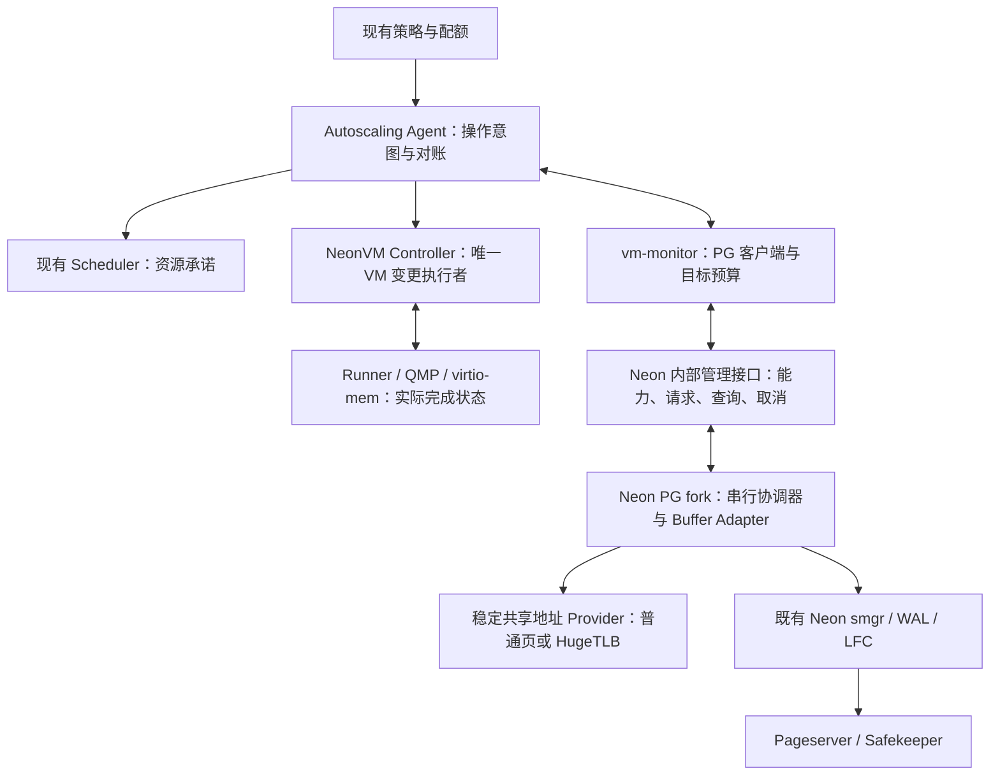

# Neon 在线内存扩缩容：架构复核与实施规范 V3

日期：2026-10-19（Asia/Shanghai）。状态：后续实施标准；项目所有者已确认以 V3 恢复实施。具体环境参数和发布认证仍待补齐。全文涉及现有实现的判断保留方案复核时快照；恢复实施后的提交、已关闭子片和剩余项统一见[当前实施状态](DSGA-当前实施状态.md)及模块记录，不将候选写成已交付。

本文落实项目所有者的最新要求：**本阶段先在 PG17 完整实现并测试，其他 Neon PG 大版本暂缓；Mac 能验证的先验证，依赖 Linux、KVM、HugeTLB 的项目明确留作后续验收。** “必须”表示交付门槛；“建议”表示尚需按指定配置/工作负载选择的参数。这里的架构结论不是并发算法的形式化证明，也不是生产验收结果。

## 1. 复核结论及文档优先级

**技术方向成立，但现有方案和已完成代码还不足以支持生产上线。** 在 Neon Compute 中动态调整 Shared Buffers，需要修改其 PostgreSQL fork 的 Buffer Manager；只改 Rust Pageserver、LFC 或 VM 内存无法完成这件事。应继续沿用 Neon 存算分离、PG 原生 pin/锁/WAL/smgr 和现有 Autoscaling 控制链。

需要修正的重点是：同一 Postmaster 内崩溃恢复的启动预算、checkpoint 长时间保护、私有内存预算的约束能力、最终 VM 写入的 fencing、普通页/HugeTLB 能力证明，以及多版本和扩展兼容范围。现有 Grow/Provider 等代码可以保留为候选基础；不能因已经写完或已有回归通过，就免除这些复核。

后续解释顺序为：项目所有者最新要求 → 本规范 → 具体模块设计与验证记录。2026-10-18 原方案和独立评审保留作历史资料；旧文中的 PG18 首发假设、未推送状态及笼统的“全部 ACK 即安全”不得继续作为实施依据。英文 RFC 与中文范围索引中的冲突以本规范为准。

原始两篇文章提供 DSGA、粒度管理和分阶段伸缩的思路，但没有给出可直接迁移到 Neon 的完整实现。第二篇是社区学习文章，不能与厂商代码或正式接口规范视为同等级证据。本文的新增协议和取舍是本项目设计判断。[阿里原文](https://developer.aliyun.com/article/1504779)、[腾讯社区文章](https://cloud.tencent.com/developer/article/2638157)

Neon 官方 2026-09 的缓存文章说明了固定规格实例的大 Shared Buffers，并把动态伸缩描述为后续工作。本次检索未取得足以替代本项目完整实现/验收的公开交付证据，不能据博客宣称上游已经提供可直接启用的完整链路。[Neon 缓存演进说明](https://neon.com/blog/improving-lakebase-compute-cache-part-1)

## 2. 本次审查基线与进度事实

本次实际读取了原方案、已有评审/RFC/模块记录，核查 PG 布局、Grow、Provider、pin/IO、checkpoint、Postmaster 恢复，以及 Monitor、Agent、NeonVM/QMP 相关路径；还按固定 Neon PG14–18 分支比较了关键结构。它不是所有源码逐行审计。恢复实现前仍须完成第 14 节的逐路径证据清单。

| 项目 | 此次核验事实 |
|---|---|
| Neon 功能分支 | `codex/dsga-neon-20261019`，`8103321197c8ba9a64f27d52fa624c8b68a1ba7f` |
| 实际 PG17 子模块 | `vendor/postgres-v17`，`2d60467e0218be4ad48761d9878e163dc74b2976`；属于 `william-lbn/postgres` fork |
| PG17 已合入维护基线 | Neon `56692dfb680281a963c7470fc7f0fec7f65ecfd4` + 社区 `94035972af3f10cdaf9ff2b5d232ad5f45463469` |
| Autoscaling 功能分支 | `ef6cd154aa3e60d72cab1e6b64abeb217ff9b245`；尚未实现本功能的 Agent/VM 业务链路 |
| 此次只读查询的 Neon 官方 main | `fa504217c61bbcaf5c512d75830564541f917f8f` |
| 此次只读查询的 Autoscaling 官方 main | `a4bce09e4d6bd7932ea634a1ed79afe26a9cfd1f` |
| 此次查询的社区 PG17 新头 | **`723075b0315d7a71c8d99252938f3582c6c1cee9`，尚未合入** |
| 中断前 M2f 工作树 | 有 pin/空闲链表和测试草稿；未完成验证、未提交。不得计为已交付 |

新社区提交修复 `jsonb_set_lax` 对常量 NULL 参数的使用后释放问题，并补回归，声明回补至 PG14。相对已经合入的 `94035972…` 为 1 个提交、3 个文件。本轮只记录；恢复实现后先走独立维护合并和回归，再继续功能开发。[官方提交](https://github.com/postgres/postgres/commit/723075b0315d7a71c8d99252938f3582c6c1cee9)

已复查原有日志：M2e 的 Mac `check-world` 开、关配置各报告 81 组/664 项通过，未启用 TAP；主仓构建的 PG17 加载 `neon_rmgr`，5 项集群生命周期测试通过。**这些覆盖 Grow/布局/部分访问边界，不覆盖完整 Shrink，也不等于真实 Pageserver/Safekeeper 存储端到端。** 本轮未重跑这些测试，未将新草稿算入旧结果。

本轮实际执行了文档/源码绑定检查：`git diff --check` 通过；`python3 ci/compute.py validate --source-ref HEAD` 和 `--source-ref index` 均通过（18 个二进制、4 个 PG 锁、39 个扩展构建阶段）。额外加 `--require-pg-checkout v17` 的严格检查因现存 M2f 未提交源码而**拒绝通过**，不是完整工作树已获认证。V3 的本地链接、代码围栏、风险/测试/门槛编号以及 14 个固定提交源码链接路径已检查。业务草稿在文档修改前后的 diff/未跟踪测试文件 SHA-256 一致。

Autoscaling 上表是本地功能分支头；当前 Neon 发行清单仍锁定其原 main `c0052f5f2d38fce6c70e448f3f1ee2ee239a0a93`。功能分支目前只有文档/约定变化，不能将它的存在解释为新 Agent 已进入发行。后续业务接入必须同时更新实际依赖清单。

## 3. 完整交付范围

| 需求 | 完整交付定义 | 当前判断 |
|---|---|---|
| FR-01 在线扩缩 | 同一连接可继续 SQL；真实新增 Buffer 被使用；真实尾部排水并减少逻辑容量；支持重复扩→缩→扩 | Grow 已有候选实现，Shrink 未完成 |
| FR-02 容量事实 | 分别报告目标、L/H/M、各数组保守占用、待回收和未知状态；VM/Guest/Host 各有实际值 | 部分字段已有，跨层未完成 |
| FR-03 操作恢复 | 身份验证、重放、取消、拒绝、部分完成、响应丢失与跨进程重连对账 | Grow 局部已有，完整链路未完成 |
| FR-04 并发生命周期 | 普通/并行 Backend、Worker、checkpointer、恢复进程的启动、退出、错误清理和过期引用均安全 | 未完整证明 |
| FR-05 Provider | 普通页与显式 HugeTLB 独立能力；指定 Linux 配置真实分配/回收可验；不支持时准确拒绝 | Mac 普通页逻辑已部分验证；Linux/HugeTLB 待验 |
| FR-06 Neon 联动 | Compute 启动预算、Monitor/LFC、Agent、Scheduler、NeonVM、RW/RO 和存储一致性 | 大部分尚未实现 |
| FR-07 平台 | Mac 用于开发验证；首个生产认证 Linux amd64；Linux arm64 单独认证 | 生产平台未认证 |
| 新增：全部版本 | PG17 完整闭环后，PG16/15/14 逐一移植；PG18 单列发行接入和 AIO 验收 | 当前只有 PG17 动态内核候选 |
| NFR-01/02 | 无错误回收/数据破坏；正常变配不主动断连；忙时可以拒绝 | 必须由并发及端到端证据证明 |
| NFR-03/04/05 | 热路径开销、服务时延/成本有基准；功能默认关闭；可冻结、回退、诊断 | 待性能及发布验收 |

首个共享内存 Adapter 是 Buffer Pool，沿用原稿明确的首期边界。其他内核共享组件预留接口；RO 自动横向增删、连接保持迁移及完整 HA 不是 Buffer Resize 自动带来的能力。它们保留在完整产品工作清单中，分别落实控制面接口、路由/一致性和故障域验收；不得因 Buffer Pool 完成而将这些依赖标作“已实现”。

| 产品工作项 | 后续必须落实的约定 | 验收边界 |
|---|---|---|
| 自动策略与 RW/RO 独立规格 | 同一组的总配额、单实例上下限、WSS 输入校准、滞回及紧急增容 | T18/T19/T22；不能仅按缓存命中率决定缩容 |
| RO 横向扩缩 | 对接实际部署的创建/删除/路由 API；追平 LSN、预热、健康后才接流；下线先停止新路由再排空 | 独立多副本/路由验收；失败创建可对账，永不误删 RW |
| 连接保持迁移 | 复用 NeonVM 迁移能力，保持网络/传输状态；与 resize 共用互斥和 fencing | T21；任意 SQL 事务不能靠换 PG Backend 无感搬迁 |
| 暂停/唤醒 | 接入准入、会话处置、WAL 持久化和旧实例 fencing；唤醒按安全 bootstrap | 独立生命周期/首查询验收；不恢复旧缓存指针 |
| HA | 写实例唯一性、Safekeeper quorum、Pageserver 恢复、独立故障域与明确 RPO/RTO | 独立故障演练；同一物理宿主机上三个 VM 不证明物理 HA |

对应的协议草案在[英文 RFC](rfcs/dynamic-shared-buffers.md)。生产控制面/API、路由系统和故障域尚未核验；`neon_local` 不能替代这些交付依赖。以上工作未验收时，只能声称完成已签收的内存子项目，不能声称完整复刻文章中的 Serverless 产品。

## 4. 目标架构和改动边界



| 组件 | 必须承担的责任 | 最小化约定 |
|---|---|---|
| PG fork / C | 对象寿命、L/H/M、排水、发布、Provider 和本 boot 操作事实 | 保留原 pin/hash/内容锁/IO 语义；不建立第二个 Buffer Pool |
| `pgxn/neon` 及配套扩展 | 受限控制/状态接口、smgr/LFC/遍历兼容、能力发现 | 内核机制留在 PG；不要只按大版本号猜能力 |
| `compute_tools` / Rust | 生成安全启动规格、扩展/二进制一致性、恢复前能力与预算 | 不用旧大规格配置重启小 VM |
| `libs/vm_monitor` / Rust | 请求关联、预算、取消/重连、跨层状态和内部认证 | 复用连接与协议框架；增加能力版本和明确状态 |
| Autoscaling Agent / Go | 目标决策、顺序、重试、持久意图与实际状态对账 | 扩展 `core`→`executor`→`execbridge`，不另建竞争控制器 |
| NeonVM / Scheduler | 资源预留、最终 fencing、QMP 串行执行、实际资源与迁移互斥 | 复用已有实际内存查询；补安全条件而非重写热插拔 |
| Pageserver / Safekeeper | 保持既有持久化权威，验证兼容 | 内存功能不创造新 WAL 格式；官方维护导致的 WAL 兼容另列模块 |

固定地址采用 fork 前建立的共享映射；正常伸缩保留地址及 backing 对象身份。首版不在各 Backend 运行时新增映射/分发 FD，不需要独立 MMAN 进程、通用共享分配器、新的缓存一致性协议或默认新增 CRD。未来若采用不同 Provider，必须重新证明其 attach/退出协议。

## 5. 必须修订的架构问题

### R01 / P0：仅修改外部启动配置，不能覆盖同一 Postmaster 内的恢复

源码中 `postmaster.c` 的异常恢复会在原 Postmaster 内执行 `shmem_exit()` 后重建共享内存；不会必然再次运行 `compute_ctl`。现有动态布局又以进程内启动 `NBuffers` 初始化。所以“启动 8 GiB → 在线缩到 2 GiB → VM 缩到 4 GiB → 子进程崩溃”仍可能再次尝试建立 8 GiB 池。现有测试验证了 boot 更新，没有验证这个资源交错。

**推荐最小方案：固定安全 bootstrap。** 每个 Compute 本次生命周期的启动 `shared_buffers = B_boot`，按该 Compute 允许的最小规格计算，运行时通过 Grow 达到较大 H。规定 `B_boot <= L <= H <= M`；所有合法目标 VM 的预算都必须能容纳 bootstrap、固定元数据和非 Buffer 保留。内部 crash recovery 自然回到安全小池，恢复完成后重新协商 Grow。新 Postmaster 的配置生成也遵守同一规则。

这会增加冷启动/恢复后的预热时间，应作为指标验收。若产品坚持在线缩到 `B_boot` 以下，就必须另行实现 Postmaster 可读取且不会随共享内存重建丢失的安全启动上限；在证明之前拒绝该目标。只改 `postgresql.auto.conf` 或只依靠 Monitor 看见重启都不够。

bootstrap 只限制 Buffer Pool，不自动限制恢复后新查询的私有内存。严格 VM 缩容模式下，新 boot 在重新确认持久目标预算/在途 VM 动作前，必须维持最小规格的准入约束，或将普通工作准入保持关闭，只允许必要的恢复、健康检查和管理操作。这个默认状态必须覆盖内部 crash recovery；不能存在“先接收任意 SQL，稍后等 Monitor 发现新 boot 再限制”的窗口。

### R02 / P0：私有内存观测不是未来资源使用的硬保证

当前 Monitor 使用近期 anon 用量决定缩容，并更新内部 threshold；现有代码不是完整查询内存约束。`work_mem` 不是单查询总上限，多个算子、并行 Worker、扩展、DSM、维护任务都可能额外消耗内存。降低新会话默认值也不会回收已执行查询的内存。

**约定：** 目标预算从准备缩容起保持到 VM 实际完成/确定撤销。需要具备明确的查询/维护并发准入与资源额度，或者等待不满足目标预算的工作结束并暂停新工作准入；可以保留连接并排队，不能靠 OOM 杀进程“完成缩容”。没有可执行约束、采样过期或正在运行的工作无法界定时，允许 PG 逻辑收缩，但拒绝发放严格模式的 VM 缩容许可。

首版建议采用受控排空与准入暂停，避免为了本功能同时重写 PG 通用内存分配器。门禁必须覆盖所有应用入口、已连接会话的新命令、扩展协议及维护/后台工作；只关代理的新连接不够。活动事务、游标、临时状态或扩展仍保留不可界定内存时拒绝本轮 VM 缩容，不强制断连。恢复准入后仍按目标规格的并发/扩展支持清单运行。若部署无法提供这种门禁，自动 VM 缩容功能保持未完成；不能默认永久返回拒绝，再把它算作完整功能。

`memory.high` 是节流/回收边界而非不可越过的上限；`memory.max` 可能触发 OOM，也不能充当无中断保证。原方案的“历史分位数 + margin”应定位为策略估计，不能称为安全证明。对于无限制 SQL/扩展内存分配，不存在只靠采样即可保证永不 OOM 的方案。[Linux cgroup v2 文档](https://docs.kernel.org/admin-guide/cgroup-v2.html)

### R03 / P0：Revision 记录进度，不自动构成最终执行权

复核基线中的 Agent VM JSON Patch 使用 replace，没有附带 VM UID/resourceVersion/操作身份的条件检查；当前 Revision 实现主要用于配置进度。旧 Agent、重试请求或已进入 QMP 的操作，可能晚于新目标生效。仅 PG 拒绝旧请求不能封住这条路径。

**约定：** 沿用 Revision，但补持久的操作身份与唯一执行者约束。最终 VM 执行必须核验 UID、领导权代次、目标、Revision 和预算承诺；Kubernetes 更新使用条件更新，Controller/Runner 还要串行处理实际 QMP 动作。API CAS 不能代替已发出的 QMP 对账。超时或租约到期均不是取消成功；旧动作未查明之前禁止与其冲突的新动作。权限超时后不得自动撤掉仍可能被 VM 缩容消费的目标预算。

**2026-10-21实施约定补充：** 协调者选择采用绑定完整VM UID/incarnation的Lease，
进程holder随机且不复用；实际issuer epoch来自原journal的CAS单调接管，不能从
LeaseTransitions、Pod名或请求方数字推导。已派发原请求保留旧epoch，换owner后
只允许观察/取消/真实效果对账，不改写成新epoch继续派发。Lease和journal均须
核验真实对象UID/RV/绑定；固定Lease对象被重建时当前会话失败关闭，不重置日志。

选主不等于最终fencing。失租要取消当前调用并等待已登记工作真正退出，不能靠
提前释放Lease宣称旧动作消失。远端凭据签发还须验证当前已授权主体与完整VM/
Compute/epoch绑定；本机私有Session构造或协议夹具不能代替远端认证/RBAC。
授权API/凭据回调必须有独立等待期限；HTTP Client自身超时不覆盖Do前的取凭据。
SDK未知原意图的解除须显式、持久且完整核验，不以一次查询/Fenced或重造空Client
清除；跨owner/boot关闭协议未完成前仍禁止相关冲突动作。

远程签发主体采用专用audience的Kubernetes TokenReview，并核对允许的SA及其
实际UID、投影令牌绑定的真实Pod UID、Pod生命周期和所在Node。进程随机holder
绑定该Pod UID；Pod名字、单纯SA名或调用方自报数字均不能当主体。签发器使用
自己的RBAC客户端读取Lease→完整原journal→Lease，核验固定UID/incarnation/
当前owner，不另设可漂移的未压缩owner镜像。续约新鲜度只用于保守拒绝，时钟
不能证明最终执行权；所有检查有独立总期限、不缓存正向授权、不泄露Bearer。
生产主体核验、独立中心HTTP/JWT、六路由代理和Agent实际消费者已分批接线；
持久启动身份也已在中心复核。各准确提交/边界见[当前实施状态](DSGA-当前实施状态.md)，
中心到真实Rust/PG全链及最终Runner仍须完成，不据这些子模块通过关闭R03。

Agent的SA令牌只可发给控制面独占TLS身份的签发器。现有每Compute TLS私钥也
挂载到Guest，不得作为签发服务身份或Agent信任启动链。中心凭据服务采用独立
监听/管理域证书，Agent只从可信平台配置取得管理CA和固定目标，拒绝Guest
单Compute身份；普通请求不得自报URL/CA。证书/SA配置不完整时启动失败，不能
借缺省关闭、旧key或general/admin Token降级继续。证书轮转及实际平台Secret/
RBAC隔离仍需目标环境证明，TokenReview协议夹具不替代该证明。

受管VM创建还必须有持久初始化屏障：apiserver分配真实VM UID后，Driver先
持久化同一incarnation/Compute实例身份、安全启动spec与完整journal，再按准确
UID/RV条件解除屏障。屏障期间Controller不得分配Runner/进入资源执行；失败或
写成丢回复只重读同UID原事实，不新建身份或初始化空日志兜底。已有Runner、
Node绑定、重启历史或丢失journal的实例不得在线改造成新的受管VM。Agent看到
受管标记（包括损坏标记）后不得退回legacy监控/资源写入。截至2026-10-21，自有Autoscaling8e1e0ea已实现API/发布CRD CEL、完整journal
初始化/释放、直接reader的Webhook/Controller及Agent拒绝保护。详见同仓
《DSGA-持久创建屏障与启动身份》。**Driver实际创建顺序仍未接通**，不能将核心
库/准入通过写成完整创建链已交付，也不能将这个代码缺口归成Linux待验。

创建协议进一步固定如下约定，后续实现不得只修改VM中的PG_VERSION：

1. 可信平台给出的模式、PG大版本、镜像不可变引用、显式bootstrap/M/最小Guest/
   non-buffer reserve及随机创建身份，必须先随原始创建Operation持久化。
   重试不能重读可变env决定是否改走legacy；最低Guest按未来所有合法目标取值，
   降低bounds低于已固定下限必须拒绝或采用独立受控重建。
2. DSGA创建采用旧worker无法执行的版本化操作入口；仅在旧JSON中增加可忽略
   字段不安全。发布/恢复时禁止DSGA意图落入旧PG16 createCompute/wake/route路径。
   旧入口发现bootstrap、任一journal标记或动态配置（包括空/null/坏值）必须拒绝，
   不得用labels相同来收养。预读不是跨对象原子fence，最终UID/RV仍不可省略。
3. PG大版本必须从项目事实贯穿创建Operation、祖先/目标Timeline及实际Guest。
   恢复/冲突GET要核对原版本与祖先身份，不能只改环境变量而继续创建PG16存储。
4. CREATE先写held、随机incarnation和固定Compute ID；取得真实VM UID后再生成
   原生v2 spec、owned且绑定同VM UID的配置Secret、完整初始journal。释放必须
   测试原UID/RV/原held记录并同时固定VM UID与实际Secret UID。**同Secret UID不
   等于内容不可变**：DSGA初始配置须冻结安全启动字段（优先使用immutable Secret，
   catalog变更经独立受限configure投影），恢复启动仍核对原持久计划。不能在同UID
   下替换预算/关闭dynamic后凭身份检查通过。丢回复只能重读同一事实，禁止重置
   日志、重复生成身份或收养已有运行历史的实例。
5. **租户SQL角色与内部超级用户必须隔离。** 旧Driver把租户密码用作cloud_admin
   verifier；生产Compute明确以SUPERUSER创建该管理角色，而当前PG准入为内部
   管理超级用户保留通道。DSGA不能沿用这份租户角色/路由/密码语义。内部管理
   凭据不得下发租户或进入普通可登录路由；应用角色不得继承管理/超级用户权限，
   并应验证SET ROLE、既有连接新SQL、RO、扩展协议及恢复后仍受准入约束。
   单独设置NOSUPERUSER仍不证明完整R02：授权关系、后台维护和全部预算继续核验。
   **官方管理身份约定（2026-10-23补充）：** `cluster.roles`只声明业务角色，禁止
   声明cloud_admin/postgres/zenith_admin等内部身份。内部cloud_admin沿用Compute的
   本地管理通道，PG口令保持NULL；外部管理JWT/TLS不是数据库超级用户口令。
   不得新造“私有PG管理SCRAM”放入全局认证目录。主库原子应用角色时清除遗留
   cloud_admin口令，但这不能撤销旧超级用户会话，旧混用实例仍须受控重建/排空。
   其他超级用户有口令则拒绝应用，不能静默覆盖未知运维身份。RO核验真实恢复
   状态、内部无口令事实和源timeline已冻结的业务verifier，不在副本生成新盐值。
   角色模块证据及当时尚未接齐的HBA/Renderer/来源回执见
   [原生角色模块交接](DSGA-原生角色模块与Mac验收-20261023.md)；不能据其单独
   通过开放公开路由或关闭R02/R03。
   **私有认证与启动契约补充（2026-10-23）：** 受管PG单一0700 Unix socket/peer、
   初始hold与角色核验后发布业务HBA、Postmaster认证参数和完整7字段/端口冻结
   已实现，Mac真实主/物理RO及HTTP定向证据见
   [私有认证验收](DSGA-PG17私有认证与启动契约-Mac验收-20261023.md)。HBA随机
   nonce仅确认本机实际加载，不等于原Operation/VM/Config/boot与混合镜像能力
   初始化回执；已有连接不因reload自动排空。完整Renderer/公开worker、预算/
   quiesce与最终执行端协议仍须完成。当前仅PG17，其他大版本按所有者要求暂缓。
6. Mac要验证实际Driver的丢回复、冲突、崩溃断点、UID/Secret重建、坏日志、旧
   worker/新协议混部拒绝与角色隔离；native链最终应经过同一中心到真实Rust/PG。
   CRD/TokenReview/RBAC/etcd及物理效果仍由目标环境独立认证。

当前代码进度、实际链路及剩余创建/预算/Runner见
[当前实施状态](DSGA-当前实施状态.md)；具体owner核心证据见
[所有权与持久循环验证](DSGA-所有权与持久循环验证.md)，不据单模块通过关闭R03。

### R04 / P1 发布阻断：checkpoint 全程 Guard 不满足在线伸缩时效目标

现有 `CheckPointBuffers()` 把整个 `BufferSync()` 包在数组 Guard 中，其内部有实际写入和 `CheckpointWriteDelay()`。因此一次正常长 checkpoint 就可能超过 Grow 的等待期限。它目前偏保守地保护了内存寿命，但不能据小数据回归证明高负载下可及时伸缩。

**约定：** 分离“访问 Descriptor 的短保护”“持 pin 的 IO”和“checkpoint 排序工作区的寿命”。扫描按有界批次取得 Guard；IO 依赖正常 pin；工作区单独持有使用登记/容量，checkpoint 完成前不得回收或在 regrow 时清零其仍占用部分。工作区可以暂时保留较大占用并计入预算，不能让长 IO/节流持续占用容量发布锁。过期候选 ID 再用时验证 H 与页面身份，确保该 checkpoint 必须持久化的旧脏页已经按原协议处理。

这项变更必须先写逐函数交错证明和 checkpoint 正确性测试；不能简单把现有 Guard 删掉，也不能每次缩容强制一次全库同步 checkpoint 来掩盖问题。

### R05 / P0：最后一次 unpin、IO 完成和非 pin 遍历必须分别证明

原 Neon 测试驱逐及原生 pin waiter 的路径存在放下自己的共享 pin 后再次访问描述符的代码；当前 M2f 草稿正尝试前移这些访问，但尚未完成测试。`StrategyFreeBuffer` 的访问保护还涉及 mapping→access 反向取锁风险。本轮没有把风险等同于已经复现的死锁。

**约定：** 所有 Descriptor/页/IOCV 访问都有可指明的保护者。最后共享 pin 释放后不再解引用对象；必要的 waiter 目标先保存，通知不能被插入的 ERROR 点丢失。IO 的完成通知、CV 退出队列和错误清理全部在相应寿命保证内结束。PG18 的 AIO handle/完成回调需要独立证明，不能只看 `BM_IO_IN_PROGRESS=0`。

### R06 / P0：Provider 的“成功”必须说明到底证明了什么

固定 VA 不等于不计系统提交额度。当前可写共享匿名 mmap 没有提供关于所有 overcommit 配置的承诺；预留 M 可能受到 commit、地址空间、页表、容器及 HugeTLB 额度约束。必须实测和前置检查，不能配置 1 TiB 上限后假设只有当前 H 有成本。[Linux overcommit 规则](https://docs.kernel.org/mm/overcommit-accounting.html)

`MADV_POPULATE_WRITE` 从 Linux 5.14 提供，可能部分成功，且 OOM 时进程仍可能被杀；返回成功也不等于永久驻留或给所有 Backend 预热页表。单次系统调用不提供业务期限内返回的硬保证。[madvise 手册](https://man7.org/linux/man-pages/man2/madvise.2.html)

**约定：** 编译宏只表示能编译；启动时用与生产相同 backing 的小范围真实探测建立能力。Linux 不支持所选语义时拒绝开启对应能力，不静默用 Mac `memset` 路径替代其保证。请求期限约束协调等待/批次，不承诺可强行中断内核调用；超时已发出的动作进入待对账，不能当作“未发生”。

### R07 / P0：PG 已释放 backing 与 Guest/Host 已缩小是不同事实

Provider 成功只能证明该 Provider 所定义的区间处理。Guest 空闲 HugeTLB 页还可能留在池中；QEMU 资源、Guest 可管理 RAM 和调度承诺也不相同。Guest HugeTLB 与 Host HugeTLB 是独立配置维度，不要求两层一定同时使用巨页。普通页、THP、显式 HugeTLB 不可互相冒充。[HugeTLB 文档](https://www.kernel.org/doc/html/latest/admin-guide/mm/hugetlbpage.html)

现有 NeonVM 已通过 QMP `query-memory-size-summary` 查询实际 base+plugged memory，并与目标比较；应复用它。仍需补 Guest 可用状态、Provider/池账本、操作关联和最终承诺释放。PG Granule 的 VA 偏移不是 virtio-mem 可拔 PFN 的地址证明，不能自行指定“一段 PG 内存对应一个 8 MiB VM 块”。[virtio-mem Linux 指南](https://virtio-mem.gitlab.io/user-guide/user-guide-linux.html)

### R08 / P1 发布阻断：上限 M、固定元数据与最小规格必须一起设计

按 M 保留 BufferTag hash 可以显著降低改动量，但存在最小内存成本。Descriptor、IOCV、checkpoint workspace 也不是零成本。以常见 64 位 PG17 的 64 字节 Descriptor 为例，64 GiB 最大 Buffer 页容量对应 8,388,608 个 Buffer，单 Descriptor 数组全驻留就需 512 MiB，尚未计入其他结构。此例不代表所有版本/平台的 `sizeof`。

**约定：** 构建/启动必须报告实际结构尺寸、hash 估算、数组对齐及固定成本，证明最高 M 与最低 VM 规格相容。保留四数组的独立生命周期；不要为省审查而悄悄把所有元数据按 M 永久实分配，也不要为了节省少量元数据增加不必要的在线 hash 重建。固定 hash 成本若已超过最低预算，先调规格范围/M；动态 hash 属于额外设计。

### R09 / P1 发布阻断：接口必须区分请求结果与观察到的当前状态

当前 Grow 只保留最近一次操作；竞争锁超时时可能返回正在执行的另一操作的 snapshot。内部原型可以这样返回，但生产协议不能把它解释为“本请求已 DENIED/COMMITTED”。旧操作被新操作覆盖后，也不能承诺任意旧 ID 都能从 PG 查到历史结果。

**约定：** 返回独立的 request receipt 和 observed state；每个结果带自身身份。PG 保留有界当前事实/终态，外层持久保存历史；过期请求返回 `STALE` 或 `RESULT_EXPIRED` 并附当前事实，绝不重新执行。业务取消、连接断开和 SQL ROLLBACK 均有明确且不同的语义。

### R10 / P0：跨版本与扩展 ABI 是完整功能的一部分

PG14 的 pin waiter 使用 PID，PG15–18 对应字段使用 PGPROC 编号；PG14/15 与 PG16+ 的关系定位类型不同；PG17 有批量读流程，所核验的 PG18 分支增加 `PgAioWaitRef`。**该 PG18 固定分支仍有 freelist**，不能根据其他开发分支的印象机械删除/增加链表逻辑。

每个大版本均要先核对官方维护基线，再做语义移植。原生 `NBuffers` 的旧假设还可能存在于扩展；例如 `neon_test_utils` 当前直接按 NBuffers 扫描，必须适配。`neon_walredo` 的 NBuffers=4 是另一运行模式，须验证而非机械替换。对任意未审计 C 扩展不能承诺自动兼容；发行扩展须按实际 PG headers 重编并列入矩阵。

### 修订事项的责任与验收映射

| 问题 | 负责模块及必须产物 | 关联测试 | 未满足时的处理 |
|---|---|---|---|
| R01 | PG 初始化、Compute、Monitor：bootstrap 预算和新 boot 准入/对账协议 | T11/T18/T19 | 不启用 VM 缩容 |
| R02 | PG/部署准入、Monitor、Agent：可执行预算、排空及恢复规则 | T13/T14/T18/T22 | 拒绝 VM 缩容，不能报完整交付 |
| R03 | Agent、Controller、Runner：持久意图、条件更新、实际动作串行与对账 | T14/T17/T21 | 冻结冲突变配，保留预算承诺 |
| R04 | PG checkpoint：短访问保护和工作区独立寿命设计 | T05/T09/T22 | 不通过在线伸缩时效验收 |
| R05 | 各版 PG pin/IO/遍历、扩展：逐函数引用及锁序清单 | T06–T10 | 禁止回收相关数组 |
| R06 | PG Provider、平台探测：真实能力与部分失败账本 | T03/T12/T15/T16 | 拒绝相应能力、保留未知占用 |
| R07 | Provider、Monitor、NeonVM/Scheduler：跨层资源回执和账实核对 | T15–T17/T21 | pending；不提前释放资源承诺 |
| R08 | PG 布局、Compute 规格：实际尺寸及最小预算计算 | T02/T03/T11/T18 | 拒绝不兼容的 M/最低规格组合 |
| R09 | PG API、Rust/Go 客户端：请求回执、当前状态和有界历史规则 | T04/T12–T14/T21 | 拒绝旧请求；未知结果先对账 |
| R10 | 每版 PG、扩展、构建发行：语义差异表和独立验收报告 | T01–T22 中该版本适用项 | 不标记该版本支持 |

## 6. 内核状态和对象寿命的强制约定

下述索引统一为 0-based；PG 对外 Buffer ID 仍按原有约定转换，禁止混用。

| 量 | 定义 | 不能代表的事实 |
|---|---|---|
| B_boot | 本 boot 重建共享内存的安全启动 Buffer 数 | 在线目标 H |
| L | 新 victim 分配上界 `[0,L)` | 旧 pin 合法性的上界 |
| H | 当前已初始化、允许受保护访问的逻辑上界 `[0,H)` | 物理 RAM 已减少到 H |
| M | 当前共享内存生命周期固定的逻辑上限 | 已预留可用的物理 RAM |
| capacity_generation | 已提交逻辑容量的版本 | VM 执行权、boot 身份 |
| committed_upper_bytes[i] | 数组 i 已占用/可能占用的保守预算上界 | RSS、全体 Backend PSS 或 Host 资源 |
| allocation_unknown / release_pending | 未能证明的分配/释放事实 | 可以忽略的成本 |

必须始终满足：

1. 稳态 `B_boot <= L = H <= M`；排水态 `B_boot <= L < H <= M`。扩容初始化完成后才发布 H，再允许 L 增长。
2. 持 pin 可继续访问 `[L,H)`；普通 hash 命中可以继续获得真实 pin，因此缩容允许因热页忙而失败。L 不是对现有页面的拒读标记。
3. 对未持 pin 的 Descriptor/IOCV/数组遍历，保护从读取边界之前开始，持续到最后一次解引用；先读地址再检查 H 不合法。
4. Hash 映射删除与新 pin 的取得按原 mapping/header 协议串行；包括 `BM_TAG_VALID=1, BM_VALID=0` 的读失败对象。
5. 无 pin、无 IO、无 dirty、无有效 tag、无相关 waiter/回调和旧遍历者，是回收前必须共同证明的条件。单独的 ACK、refcount 快照或 H 数字均不充分。
6. 控制目录、身份、协调锁不在可回收区。每个数组的对齐/保留边界独立计算，不能按 Buffer 页数直接推断元数据释放量。
7. 发布较小 H 后不以“事务回滚”恢复旧 ACTIVE。恢复容量只能作为新 Grow，先重新准备 backing 和对象。
8. SQL ERROR、取消、FATAL 的资源清理和 Postmaster crash recovery 都要有测试；不能只测试正常函数返回。

**锁纪律：** resize 锁只串行容量操作；access 锁保护无 pin 访问及短发布；strategy 锁保护 freelist/clock；status spinlock 只复制固定大小事实。不得在 spinlock 下做 IO、分配、报错或长遍历；不得持 access 独占等待 pin、IO 或 barrier。已有 mapping/header/content 锁的路径不得临时引入未经证明的 access 反向取锁。对 `StrategyFreeBuffer` 等特殊入口，若采用 strategy 锁内 L 校验替代 Guard，必须证明所有 L 下降同锁发布，且 Grow 初始化与 L 读取之间有发布/获取屏障。

`ProcSignalBarrier` 只用于完成已定义的进程本地动作；必须逐项列出需要清理的本地缓存/引用。稳定地址本身不要求每次 Grow 重新 attach。若保留 shrink barrier，其完成依据是原生 slot generation 和完成回调，不是信号已发送或 check mask 已清零；新加入/退出进程复用原生生命周期。barrier 不能替代 Guard/pin 排水，也不能持有 ACK 所需的锁等待。是否能删减某个 barrier 必须有引用清单证明，不能凭“地址没变”判断。

## 7. Grow / Shrink 的线性化与失败语义

### 7.1 Grow

顺序必须为：验证身份/范围/目标总预算 → Scheduler 预留 → VM 实际增加与 Guest 可用 → PG 取得串行操作权 → 分批准备各数组 → 初始化所有新对象 → 短保护下发布 H/L/generation/COMMITTED → 外层对账完成。

每次 Provider 调用前先登记最坏占用，失败/取消保留可能已经分配的成本。较小重试不能清掉先前较大失败请求的未知尾部。正常页预触、Descriptor/IOCV 初始化和 checkpoint workspace 准备分别处理。任何仍被旧 checkpoint 使用的工作区不能因 Grow 被清零。

**PG Grow 的线性化点**是受保护的 H/L 与操作终态发布。此前失败维持旧容量；此后响应丢失仍然已提交。SQL ROLLBACK 不撤销共享内存容量。VM 已大、PG 未长大的状态可以保留并对账，不能未经新的安全检查立即补偿缩 VM。

### 7.2 Shrink

1. 验证当前实例身份、支持能力、目标规格、B_boot/M 和完整内存预算；获取目标预算承诺并阻止冲突操作。
2. PG 串行记录操作；在短发布保护下令 L=目标、H 不变；过滤尾部 freelist，限制 clock/ring 新 victim。
3. 分批尝试排水：尾部被 pin/IO/dirty/竞争锁占用就跳过或稍后重试，不强清引用，不删除仍在用的标签。
4. dirty 使用现有 PG/Neon 写回链路。首个正确性版本可节流请求异步 checkpoint，但不得等待全库同步 checkpoint 作为唯一进展机制；服务验收还要测其 WAL/GetPage/IO 放大。
5. 对无 pin 的干净 tagged 对象，遵守 mapping/header 协议重新检查并原子撤销 tag；包括读失败残留标签。不持 header spinlock 阻塞等待 mapping 锁。
6. 完成本地引用/遍历排水及必要 barrier；取得短独占保护作最终检查，确认没有新的尾部对象可再进入。发布新 H/generation 和逻辑提交事实。
7. 在生命周期规则允许时逐数组回收完整安全页，保留活跃边界页和仍在使用的 checkpoint workspace；记录各区间成功、未知、未支持或待回收。物理调用不在短发布锁/策略锁内执行。
8. 只有 PG/其他预算及 Guest 条件均满足，才生成与当前操作绑定的 VM 缩容许可；Controller 再次核验并执行，观察 QMP/Guest 实际结果。
9. 实际收缩完成后释放相应 Scheduler/Host 承诺；保持仍留在池/映射/未知范围中的预算。

**两处提交点必须分开：** PG 逻辑 H 发布；VM 物理资源实际改变。二者之间可长期存在安全的额外资源占用。禁止将任一阶段写成跨系统 ACID 原子事务。

| 故障发生点 | PG 允许动作 | 外层约定 |
|---|---|---|
| 尚未取得串行权 | 返回 BUSY/期限结果及当前快照，不冒用别人的 operation ID | 重试或取消意图 |
| H 未缩且 backing 未动 | 可恢复 L=H；已正常驱逐的页无需还原 | 不缩 VM |
| H 已缩、尚未释放 | 保持较小 H，记录物理待回收 | 不凭逻辑数字扣占用 |
| 某数组部分释放或结果未知 | 保持较小 H，保守记账；禁止回滚旧 ACTIVE | 无充分预算证据不许可 VM 缩容 |
| PG 回执丢失 | 同一身份查状态/重放，不重复执行 | 响应超时不等于取消 |
| VM 命令丢响应/Controller 换代 | 保持目标预算约束；PG 不擅自 regrow | 查询实际值及旧操作进度，阻止冲突动作 |
| PG 内部 crash recovery | 新 boot、小 bootstrap，所有旧 PG 许可失效 | 未完成的 VM 目标预算仍须约束新 boot |
| Monitor/Agent 重启 | 从 PG/VM 实际值及持久意图重建状态 | 不以本地内存为空推断没有在途缩容 |

Mac 普通页 Provider 的物理释放不支持时，允许验证逻辑 H 降低、数据正确和保守预算保留；结果必须是物理未完成，不能生成 VM 完成证据。故障后清理/regrow 同样受 resize 操作身份保护，禁止旧异步 Release 回收新 Grow 刚使用的范围。

## 8. 内存预算与最小规格

预算以 Guest 目标实际可管理容量为基础，并同时满足 Host/Scheduler 限额。建议按以下项建立不重计的账本：

```text
目标 Guest 可管理内存 >=
  OS/内核与不可迁移区保留 + 页表与进程基础成本
  + 固定 PG/Neon 共享结构及按 M 保留的 hash/目录
  + 各 DSG 数组保守占用（包括失败 Grow、边界页、延迟回收）
  + 正在执行和已准入查询/并行/DSM/维护的预算
  + LFC 元数据及其需保留的驻留预算
  + 未被上述 DSG 项计入的 Guest HugeTLB 池/保留成本
  + 变配瞬时开销 + 安全余量
```

逐项标记它是“硬额度/已承诺上界/观测/估计”。实际 cgroup 总量与分类项校验时要去重：共享内存不按 Backend RSS 相加；shmem、file、anon 与 HugeTLB 依目标内核的记账规则解释；HugeTLB 是否计入 memory controller 还取决于内核和挂载能力。reservation、已分配页和池中页存在包含关系，不能直接三者相加；已归池的页从 DSG 占用转到池占用，池尚未减少时 Guest 总预算不下降。不能把所有 file 都当作可立即丢弃的缓存。

LFC 文件大小、驻留页缓存和内存消耗不是同一数字。增大 Shared Buffers 后，LFC 事件减少可能意味着一级缓存更有效，不能当成工作集消失后继续反复缩容。保留 LFC 回退能力；SB/LFC 比例经负载基准确定，不复制 75% 或文章中的 CPU 阈值。

缩容步长按实际 Provider 页边界和 VM 规格粒度分别取整；向安全方向取整，返回真实目标及原因。最小 Buffer 数由 bootstrap、并发/pin、恢复和工作负载验证决定，不能把内部 API 允许的 16 个 Buffer 当作生产规格承诺。超过 M 需要另一次受控重启/升级配置，不承诺当前 boot 无限在线增长。

实施时必须填写以下规格表；目前没有现场证据的值保持“待配置/待测”，不能在代码中悄悄固化：

| 参数组 | 需要固定的内容 | 缺少时影响 |
|---|---|---|
| 容量 | VM 最低/最高/启动值，B_boot、M、Provider 页粒度、VM 步长；统一 bytes 与 Buffer 数转换 | 阻止生产启用；Mac 可使用明确标注的测试配置 |
| 工作负载 | 最大连接/活跃查询/并行/维护并发，支持扩展清单，准入执行点及排队期限 | 阻止 VM 缩容许可；不能仅给出 work_mem 默认值 |
| 平台 | Linux/架构、backing、Guest/Host kernel、QEMU、NUMA、swap/overcommit/cgroup/hugetlb 配置 | 阻止该组合物理能力认证 |
| 服务目标 | 增长/排水期限、失败退避、最长 pending、P99/TPS/恢复预热阈值 | 只能报告实测分布，不能宣称达到未定义 SLO |
| 产品接口 | 资源承诺存放位置/寿命、控制面与路由 API、VM 唯一执行者、迁移/HA 约束 | 阻止相关完整产品工作项签收 |

请求必须显式处理“目标不可表示/取整后不同/低于安全下限/超过 M”。取整值返回给调用者确认其实际意图；常规合法规格由双方事先协商，无需每次变配人工确认。

### 8.1 聚合预算与实际动作顺序（2026-10-24接线约定）

原生startup_shared_upper_bytes已经包含bootstrap四数组；运行期使用新成本API提供的固定主段上界+当前数组保守占用。不能将启动总量与当前数组再相加，也不能按逻辑H或RSS直接扣除未知/待回收成本。该范围不含DSM/私有/LFC/OS/Guest池。

预算结算合同允许分类模式与聚合模式互斥选择。聚合模式覆盖整个PG主段/DSG/私有/DSM/LFC和整个Guest HugeTLB池（包括空闲池），再加不在覆盖范围中的系统、变配与安全上界；不得再叠加Shared/私有/LFC/池分类。聚合约束由生产者核验，不要求将操作系统不提供的独立私有硬限额生硬拆账。是否由memory controller计入HugeTLB、池与使用的包含关系必须按实际内核/挂载验证，不能盲加memory.max与池大小。

PrepareBudget首先持久化目标承诺并保持现行约束，不能在Guest尚小时提前提高grow额度，也不能在PG仍占大池时提前强压完整shrink聚合上限。Grow在VM/Guest实际可用后提高相应约束，再扩PG；Shrink先关准入并真实排空，再缩/释放PG，满足实际占用与保留预算后由GuestReady域应用并回读目标约束，再允许VM变更。物理未释放/不支持或命令未知时保持原承诺和待对账，不提前退Host额度。

约束生产者须认证并持久fence（独立于PG boot），核对真实进程/cgroup/Guest/Host身份、约束写回和持有寿命。kind/SourceID格式、memory.high、采样/估计或PG成本成功均不是完成证据。新PG boot仍受未完成VM目标的旧预算约束，不能清journal/HWM重造“初始空闲”。此处是后续生产者的实现标准，相关生产者尚未全部接齐；仅最终恢复准入消费者及成本API已有Mac基本验收，见[模块记录](DSGA-PG17共享成本与预算接线-Mac基本验收-20261024.md)。

### 8.2 Guest硬约束执行器的生产边界（2026-10-24）

AS的`pkg/dsga/resourceguard`执行固定cgroup memory.max/禁swap及全部hstate池
约束。资源floor不能随PG boot重置；原日志缺失不能由Fence自动补建。写前保留
完整原意图与上一份Held约束，跨进程锁覆盖同步内核调用与前后fsync；超时、取消、
部分写或丢回复保留未知，普通重试只读对账，当前owner才能显式原样重放。

内核适配器必须确认root控制目录和限额文件及实际Postmaster进程归组；不得在
官方旧postgres可写限额配置下声称约束成立。全部hstate都必须有目标，禁surplus
overcommit并读回目标池/surplus0；整个池含空闲，只在当前支持的未计入memory
controller模式下与memory.max组成保守聚合上界。该上界不包含外部系统/过渡/
安全承诺的认证，也不证明Host释放、VM完成、物理回收或永不OOM。

这个执行器及Mac基本验证已经存在，但受管权限/启动、Compute授权通道及完整
预算/独立启动准入接线仍是业务工作，不能改成Linux待验。Linux6.12不能假定新
内核memory.max的O_NONBLOCK语义；同步等待期间不得提前释放锁。真实内核写、
HugeTLB/surplus/HVO、SIGKILL恢复和物理行为留目标环境验收。见
[本模块事实及接线边界](DSGA-Guest资源硬约束与控制链接线边界-20261024.md)。

### 8.3 先约束后出生与PID不变量（2026-10-24）

PG尚不存在时，以独立BootstrapCommand建立真实Guest/cgroup限额，不伪造PG PID。
写前保留原身份/epoch/承诺与全部额度，准确读回前不能出生；组内必须空闲。未知
写保留原意图，普通重试只观察，当前floor才能显式原样重放。裸floor并非启动预算。

受管Linux固定帮助程序须root拥有且不可被postgres修改。普通postgres真实UID只
可使用launch-postgres：同一资源锁内读回当前Held/真实约束，入固定cgroup，清
能力保留/ambient，全线程降组/降真实/有效/保存UID，NO_NEW_PRIVS后原位exec固定
PG。不能增加sudo/代理父进程却继续将Child PID当作PG；不得留下root线程或泄漏
root控制FD。资源写操作另要求真实root及独立认证通道，不能接旧无认证neonvmd。

配置/程序路径不由租户、环境或请求选择。缺少原启动事实、未知命令、约束漂移、
在用组或Guest身份变化都不能回退旧cgexec。重启采用当前Held而非原较大额度；
Guest已有受管标记但尚无冻结DSGA spec也必须拒绝启动，不能走非受管fallback。
受管模式不使用无创建预算的临时512MiB预热池。此出生只启动关闭普通SQL准入的
Postmaster，不代表预算全结算、普通SQL可用或VM许可。实际sysinit/安装/原预算
与认证接线仍继续编码；Linux UID/SUID/迁移/PID信号/内核行为须后验，见
[模块事实](DSGA-启动硬约束与原位PG出生-Mac基本验收-20261024.md)。

### 8.4 原资源来源与产品sysinit（2026-10-24）

平台VM profile v2显式保留normal硬限、OS/过渡/安全上界及全部hstate池；禁止
worker以RSS/比例/当前env给旧计划补额度。资源来源与Compute配置由原Renderer
一次成功生成，同存原owned immutable Secret并绑定UID。资源数据只含管理公钥，
不含签名seed/TLS私钥或业务verifier；原计划深拷贝所有可变额度/池数组。

Controller直接重读原VM/完整Spec和原Secret，核验原UID/owner、immutable、原
pristine日志、native预算/公钥与资源来源一致，再给Runner只读ISO输入。Runner
有界解压并复核完整启动身份；来源字节/SHA不因重序列化丢失。手工flag不是Kube
授权，该投影不能替代最终Runner/QMP的持久fence。已有history的重启走受控恢复。

Guest封存准确原来源，固定root目录/cgroup与实际限额；任何已有不同来源不覆盖。
vmstart和每次PG出生重读ISO/封存/固定配置及原Bootstrap，核验当前Held，不能让
provision失败后旧Applied代另一来源放行。Kernel/残留模式只收紧旧入口，不是
预算授权。根迁移权限关闭后不得由旧cgconfigparser再次委派；受管Compute不启动
旧WS Monitor并发修改memory.high/LFC。旧Guest daemon只保留CPU只读和固定管理
TLS三键有界供给，资源写另由认证/fence通道执行，不开放任意文件写。

此段产品源码已接入，未构建镜像/安装SUID/执行Guest。Mac只证明相关输入/恢复/
路由逻辑和编译，实际只读ISO、root权限/迁移、TLS正向供给及内核/物理行为必须
Linux验收。完整运行期控制链与受控跨boot恢复仍是业务工作，见
[本批证据](DSGA-原资源来源与Guest启动接线-Mac基本验收-20261024.md)。

### 8.5 认证root资源通道与独立生命周期（2026-10-24）

原公钥来源延续8.4，不让普通Compute通过SUID调用资源写；SUID仅允许原位PG
出生。root服务由Guest init以真实root启动，固定UDS、root不可委派目录、服务
独占锁先于socket清理。每请求重新校验原Ed25519短JWT、准确aud/control scope、
VM/CI、epoch、时间和唯一JSON字段；Compute已验签不替代root验签。可连接socket
不是授权，凭据也不是租约/完整预算/VM许可，网关current owner和最终资源floor
各自保留职责，不向旧无认证TCP入口回退。

五个固定identity/fence/apply/observe/replay-original接口独立于SQL连接和PG boot。
资源Fence必须在同一锁中比较完整Guest boot/cgroup身份再落盘floor，不能在
Inspect后另行无身份接管。新owner只读旧epoch原意图，旧代次不得重放；接管保留
Original/Held/未知结果。网络不提供initialize/bootstrap或清空Pending动作。

调用方先写外层完整原意图，再发送；消费者保留未知栅栏、独立观察连接和显式
原重放，不因超时/丢回复或新PG boot抹除资源承诺。回复必须完整严格解码，核对
所有实际限额、整池、占用和准确身份，vm_shrink_permit必须false。原资源身份
首次发现后须持久固定，跨Guest/PG重启不能自动重绑。PG死亡仍须受控关闭旧资源
效果，不能以旧PID查询失败推导NoEffect。

产品服务、正式Compute代理和中心固定网关源码已接线；Agent资源领域执行器/
持久恢复及完整预算/排空/Host/最终VM仍继续实施。Mac签名/TLS/真实UDS及分段
协议检查不是Linux root/cgroup/HugeTLB或K8s/物理端到端认证，详见
[本批事实与边界](DSGA-认证Guest资源转发-Mac基本验收-20261024.md)。

### 8.6 原Postmaster出生事实与不可收养（2026-10-24）

资源命令不能仅以请求PID/starttime及同组进程当作Postmaster。原位root出生路径
先在同一资源锁内持久Birth，再入组/全线程降权/exec；PID和starttime来自实际
启动程序自身，不由普通请求填补。临时存储同步不能冒充普通Postmaster出生。
Birth记录本身只是启动意图，真实程序/UID/固定cgroup和启动时间仍须独立读回。
PG程序及可替换它的父目录须root保护，产品构建源必须与检查约定一致。

运行期写必须匹配原Birth，固定GET process只读来源不接受自选PID。缺旧记录、
exe不匹配或进程死亡都不能收养另一进程或清除旧资源承诺/未知动作；新PG不改
旧命令、Held及floor。计划者读取后先持久冻结完整进程事实及原命令，再发送。
PG17原位exec与UID/exe/cgroup/文件系统语义仍须Linux真实验收，Mac协议及源码
核对不可替代。详见[出生来源接线](DSGA-原Postmaster身份转发-Mac基本验收-20261024.md)。

### 8.7 实际Agent原Guest绑定与资源floor（2026-10-24）

实际Agent先确认长期owner Session，以原VM/Compute绑定做一次只读Guest发现。
没有HWM/任何历史/原操作才允许首次冻结；root已有孤立运行期命令时拒绝收养。
完整资源身份先经原VM UID/RV CAS写前持久化，再root fence。丢回复不能派发，
恢复只能读取原身份；接管、PG boot和历史淘汰都不得清除或重发现替换。

新字段为原账本optional ResourceIdentity，旧未启用数据可读，已写新字段须用
对齐版本reader，不能无条件降级。原pristine bootstrap不允许夹带运行期绑定。
同一资源客户端随Session持有，未知完整GuestReady命令从原步骤恢复Pending。
新PG POST及显式重放前仍须检查当前资源floor和已确认持续约束，不能仅凭旧
GuestReady或配置数字；原未知PG查询保持可达，约束暂态保持unknown而不换owner。

固定资源状态接口是原日志和当前约束的观察，不是NoEffect/预算/VM许可。独立
资源revision不能借Native PG revision或淘汰历史后猜测。完整资源步骤生产/执行、
预算、准入、排空、Host和最终VM仍须接齐，见
[实际接线范围](DSGA-Agent原Guest接管与状态转发-Mac基本验收-20261024.md)。

### 8.8 GuestReady独立资源执行（2026-10-24）

同一VM账本的原Completed PrepareBudget必须提供完整Prepared目标承诺，绑定
原请求/Guest/Runner/原VM与目标可用Guest容量；outside系统/过渡/安全类别去重。
Grow未来数组上界按ABI6固定前缀保守放大，固定主段只计一次；不得把当前PG成本
当目标成本。该计算可能保守拒绝，精确quote另行完善，不削减未知或保留尾部。
Prepared格式和kind不是生产者认证；真实预算生产者未齐时不能启用完整功能。

实际Agent的GuestReady执行器先核对原前驱、当前PG/floor及实际Runner/VM/Guest。
Grow必须VM已增且Guest可用，再提高限额，后扩PG；Shrink必须原提交和四数组物理
释放均已确认，再设目标约束，后变VM。完整命令先原UID/RV CAS再Apply，独立资源
revision来自root原WAL。回复未知普通轮询只Observe原命令；显式恢复入口独立，
不换epoch/PID/预算、不从not-found生成NoEffect、不自动重发。写后重读PG/root/
VM/Birth再落审计，任何漂移保留Unconfirmed。GuestReady完成仅属资源约束领域，
不开放准入、不释放Host、不发最终VM许可。预算/全排空/Host/最终VM/受控恢复仍须
实现，目标内核物理证明仍由Linux验收。见
[当前实现范围](DSGA-GuestReady资源执行版本对齐-Mac基本验收-20261024.md)。

### 8.9 已落账原生终态的只读恢复（2026-10-25）

重建worker仍从完整已派发WAL恢复Pending，不能仅看Settled省略栅栏。已有完整
原生COMMITTED/DENIED并已由原审计核验时，实际PG循环可先确认当前floor，再只读
查询同原终态：完整请求context、历史回执与当前观察、逻辑不变量及本地同一
Pending均须一致。网络前后拒绝执行在途，不能借旧回执清另一个请求；普通Status
不改变此规则。成功只返回SDK reconciled，不重写WAL、不重发Resize、不授权预算/
VM/准入；之后仍逐域推进。缺历史、过期、非原生拒绝、跨boot或矛盾结果保持未知。

严格Mac跨仓门禁已验证实际Router/JWT/SQL/PG及更高owner下历史原终态，仍不是
Guest/Host/最终VM证明。完整预算、初始准入/排空与受控关闭继续实施，见
[当前模块记录](DSGA-原生终态恢复版本对齐-Mac基本验收-20261025.md)。

### 8.10 协议读入也是准入预算的一部分（2026-10-25）

门禁不能等完整消息体分配/读入后才检查。关闭时的Query/Parse/Bind/FastPath、
主循环CopyData及ignore-till-Sync大帧须在StringInfo扩张之前决定，固定缓冲流式
消费被拒/忽略正文；沿用原类型、长度上限和断连规则。CopyData残留必须静默，
不得额外报准入错误/Ready；其他完整拒绝帧返回55000并
保留连接，Sync/Close/Terminate按原协议清理；半帧/非法长度不能伪造Ready。
丢弃时门禁重开仍拒绝该原帧，不对已消费正文再次检查后当空命令执行。

此修复仅限制新拒绝/忽略消息。关闭前已经开始的读入、认证/新连接、当前COPY、
后台/并行/DSM工作仍须真实在途注册/排空及持续预算；不得据本项完成Quiesce、
发VM许可或推断无OOM。真实PG半帧memory-context日志和旧版本负向证明仅覆盖
消息缓冲上界，不替代Linux cgroup/HugeTLB/Host/物理证明。见
[本批实现与边界](DSGA-准入大帧读取上界-Mac基本验收-20261025.md)。

### 8.11 真实前台在途与进程生命周期观察（2026-10-25）

按固定PGPROC槽真实注册/注销，目录全部计入主段预算，不改变Buffer ABI6。
在类型校验后、正文分配前与admission同锁决定拒绝并登记；COPY/WAL流到真实命令
返回前一直是执行。错误恢复/退出须先完成资源清理再报告idle/注销。保留事务
独立于消息阶段，拒绝慢帧不能隐藏事务；Describe同Parse/Bind须在门禁内。
只读观察同锁复制Native boot/floor/generation/门禁与计数，五互斥阶段覆盖client，
事务为子集，固定有界丢弃仍需连接预算；后台/辅助生存期不能解释为已quiesce。

正式管理Work1为独立增量能力，扩展1.12正式升级及函数成员必须存在；旧版本
明确拒绝。固定无参数观察用完整Simple Query：普通扩展协议Parse/Bind未Sync
本来就可能保留事务，不能为使管理观察通过而削弱Native登记。其他会话、显式
事务、原未Sync事务必须仍阻止idle；观察不解除任何Pending，不产生预算或VM权。

本项是实际前台登记与管理消费者，尚非完整Quiesce。PGPROC前的startup packet/
SSL/GSS、后台/并行/DSM/预备事务及全部持续约束须有真实覆盖并接入完整生产者，
不得以foreground_idle替代后续证明。锁内不得扫描/分配/报错；ProcStructLock外
注册/注销，退出后槽所有权未知须失败关闭。详见
[源码及Mac证据](DSGA-真实前台在途登记-Mac基本验收-20261025.md)。

### 8.12 Postmaster启动包前登记的无锁边界（2026-10-25）

Work2必须覆盖fork前到PGPROC建立，不能只看pg_stat_activity或InitProcess后的
STARTUP。Postmaster先登记固定子槽；PGPROC在同status_lock内交接；确认退出或
fork失败由父进程回收，重复回收幂等。早期child沿用官方直接_exit，不安装依赖
共享内存清理；Postmaster不得等待任何backend锁，不从共享长度决定寻址范围。
原生32位原子及内存屏障不支持则拒绝启用，不能退化到共享锁模拟拖死恢复。
元数据全计入主段预算。受管容量/恢复拒绝必须在fork前结束，不能产生未登记的
无界dead-end子进程；临时连接可直接EOF，既有连接和非DSGA路径保留。

真实验收含慢/半startup、SSL/GSS、超时/取消/畸形早退、PGPROC交接、容量满及
持status_lock所有者SIGKILL后Postmaster仍重建；发送信号不等于退出，必须观察
实际reap结果。旧Work1不提供此覆盖，正式消费者须明确要求Work2，不能仅因字段
形状相同而接受。此版本仍不提供禁止后续新fork的持续门禁确认；完整Quiesce须
继续覆盖允许的有界管理/检查点回收工作、后台/并行/DSM/预备事务及持续预算，
不能全停检查点造成回收死锁，也不能将一张idle快照升级为VM许可。见
[本批源码与Mac验收](DSGA-Postmaster启动前登记-Mac基本验收-20261025.md)。

## 9. 请求、权限、幂等与观测接口

请求至少绑定 `(VM UID, Compute 实例身份, PG boot ID, issuer epoch, Revision, operation ID)`，并携带预期 capacity generation、目标 PG Buffer 数、目标 VM bytes、目标预算承诺标识和期限。预算承诺是外部约束的引用，不能由普通 SQL 调用者自行填个数字就获得资源。

最小接口为 `capabilities`、`request_resize`、`resize_status`、`cancel_resize`、`memory_status`、`fence_issuer`（独立代次接管）。实现位置可以是 `pgxn/neon` 包装内核接口；只能由内部管理身份调用，函数内部仍检查权限和状态。请求期间不能携带调用者任意业务事务已有的 buffer pin/锁；生产管理连接使用独立会话和受限执行环境。普通角色、只读副本普通用户、重复 ID 改参数、负数/溢出/超限必须有拒绝测试。

内部 SQL 控制端点不是普通应用查询接口；需要明确其对只读 Compute 的支持方式，避免借“只读”开关绕过管理认证。JSON/Rust/Go/SQL 的数字范围统一；不得把 uint64 身份在 bigint/浮点之间无损性不明地转换。

状态必须分别包含：

- 请求 receipt：本请求的 ID、accepted/replayed/stale/busy、终态/错误原因。
- 当前 PG：boot、issuer_floor_epoch、L/H/M、capacity generation、当前操作、各数组预算和未知区间。
- 外层资源：目标/实际 Guest、QMP plugged、Host/Scheduler 承诺、HugeTLB 使用/池/待释放。
- 能力：Provider、实际页粒度、是否支持受控 populate/物理 release、协议/内核 ABI 版本。
- 进度与阻塞：pin/IO/dirty/扫描/工作区/预算/迁移/不支持能力的分类及耗时。

`SHOW shared_buffers` 保持启动值和可解析的 PG size 语义；实际 H 用专用状态接口报告。`shared_memory_size` 对独立 DSG 映射的统计边界必须注明。指标标签使用有界维度，operation ID 等高基数身份放日志/审计记录。

向旧 Monitor/Agent 的兼容不能仅靠忽略新字段。动态模式启用前必须全链路协商；旧版只能使用经验证的旧模式，不能把旧 `Ok=true` 当作新内核的缩容许可。已经处于动态模式后降级控制组件必须先冻结新的 VM 缩容并按发布流程处理。

## 10. HugeTLB 与平台能力矩阵

| 模式 | 必须证明 | 不支持或未知时 |
|---|---|---|
| Mac 普通共享 mmap | fork 共享、布局/边界、真实 SQL 与逻辑状态 | 可开发验证；不报告 Linux 物理释放成功 |
| Linux 普通页 | 实际内核/backing 的 populate、remove、部分失败、跨 Backend 可见性、overcommit/cgroup | 能力拒绝；不静默改语义 |
| Guest 显式 HugeTLB | 预留/实际分配/归池/减少池分别记账；安全对齐和重新 Grow | 保留成本或拒绝对应物理缩容 |
| Host 显式 HugeTLB backing | QEMU/Host 池与调度额度、源/目标 Host 兼容 | 禁止未证明的热缩或迁移 |
| Linux virtio-mem | 真实 plugged、Guest onlining/zone、回收压力、无法拔出时部分完成/重试 | 保持 pending，不能先退调度承诺 |
| EXEC_BACKEND/Windows | 另有跨进程映射/地址协议 | 本轮明确不支持 |

HugeTLB Provider 可以只用于 BufferBlocks；Descriptor、IOCV、小工作区继续普通页，避免巨页对齐浪费。Provider 选择属于启动配置，首版不在线把同一存活区域从普通页切换成 HugeTLB。按数组报告实际 backing，不能用一个全局 `huge_pages` 字符串代替事实。

## 11. 全版本实施顺序和维护契约

**顺序：PG17 完整功能、Mac 可执行验证及可用 CI 验证 → PG16 → PG15 → PG14；PG18 完成发行接入前置审计后单独推进。** 若 Linux/KVM 环境届时仍未提供，PG17 可以达到“本地候选完成”，不能称为生产认证；其他版本可准备差异分析，不能借此跳过 PG17 的未完成内核模块。最终每个版本都通过自己的发布门槛。

| 版本 | 当前发行锁（审查快照） | 本次核查的移植重点 | 完整支持状态 |
|---|---|---|---|
| PG17 | 17.11 / `2d60467e…` | 当前参考实现、批量读、pin/IO/恢复、全链路 | 未完成 |
| PG16 | 16.9 / `a42351fc…` | RelFileLocator、读写接口、扩展 ABI | 未移植 |
| PG15 | 15.13 / `2aaab3bb…` | RelFileNode、IO/资源清理差异 | 未移植 |
| PG14 | 14.18 / `2155cb16…` | waiter PID 与进程退出、旧接口、维护生命周期 | 未移植 |
| PG18 | 主仓没有 v18 gitlink | PG/Neon 构建与镜像接入、AIO 引用/完成回调、WAL/扩展 | 有 fork 分支不等于发行支持 |

上表旧版本是**当前主仓锁值，不是社区最新版本**。PG14 的官方最终支持日期为 2026-11-12，PG15–18 也有各自生命周期；需要在发行政策中明确 EOL 后是升级迁移还是额外维护，不能承诺永久从已停止维护的上游获得所有补丁。[PostgreSQL 版本政策](https://www.postgresql.org/support/versioning/)

每次版本工作先固定 Neon 主仓、Autoscaling、对应 Neon PG 稳定头与社区稳定头，审查全部差异并保留 Neon 修改。维护合并、WAL 兼容和内存功能分开提交；更新 gitlink、两份版本锁、二进制、扩展和镜像清单。跨大版本的支持不等于允许跨大版本物理 WAL/数据目录混用；采用各版本正式升级路径。

此次社区维护头只读快照：PG14 `42b320abe33907fc8449c63ed6c62ad9fba5bd90`；PG15 `b3477b1cab4365b3aa6f97c33bf18bfecec3b159`；PG16 `4a3177299f678043e36f6fad075ce3d69301b4a5`；PG17 `723075b0315d7a71c8d99252938f3582c6c1cee9`；PG18 `52af12e9d908fd528bc347a0c01bb931d3c89010`。这是时间点记录，恢复实现时须重新查询，不能称为永久“最新”。

## 12. Mac / Linux / 端到端验证标准

每项测试必须在报告中记录**平台、配置、源码 SHA、是否实际执行、触发条件和结果断言**。不能把 skipped、仅编译、零项测试或预期失败记作业务通过。Linux 专用 Rust 模块在 Mac 因 cfg 未进入测试时，必须显式标注；纯协议/预算逻辑应与平台调用分离，便于 Mac 执行。

| 编号 | 场景及必须检查的结果 | Mac | Linux CI / 真实环境 |
|---|---|---|---|
| T01 | 三仓/PG gitlink/版本锁一致；发行检查拒绝错误检出和未登记脏树；开发测试记录 HEAD 与完整 diff | 可执行 | 同样必须执行 |
| T02 | 每版本编译、格式、静态分析、开关关闭的原行为 | 可执行的平台部分先做 | 目标发行构建、Assert/Release 必须做 |
| T03 | fork 共享真实映射；边界、溢出、页对齐、部分末页 | 可执行逻辑/映射部分 | 真实 Provider 再验 |
| T04 | 同一会话 Grow 后新 ID 真正承载普通表数据；ROLLBACK/重放不重复改变容量 | 可执行 | 同样执行 |
| T05 | 真正 Shrink、regrow、跨 Granule、反复冷热数据与 stale ID/tag | 实现后可测逻辑；保留物理 pending | 必须同时证明 backing 释放/复用 |
| T06 | 真实尾部 pin 阻止缩容；释放后成功；hash-hit 重新 pin 与撤销交错 | 实现后可执行 | 调度/压力下复验 |
| T07 | 原生 cleanup waiter 的正常通知、取消、FATAL；最后 pin 后无访问 | 可做真实多进程和访问探针 | 目标内核/优化构建复验 |
| T08 | tagged-invalid 读失败、dirty、IO 完成/错误、CV 清理 | 可做本版本支持路径 | PG18 各启用 AIO 后端分别验 |
| T09 | checkpoint/pg_buffercache/autoprewarm/Drop/Flush 与 resize 交错，候选 ID 不越界 | 可执行；大数据验证锁持有范围 | 慢 IO、完整 checkpoint 周期压力 |
| T10 | fork/并行 worker/退出/barrier/异常清理；无 ACK 死锁 | 可执行 | Linux 进程与故障复验 |
| T11 | 同 Postmaster crash；小规格下 bootstrap 安全；新 boot 拒绝旧请求 | 可测身份、配置和逻辑 | 实际 VM 缩小后的恢复/OOM 边界 |
| T12 | 逐数组 populate/remove 部分成功、错误、响应丢失，预算不漏记 | 可测状态/注入；不是 Linux 成功证明 | 真实系统调用故障与进程被杀 |
| T13 | 内部 API 权限、范围、重复/过期 ID、SQL/网络取消差异 | 可执行 | 真实管理部署认证再验 |
| T14 | Rust/Go 协议、单位、状态机、CAS/旧许可/重连；race 适用包 | 纯逻辑可执行，明确平台跳过 | Linux 组件/集成同样执行 |
| T15 | 普通页跨进程物理释放及再触页、实际记账 | Mac 不支持该证明 | Linux 必须；swap/overcommit/cgroup 按认证矩阵 |
| T16 | HugeTLB 分配/归池/减池；不支持、NUMA 和碎片化拒绝 | 只能解析/状态逻辑 | 真实 Linux Guest/Host，不能用 mock 替代 |
| T17 | QMP/virtio-mem 实际增减、Guest 可用、Host 承诺 | 协议单测可做 | KVM 机器或有真实能力的 runner |
| T18 | PG 释放后、VM 执行前新增查询/维护压力；旧 Agent 延迟请求 | 可测协议模型 | 真实资源压力及准入约束必验 |
| T19 | Neon smgr、Pageserver/Safekeeper、RW/RO、LFC、分支/恢复 | 可用本地环境的部分可做 | 完整部署端到端必验 |
| T20 | WAL 旧/新格式兼容、FSM/VM、UNLOGGED、索引、逻辑解码 | 可执行的回归先做 | 完整存储/版本组合复验 |
| T21 | 迁移/缩容互斥、Runner/Controller 重启、旧 QMP 在途 | 状态机可做 | 真实 VM 故障和迁移必验 |
| T22 | 1000 次混合变配、72h soak、数据校验、P99/TPS/成本 | 小规模业务逻辑可先做 | 指定生产硬件/负载认证；次数不等于证明 |

T05–T10 等尚未实现的项目是后续必做门槛，不能在当前报告打勾。现存 M2f 隔离测试草稿还未闭合预期输出和完整阻塞调度，禁止直接引用作 T07 通过证据。Mac 的 `mprotect(PROT_NONE)` 可以检测特定访问寿命，但只改变测试进程页表，不能证明 Linux 物理释放、另一进程的访问权限或 Host 内存下降。

Linux CI 可以承担普通 Linux 进程/Provider 的一部分测试；普通 GitHub runner 通常不能自动代表目标 KVM、Guest/Host 巨页和迁移环境。报告按实际能力记录，不能把“已有 GitHub CI”写成“已有完整 VM 验收”。用户后续提供端到端环境后补 T16–T22 的对应证据。

### 发布门槛

- **G0 方案定稿：** R01–R10 均有实现责任、验证编号和明确失败语义；不遗留以猜测代替安全条件的项。
- **G1 Mac 本地候选：** 模块真实业务与受影响组件全量可执行检查通过；关闭模式回归；草稿/跳过项如实列出。此时允许模块化候选提交，不称生产可用。
- **G2 Linux 内核候选：** 指定版本/架构/kernel/backing 的真实普通页 Grow/Shrink、失败与恢复；Release/Assert 构建及适用工具验证通过。
- **G3 Neon 链路候选：** 真实 smgr/存储/RW/RO、Compute 恢复、Monitor/Agent 协议与权限通过；测试不只加载 rmgr。
- **G4 VM/Provider 认证：** 对指定普通页或 HugeTLB 组合，真实 Guest/Host/QMP/调度承诺、故障与迁移互斥通过。每种组合独立认证。
- **G5 生产候选：** 目标工作负载的性能/成本基准、压力、长稳、升级/回滚及小流量灰度通过。PG 大版本逐一签收。

G1 不能跳过 G2–G5。Linux 环境暂未提供时，可以完成文档、Mac 验证和候选代码，但发布状态必须保持“待 Linux/端到端验收”。最终合并自有主分支仍按项目所有者约定办理。

## 13. 性能、活性及回退标准

正确性要求绝对禁止错误释放和数据损坏；伸缩完成速度则有前提。持续热 pin、不可完成 IO、没有资源余量时必须可以超时拒绝，并返回阻塞类别。策略采用扩缩不同窗口、滞回、步长/频率限制、失败退避、紧急增长优先和最长 pending 告警，避免拒绝后立即循环重试。

同一实际 Guest/Host 资源下比较：原静态小 SB+LFC、静态较大 SB、动态普通页、已认证动态 HugeTLB。覆盖读/写/混合、工作集超过内存、并行查询、连接规模、checkpoint 和远端延迟。报告 TPS、P50/P95/P99、CPU、GetPage、WAL/IO 放大、PG/Guest/Host 记账及伸缩拒绝率。收益不得归因于动态机制却偷偷增加总资源。

沿用原稿的 1000 次混合变配、72h soak 作为最低实验样例；性能退化阈值需要按服务 SLO 定稿，原文 10%/20% 只是建议而不是已确认合同。零 SIGSEGV、无 checksum/amcheck/结果不一致是必要条件，不能只看测试进程退出码。

运行时可冻结新 Shrink/自动策略；已在途操作先对账，不能通过开关重置为 IDLE。内存布局/二进制回退要受控重启并采用安全 bootstrap。升级顺序先部署可理解新协议的读者/控制端，再启用内核能力，最后启用自动策略；维护 WAL 变更另行确定读者先行顺序。任何 P0 缺口或未知物理结果均禁止自动 VM 缩容。

## 14. 恢复实现前的必交付清单

1. 冻结本规范和实际规格矩阵：最低/最高 Guest、B_boot/M、连接/并行/维护约束、扩展清单、内核/架构/Provider、目标 SLO。未明确的参数不能用文章示例填成生产默认值。
2. 刷新上游 SHA，先处理本次发现的 `jsonb_set_lax` 修复和其他新差异；独立维护验证，保留 Neon 专有行为。
3. 建立逐函数引用清单：所有 NBuffers、Descriptor/Blocks/IOCV/workspace、pin/unpin、IO 回调、checkpoint/扫描、扩展入口；每条记录保护方式、锁序、异常清理、版本差异、测试编号。重点审查当前 Guard 对 interrupt holdoff 的人工配对和 ERROR/FATAL/LWLockReleaseAll 交错，不能仅凭正常取消用例断言全部退出路径正确。
4. 为正常 shrink、hash re-pin、最后 unpin/waiter、checkpoint、同 Postmaster 恢复、旧 Agent/在途 QMP 各写一份确定性交错表。必要的状态机模型可在 Mac 执行，但模型通过不能替代真实测试。
5. 先审查并完成 M2f 候选；再完成 Shrink 全协议；不要将未验证草稿提交或批量复制到其他版本。checkpoint 生命周期重构单独切片，保持每批可复查。
6. 完成 PG17 内核与 Neon/Monitor/Agent/VM 协议实现，运行所有当时可执行测试，逐项记录待环境验收；随后按第 11 节移植各版本。
7. 每个提交使用中文标题和正文，说明修改原因、不变量/兼容影响、真实测试、跳过/待验收；关键代码中文注释解释锁、寿命、失败和恢复，不只翻译语句。
8. 先推依赖 PG fork 的新分支，再更新 Neon gitlink/两份锁；禁止强推、未经验证合并主分支或提前发布生产镜像。

单模块验收记录至少包含：需求/R 编号、源码与依赖完整 SHA、平台/编译参数、实际测试命令、输出日志、通过/失败/跳过数、真实业务断言、已知限制、后续 Linux/端到端责任项。没有证据的项目标“未执行”，不得用“应该可用”填补。

### 实施切片及停止条件

以下是恢复编码后的顺序，不是本轮已执行的操作。每片先在 Mac 完成其可执行测试和受影响组件检查，再形成独立中文提交。

| 切片 | 产物 | 进入下一步的条件 |
|---|---|---|
| S0 维护与证据 | 最新官方基线、冲突审查、发行锁；引用清单/规格矩阵 | 维护回归通过；不把维护失败归入内存功能 |
| S1 对象安全 | 复核 M2f、pin/waiter/IO/异常清理，补确定性交错 | T06–T10 的已实现范围通过，无未解释锁序 |
| S2 checkpoint 与恢复 | 独立工作区寿命、安全 bootstrap 和重启约束 | 长 checkpoint 不长期阻塞发布；内部 crash 场景通过 |
| S3 完整 PG17 Shrink | 排水、逻辑提交、各数组回收、失败/取消/regrow | Mac 真实逻辑闭环；物理 pending 正确；T05–T12 对应断言通过 |
| S4 Neon 控制链 | API、Compute/Monitor、准入、Agent、VM 条件执行和对账 | 真实业务及跨语言状态测试通过；无旧许可窗口 |
| S5 Linux 与 VM 认证 | 普通页、HugeTLB 分开认证；完整存储与故障/性能记录 | 相应 G2–G5 通过；缺环境则停在候选状态 |
| S6 各大版本 | PG16/15/14 语义移植；PG18 发行和 AIO 接入 | 每版重复适用门槛，禁止复制 PG17 的通过结论 |

Linux 环境可在 S1–S4 期间并行用于验证，但不能省略 Mac 本地可执行验证。S6 的准备和移植遵守第 11 节；Linux 延后并不意味着可以省略 PG17 尚未完成的业务模块。其他 Serverless 产品工作项单独跟踪，不塞入上述内核安全提交。

### 测试报告模板

```text
模块 / 需求 / 风险编号：
源码：Neon SHA；PG SHA；Autoscaling SHA；本地 diff 摘要/校验值
产物：构建配置、二进制/扩展身份、镜像 digest（本地未产出则注明）
环境：OS/架构；Linux 时补 kernel、cgroup、swap/overcommit、页大小
VM 项补充：Host/Guest、QEMU/virtio-mem、NUMA/HugeTLB 配置、runner 能力
执行命令及日志路径：
触发和断言：实际参与进程、暂停点、边界/数据/资源期望
结果：通过 / 失败 / 跳过 / 未执行（各自数量及原因）
预算回执：PG 逻辑、Provider、Guest、QMP、Host/Scheduler 分别记录
未完成：Linux / KVM / HugeTLB / 存储端到端 / 性能（责任模块及测试编号）
结论：仅本模块通过 / Mac 候选 / 指定平台认证；禁止扩大结论
```

## 15. 主要源码证据入口

以下链接固定到本次已提交基线；M2f 工作树是额外未验草稿，不包含在这些链接中。

- [PG Postmaster 异常恢复](https://github.com/william-lbn/postgres/blob/2d60467e0218be4ad48761d9878e163dc74b2976/src/backend/postmaster/postmaster.c)：原 Postmaster 内重建共享内存。
- [Buffer 初始化与独立映射](https://github.com/william-lbn/postgres/blob/2d60467e0218be4ad48761d9878e163dc74b2976/src/backend/storage/buffer/buf_init.c)、[Buffer 生命周期/checkpoint](https://github.com/william-lbn/postgres/blob/2d60467e0218be4ad48761d9878e163dc74b2976/src/backend/storage/buffer/bufmgr.c#L3896)：R01、R04、R05。
- [Grow 与操作记录](https://github.com/william-lbn/postgres/blob/2d60467e0218be4ad48761d9878e163dc74b2976/src/backend/storage/buffer/dsg_buffer_grow.c)、[普通页 Provider](https://github.com/william-lbn/postgres/blob/2d60467e0218be4ad48761d9878e163dc74b2976/src/backend/storage/ipc/dsg_region.c)：已实现边界与 R06/R09。
- [Monitor 缩容逻辑](https://github.com/william-lbn/neon/blob/8103321197c8ba9a64f27d52fa624c8b68a1ba7f/libs/vm_monitor/src/runner.rs)、[cgroup 采样](https://github.com/william-lbn/neon/blob/8103321197c8ba9a64f27d52fa624c8b68a1ba7f/libs/vm_monitor/src/cgroup.rs)、[旧协议](https://github.com/william-lbn/neon/blob/8103321197c8ba9a64f27d52fa624c8b68a1ba7f/libs/vm_monitor/src/protocol.rs)：R02/R09。
- [Agent VM 请求](https://github.com/william-lbn/autoscaling/blob/ef6cd154aa3e60d72cab1e6b64abeb217ff9b245/pkg/agent/runner.go#L724)、[Revision 来源](https://github.com/william-lbn/autoscaling/blob/ef6cd154aa3e60d72cab1e6b64abeb217ff9b245/pkg/agent/core/revsource/revsource.go)：R03。
- [NeonVM 实际资源协调](https://github.com/william-lbn/autoscaling/blob/ef6cd154aa3e60d72cab1e6b64abeb217ff9b245/pkg/neonvm/controllers/vm_controller.go)、[QMP 查询](https://github.com/william-lbn/autoscaling/blob/ef6cd154aa3e60d72cab1e6b64abeb217ff9b245/pkg/neonvm/controllers/vm_qmp_queries.go)：R07。
- [Neon smgr](https://github.com/william-lbn/neon/blob/8103321197c8ba9a64f27d52fa624c8b68a1ba7f/pgxn/neon/pagestore_smgr.c)、[主仓版本接入](https://github.com/william-lbn/neon/blob/8103321197c8ba9a64f27d52fa624c8b68a1ba7f/.gitmodules)：存储和版本边界。

本次结论是有条件的工程可行性判断：完整实现所需的组件和安全门槛已在本文明确；未知平台能力和未执行验证保留为显式门槛。不得将方案定稿、Mac 候选完成、Linux 认证和生产可用合并成同一个状态。
